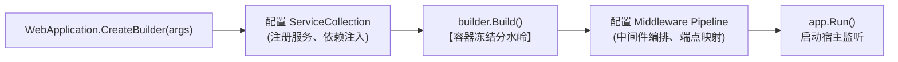
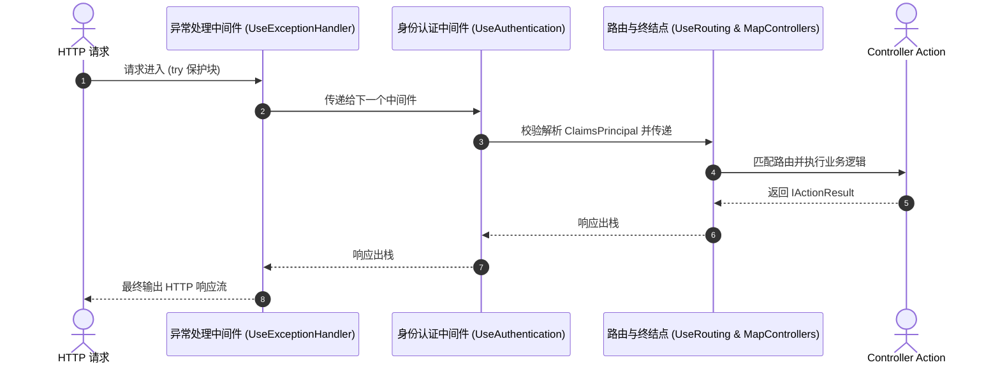
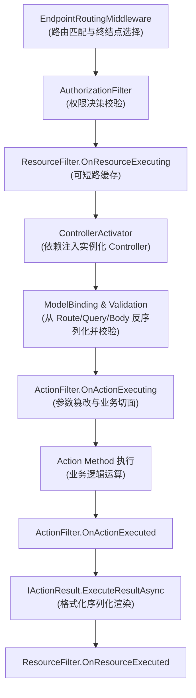
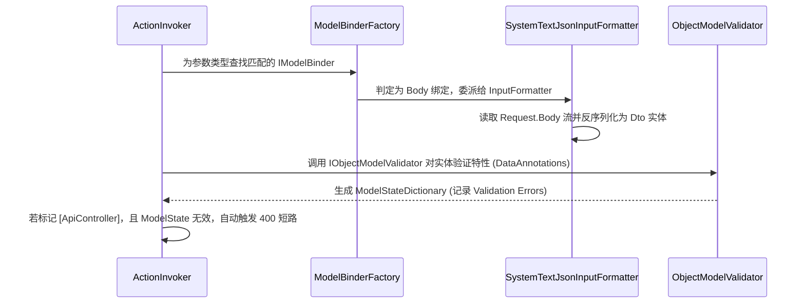
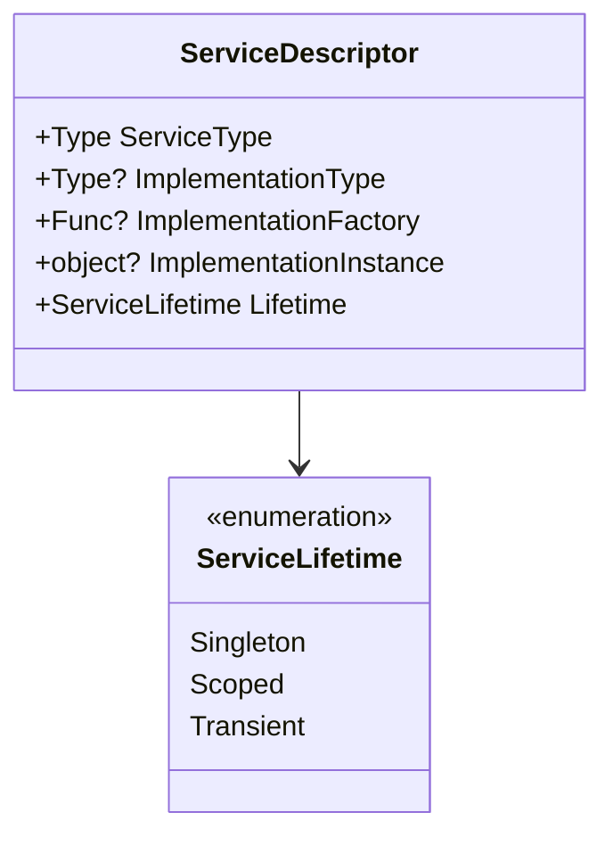
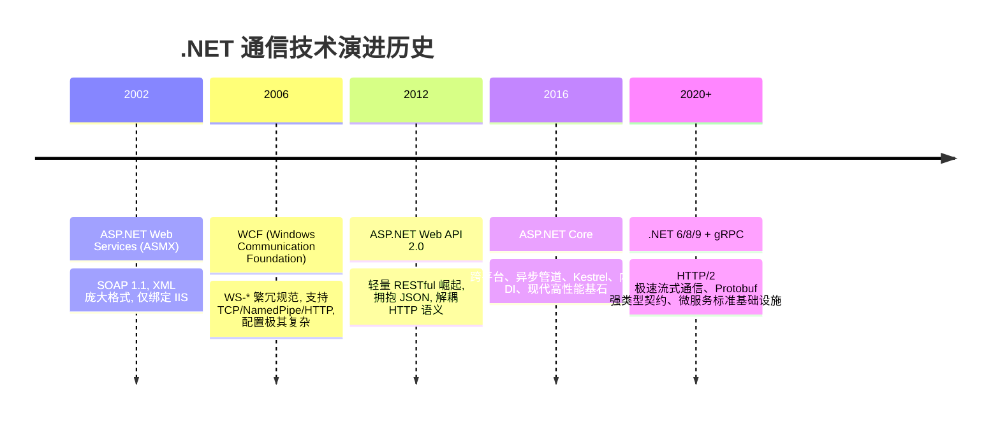

> [!IMPORTANT]
> **适用读者与前置背景**：本系列面向具备扎实 C# 基础、拥有实际项目经验并希望向中高级后端/全栈架构进阶的开发者。内容剥离基础语法铺垫，直击 ASP.NET Core 运行时底层机制、高并发架构设计与生产级排障。**覆盖领域全面兼顾现代企业级通用全栈开发（SaaS 平台、ERP/OA/CRM 协同系统、高并发电商/OTA 票务中台）与特定行业高阶专项（工业物联网、大屏数字孪生）**。

<details open class="in-post-toc-card border border-neutral-200/80 dark:border-neutral-700/80 rounded-xl p-4 my-4 bg-neutral-50/50 dark:bg-neutral-800/30">
<summary class="font-bold text-base cursor-pointer select-none text-neutral-800 dark:text-neutral-200 flex items-center justify-between outline-none">
📑 本篇目录（点击收起 / 展开）
</summary>

<div class="max-h-72 overflow-y-auto mt-3 pt-2 border-t border-neutral-200/60 dark:border-neutral-700/60 hide-scrollbar">

## 目录

- [1. 现代 .NET 宿主与启动模型（Hosting Internals）](#1-现代-net-宿主与启动模型hosting-internals)
  - [1.1 WebApplicationBuilder 与 WebApplication 两阶段构建解耦](#11-webapplicationbuilder-与-webapplication-两阶段构建解耦)
  - [1.2 Kestrel 内核剖析：Socket Transport 与零拷贝内存池](#12-kestrel-内核剖析socket-transport-与零拷贝内存池)
  - [1.3 生产托管模式对比：IIS In-Process vs Linux 反向代理](#13-生产托管模式对比iis-in-process-vs-linux-反向代理)
- [2. 请求流转全景：中间件洋葱模型（Middleware Pipeline）核心机制](#2-请求流转全景中间件洋葱模型middleware-pipeline核心机制)
  - [2.1 RequestDelegate 委托链与编译期组合原理](#21-requestdelegate-委托链与编译期组合原理)
  - [2.2 两种中间件实现模式：基于约定 vs 基于工厂（IMiddleware）](#22-两种中间件实现模式基于约定-vs-基于工厂imiddleware)
  - [2.3 生产级实战：链路追踪 CorrelationId 贯穿与 Request.Body 重复读取](#23-生产级实战链路追踪-correlationid-贯穿与-requestbody-重复读取)
- [3. MVC 与 Web API 内部底层运行机制（Action Invoker 机制）](#3-mvc-与-web-api-内部底层运行机制action-invoker-机制)
  - [3.1 终结点路由（Endpoint Routing）匹配与逻辑短路](#31-终结点路由endpoint-routing匹配与逻辑短路)
  - [3.2 Action 激活与 IControllerActivator 源码级流转](#32-action-激活与-icontrolleractivator-源码级流转)
  - [3.3 模型绑定（Model Binding）与验证管道底层](#33-模型绑定model-binding与验证管道底层)
  - [3.4 五大 Filter 管道生命周期与拦截执行序列](#34-五大-filter-管道生命周期与拦截执行序列)
- [4. 依赖注入（DI）底层架构与生产级避坑](#4-依赖注入di底层架构与生产级避坑)
  - [4.1 ServiceDescriptor 与 ServiceProvider 引擎架构](#41-servicedescriptor-与-serviceprovider-引擎架构)
  - [4.2 致命陷阱：单例捕获（Captive Dependencies）根因与 ValidateScopes](#42-致命陷阱单例捕获captive-dependencies根因与-validatescopes)
  - [4.3 异步线程与后台任务：IServiceScopeFactory 生产标准范式](#43-异步线程与后台任务iservicescopefactory-生产标准范式)
- [5. 历史技术演进与跨版本迁移重构策略](#5-历史技术演进与跨版本迁移重构策略)
  - [5.1 Web Service (ASMX) -> WCF -> Web API -> ASP.NET Core -> gRPC 演进逻辑](#51-web-service-asmx---wcf---web-api---aspnet-core---grpc-演进逻辑)
  - [5.2 从 .NET Framework 到现代化 .NET 8/9 的关键架构迁移断点](#52-从-net-framework-到现代化-net-89-的关键架构迁移断点)

</div>
</details>

---

## 1. 现代 .NET 宿主与启动模型（Hosting Internals）

在 ASP.NET Core 6+ 之后，引入了基于 Top-Level Statements 的极简宿主模型（Minimal Hosting Model）。看似简单的几行代码，其底层封装了极高内聚的宿主构建与配置解耦机制。

### 1.1 WebApplicationBuilder 与 WebApplication 两阶段构建解耦

ASP.NET Core 将启动过程严格划分为两个阶段：**配置注册阶段** 与 **运行时管道装配阶段**。



#### 为什么必须严格区分两阶段？
在传统的旧版框架（或许多自研框架）中，允许在应用运行期间向容器动态注入或修改服务注册。这在高并发环境下极易触发线程竞态（Race Condition）、导致缓存失效甚至造成对象生命周期的不可预测破坏。

ASP.NET Core 通过 `builder.Build()` 作为**不可逆分水岭**：
- 一旦调用 `builder.Build()`，底层的 `IServiceCollection` 立即被冻结并编译生成 `ServiceProvider` 依赖解析树。
- 此后 `app.Services` 变为只读，任何试图在运行时动态注册服务的操作均被杜绝，确保了线程安全与 JIT 优化的稳定性。

```csharp
var builder = WebApplication.CreateBuilder(args);

// === 阶段 1：服务注册 (仅允许配置 IServiceCollection) ===
builder.Services.AddControllers();
builder.Services.AddEndpointsApiExplorer();
builder.Services.AddSwaggerGen();

// 配置日志与配置中心
builder.Logging.ClearProviders();
builder.Logging.AddConsole();

var app = builder.Build(); // [分水岭] 容器在此处构建并锁定

// === 阶段 2：管道配置 (仅允许编排 IApplicationBuilder / IEndpointRouteBuilder) ===
if (app.Environment.IsDevelopment())
{
    app.UseSwagger();
    app.UseSwaggerUI();
}

app.UseHttpsRedirection();
app.UseAuthentication();
app.UseAuthorization();
app.MapControllers();

app.Run();
```

---

### 1.2 Kestrel 内核剖析：Socket Transport 与零拷贝内存池

Kestrel 是 ASP.NET Core 的跨平台原生 HTTP 服务器内核。在现代高性能基准评测（TechEmpower）中，Kestrel 稳居第一梯队，其核心驱动力来源于底层的两项设计：

1. **System.IO.Pipelines（管道流式传输）**：
   传统基于 `Stream`（如 `NetworkStream`）的读取模式需要开发者频繁申请 `byte[]` 缓冲区并将数据从内核缓冲区拷贝到用户态缓冲区，极易引发大对象堆（LOH）碎片和高频 GC 压力。
   Kestrel 深度集成了 `System.IO.Pipelines`，采用 `PipeReader` 和 `PipeWriter`：
   - 内部基于分页环形缓冲区（`MemoryPool<byte>` 和 `ArrayPool<byte>.Shared`）借还内存块。
   - 实现了请求报文从网卡 Socket 接收到 HTTP 解析器的**零内存拷贝（Zero-Copy）**流转。

2. **Socket Transport 线程分离架构**：
   Kestrel 底层利用多路复用技术（Windows 下基于 I/O Completion Ports - IOCP；Linux 下基于 epoll），将网络 I/O 监听与应用工作线程（ThreadPool Worker）严格解耦，彻底避免了慢请求挂起导致网络连接池耗尽。

---

### 1.3 生产托管模式对比：IIS In-Process vs Linux 反向代理

在企业级部署中，ASP.NET Core 运行在不同的托管拓扑下：

```mermaid
flowchart TD
    subgraph IIS In-Process 模式
        Client1[HTTP Request] --> HTTP_SYS[HTTP.sys 内核驱动]
        HTTP_SYS --> W3WP[w3wp.exe 工作进程]
        subgraph w3wp.exe
            ANCM[AspNetCoreModuleV2] --> KestrelCore[ASP.NET Core 托管内核]
        end
    end

    subgraph Linux + Nginx 反向代理模式
        Client2[HTTP Request] --> Nginx[Nginx / YARP 网关]
        Nginx -->|Unix Domain Socket / TCP Loopback| KestrelProc[dotnet myapp.dll (Kestrel 进程)]
    end
```

| 部署模式 | 宿主进程 | 通信协议 | 性能损耗 | 典型适用场景 |
| :--- | :--- | :--- | :--- | :--- |
| **IIS In-Process (进程内)** | `w3wp.exe` | 进程内直接函数指针调用 | **极低**（无跨进程 IPC 开销） | 传统 Windows Server、现有 IIS 集群内网运维 |
| **IIS Out-of-Process (进程外)** | `dotnet.exe` | 本地回环 HTTP（127.0.0.1 转发） | 中等（存在两次 HTTP 报文解析与 Socket 拷贝） | 多版本共存隔离、遗留系统迁移临时方案 |
| **Linux + K8s / Nginx** | `dotnet myapp.dll` | 反向代理（支持 Unix Domain Socket） | 低（Nginx 负责 SSL 卸载、动静分离与限流） | 现代微服务、Docker 容器化、云原生集群 |

> [!TIP]
> **生产避坑**：在 Linux 反向代理（Nginx/Ingress）场景下，客户端真实 IP 与协议 scheme（HTTP/HTTPS）会被反代遮蔽。必须在中间件最前列显式配置 `app.UseForwardedHeaders()`，否则 `HttpContext.Connection.RemoteIpAddress` 将始终获取到网关的内网 IP。

---

## 2. 请求流转全景：中间件洋葱模型（Middleware Pipeline）核心机制

### 2.1 RequestDelegate 委托链与编译期组合原理

ASP.NET Core 中间件的核心定义是一个单一的递归委托：
```csharp
public delegate Task RequestDelegate(HttpContext context);
```

整个请求管道的装配本质上是**函数式编程的嵌套组合**：每一个中间件接受一个 `RequestDelegate next`，并返回一个新的 `RequestDelegate`。

```csharp
// 伪代码解析：管道如何逆向链接
// 注册顺序：UseA -> UseB -> UseC -> 终结点
RequestDelegate pipeline = context => {
    // 最终终结点 (如 404 Not Found 或 Action Invoker)
    return Task.CompletedTask;
};

pipeline = UseC(pipeline);
pipeline = UseB(pipeline);
pipeline = UseA(pipeline);

// 最终对外暴露的 pipeline(context) 即为完整洋葱执行链
```



---

### 2.2 两种中间件实现模式：基于约定 vs 基于工厂（IMiddleware）

在企业级脚手架中，编写自定义中间件有两种主流方式：

#### 方式一：基于约定的中间件（Convention-based，单例常驻）
- **特点**：无需实现任何接口，通过反射识别 `InvokeAsync(HttpContext context, ...)`。
- **内存生命周期**：中间件实例为**单例（Singleton）**，整个应用生命周期只实例化一次。
- **注意**：构造函数中**严禁注入 Scoped 服务**，Scoped 服务必须在 `InvokeAsync` 的参数中进行方法级注入！

```csharp
public class RequestPerformanceMiddleware
{
    private readonly RequestDelegate _next;
    private readonly ILogger<RequestPerformanceMiddleware> _logger;

    // 构造函数：只能注入 Singleton 服务
    public RequestPerformanceMiddleware(RequestDelegate next, ILogger<RequestPerformanceMiddleware> logger)
    {
        _next = next;
        _logger = logger;
    }

    // 方法级参数注入：可以注入 Scoped 服务 (如 AppDbContext)
    public async Task InvokeAsync(HttpContext context, IMetricService metricService)
    {
        var sw = Stopwatch.StartNew();
        try
        {
            await _next(context); // 调用下一个中间件
        }
        finally
        {
            sw.Stop();
            metricService.RecordLatency(context.Request.Path, sw.ElapsedMilliseconds);
            _logger.LogInformation("Path: {Path} 耗时: {Elapsed}ms", context.Request.Path, sw.ElapsedMilliseconds);
        }
    }
}
```

#### 方式二：基于工厂的中间件（Factory-based，强类型 `IMiddleware`）
- **特点**：显式实现 `IMiddleware` 接口，必须在 DI 容器中通过 `builder.Services.AddTransient<MyMiddleware>()` 注册。
- **优势**：生命周期由容器管理（通常为 Transient 或 Scoped），可以直接在构造函数中注入 Scoped 服务，无反射开销。

```csharp
public class TenantResolutionMiddleware : IMiddleware
{
    private readonly ITenantDbContext _tenantDb; // 可以直接在构造函数注入 Scoped 服务

    public TenantResolutionMiddleware(ITenantDbContext tenantDb)
    {
        _tenantDb = tenantDb;
    }

    public async Task InvokeAsync(HttpContext context, RequestDelegate next)
    {
        var tenantCode = context.Request.Headers["X-Tenant-Id"].FirstOrDefault();
        if (!string.IsNullOrEmpty(tenantCode))
        {
            await _tenantDb.SwitchTenantAsync(tenantCode);
        }
        await next(context);
    }
}
```

---

### 2.3 生产级实战：链路追踪 CorrelationId 贯穿与 Request.Body 重复读取

在企业级微服务或日志排查中，面临两个高频痛点：
1. **全局链路追踪 ID**：必须在请求刚进入时生成或继承 TraceId，并贯穿于请求头、日志上下文中。
2. **请求报文审计日志**：HTTP 请求流 `HttpRequest.Body` 默认是**只进单向流（Forward-only stream）**。如果在中间件里读完了流用于打印审计日志，后续 Controller Action 的 ModelBinding 解析时将读到空流抛出异常。

#### 解决方案与闭环代码：

```csharp
public class ApiAuditMiddleware
{
    private readonly RequestDelegate _next;
    private const string CorrelationHeaderName = "X-Correlation-ID";

    public ApiAuditMiddleware(RequestDelegate next)
    {
        _next = next;
    }

    public async Task InvokeAsync(HttpContext context, ILogger<ApiAuditMiddleware> logger)
    {
        // 1. 链路追踪 ID 注入与回传
        if (!context.Request.Headers.TryGetValue(CorrelationHeaderName, out var correlationId) 
            || string.IsNullOrWhiteSpace(correlationId))
        {
            correlationId = Guid.NewGuid().ToString("N");
        }
        context.TraceIdentifier = correlationId!;
        context.Response.Headers.Append(CorrelationHeaderName, correlationId);

        // 2. 将 CorrelationId 绑定到当前异步日志上下文 (Serilog LogContext)
        using (logger.BeginScope(new Dictionary<string, object> { ["CorrelationId"] = correlationId }))
        {
            // 3. 启用请求缓冲机制：支持流指针倒回 (Seek)
            context.Request.EnableBuffering();

            // 4. 安全读取请求体进行审计记录
            string requestBodyText = await ReadRequestBodyAsync(context.Request);
            logger.LogInformation("HTTP {Method} {Path} Payload: {Body}", 
                context.Request.Method, context.Request.Path, requestBodyText);

            // 5. 调用下游业务
            await _next(context);
        }
    }

    private static async Task<string> ReadRequestBodyAsync(HttpRequest request)
    {
        if (request.ContentLength is null or 0 || !request.Body.CanSeek)
        {
            return string.Empty;
        }

        // 读取前将指针重置到流起始位置
        request.Body.Position = 0;
        using var reader = new StreamReader(request.Body, Encoding.UTF8, leaveOpen: true);
        var body = await reader.ReadToEndAsync();
        
        // 关键点：读取完毕后必须重置回 0，留给后续 ModelBinding 消费！
        request.Body.Position = 0;
        return body;
    }
}
```

---

## 3. MVC 与 Web API 内部底层运行机制（Action Invoker 机制）

许多开发者只熟悉在 Controller 中写 `[HttpGet]`，但对请求穿透中间件后，如何在 MVC 内部被分发、激活与拦截缺乏底层全局观。



### 3.1 终结点路由（Endpoint Routing）匹配与逻辑短路

在 ASP.NET Core 3.0+ 之后，引入了终结点路由系统，将路由拆分为两步：
1. `app.UseRouting()`：负责**匹配终结点**，把选中的 `Endpoint` 元数据挂载到 `HttpContext.GetEndpoint()` 上。
2. `app.UseEndpoints()`（或 .NET 6+ 的 `app.MapControllers()`）：负责**执行终结点**。

**架构收益**：
中间件可以在 `UseRouting` 之后、业务执行之前直接通过 `context.GetEndpoint()?.Metadata` 访问到 Action 上的特性标记（例如获取 `[Authorize]` 或自定义的 `[RateLimit]`），无需等到 MVC 内部再反射查找，大幅提升了管道判断效率。

---

### 3.2 Action 激活与 IControllerActivator 源码级流转

控制器本身不是魔法，它本质上也是一个普通类。
1. **查找控制器**：`IActionDescriptorCollectionProvider` 扫描程序集并缓存所有带有 `[ApiController]` 或继承 `ControllerBase` 的类。
2. **实例化控制器**：底层通过 `IControllerFactory` 调用 `IControllerActivator`。
3. **依赖注入容器解析**：默认的 `DefaultControllerActivator` 从当前请求的 `HttpContext.RequestServices`（即当前的 Scoped 容器）中解析出控制器实例及其所有构造函数依赖项。

> [!NOTE]
> **性能细节**：默认情况下 Controller 本身**并未**注册在 `IServiceCollection` 中，而是通过 `ActivatorUtilities.CreateInstance` 利用反射调用构造函数。如果希望让 Controller 完全受 DI 容器的生命周期管理，可使用 `builder.Services.AddControllers().AddControllersAsServices()`。

---

### 3.3 模型绑定（Model Binding）与验证管道底层

当 Action 参数被定义为 `[FromBody] DeviceCommandDto dto` 时，内部流转如下：



#### 关键机制解析：
- **`[ApiController]` 特性的隐式短路**：在旧版 MVC 中，必须手动书写 `if (!ModelState.IsValid) return BadRequest(ModelState);`。而打上 `[ApiController]` 后，ASP.NET Core 会自动挂载 `ModelStateInvalidFilter`，在 Action 执行前直接拦截并返回封装规范的 400 Bad Request。

---

### 3.4 五大 Filter 管道生命周期与拦截执行序列

Filters 紧密包裹着 Action 的执行生命周期，各司其职：

| 过滤器类型 | 核心接口 | 触发时机 | 最佳实战职责 |
| :--- | :--- | :--- | :--- |
| **1. Authorization** | `IAsyncAuthorizationFilter` | 管道最前列，最早触发 | 校验 Token、Role、Permission，未授权直接短路返回 401/403 |
| **2. Resource** | `IAsyncResourceFilter` | 模型绑定之前与整个生命周期之后 | 性能缓存（命中则跳过模型绑定直接输出）、大文件上传流预处理 |
| **3. Action** | `IAsyncActionFilter` | 模型绑定后、Action 执行前后 | 请求入参安全清洗、通用审计参数注入、DTO 统一字段补全 |
| **4. Exception** | `IAsyncExceptionFilter` | Action 抛出未捕获异常时触发 | 异常类型归类、特定业务异常（如 `BusinessException`）转换 |
| **5. Result** | `IAsyncResultFilter` | Action 执行完毕、返回结果渲染前后 | 响应头扩展、统一封装包裹 `ApiResponse<T>` |

---

## 4. 依赖注入（DI）底层架构与生产级避坑

### 4.1 ServiceDescriptor 与 ServiceProvider 引擎架构

ASP.NET Core 内置的依赖注入容器是一个高效轻量的服务容器，其核心数据模型是 `ServiceDescriptor`：
- **ServiceType**：暴露的抽象接口（如 `IDeviceService`）。
- **ImplementationType / ImplementationFactory / ImplementationInstance**：具体的实现类、工厂委托或单例实例。
- **Lifetime**：生命周期枚举（Singleton, Scoped, Transient）。



当请求到达时，ASP.NET Core 会通过 `IServiceScopeFactory.CreateScope()` 创建一个请求作用域，实例化该请求内唯一的 `ServiceProvider` 子容器。

---

### 4.2 致命陷阱：单例捕获（Captive Dependencies）根因与 ValidateScopes

这是企业高并发系统中最容易引发偶发诡异 Bug 和内存泄漏的隐蔽陷阱！

#### 什么是单例捕获（Captive Dependency）？
如果一个 **Singleton 服务（全局唯一，永不释放）** 在构造函数中直接注入了一个 **Scoped 服务（本应在单个请求结束时销毁）**：
- 结果：该 Scoped 服务被 Singleton 服务持有了引用，导致这个 Scoped 实例的生命周期被“绑架”提升为了 Singleton！
- **严重后果**：
  1. **DbContext 线程不安全并发崩盘**：EF Core 的 `DbContext` 默认是 Scoped。如果被单例捕获，多个并发 HTTP 线程同时访问同一个 `DbContext` 实例，会直接抛出 `InvalidOperationException: A second operation was started on this context before a previous operation completed`。
  2. **脏数据渗透**：单例持有的 Scoped 对象内缓存了旧请求的用户凭证或租户信息，导致下一个请求串用上一个请求的数据！

```mermaid
flowchart TD
    subgraph 错误陷阱：单例捕获
        S[Singleton: DeviceTelemetryManager] -->|构造注入持久引用| C["Scoped: AppDbContext (生命周期被绑架，永不释放！)"]
        Req1[Thread 1: HTTP Request A] --> S
        Req2[Thread 2: HTTP Request B] --> S
        S -->|并发冲突报错崩盘| C
    end
```

#### 官方防御机制：`ValidateScopes`
ASP.NET Core 在 Development 环境下默认开启了容器依赖校验：
```csharp
var builder = WebApplication.CreateBuilder(new WebApplicationOptions
{
    Args = args,
    // 强制开启作用域与单例捕获验证
    EnvironmentName = Environments.Development
});
```
开启后，如果在 Singleton 中注入 Scoped，应用在启动阶段构建容器时会直接抛出 `InvalidOperationException` 并终止启动，迫使开发者修复。

---

### 4.3 异步线程与后台任务：IServiceScopeFactory 生产标准范式

在脱离了 HTTP 请求上下文的场景下（例如 `BackgroundService`、消息队列消费者、`Task.Run` 后台线程）：
**当前不存在现成的 RequestScope！** 如果直接在构造函数中注入 Scoped 服务，或者试图从根容器解析 Scoped 服务，将引发 `ObjectDisposedException` 或直接报错。

#### 生产级正确范式：手动创建作用域
必须注入 `IServiceScopeFactory`，在使用时显式开启生命周期块，并在完成时立即释放。
以下展示企业系统通用后台 Worker（如：**电商/OTA 票务系统中扫描释放 15 分钟未支付的锁座/库存订单、ERP 每日财务日结对账、或后台离线批处理**）：

```csharp
public class EnterpriseBatchProcessingWorker : BackgroundService
{
    private readonly IServiceScopeFactory _scopeFactory;
    private readonly ILogger<EnterpriseBatchProcessingWorker> _logger;

    // 单例 Worker 仅注入 IServiceScopeFactory，严禁直接注入 DbContext 等 Scoped 服务
    public EnterpriseBatchProcessingWorker(
        IServiceScopeFactory scopeFactory, 
        ILogger<EnterpriseBatchProcessingWorker> logger)
    {
        _scopeFactory = scopeFactory;
        _logger = logger;
    }

    protected override async Task ExecuteAsync(CancellationToken stoppingToken)
    {
        while (!stoppingToken.IsCancellationRequested)
        {
            try
            {
                // 1. 显式创建隔离的局部作用域 (Scope)
                using (var scope = _scopeFactory.CreateScope())
                {
                    // 2. 从当前局部作用域中安全解析 Scoped 服务 (如 AppDbContext、IOrderService)
                    var dbContext = scope.ServiceProvider.GetRequiredService<AppDbContext>();
                    var orderService = scope.ServiceProvider.GetRequiredService<IOrderProcessingService>();

                    // 业务：扫描超时未支付订单并原子释放库存/锁座位
                    await orderService.CancelTimeoutPendingOrdersAsync(dbContext, stoppingToken);
                } 
                // 3. 退出 using 块，scope 内部的所有 Scoped 实例及 DbContext 链接被立即优雅释放与回收
            }
            catch (Exception ex)
            {
                _logger.LogError(ex, "后台批处理作业执行异常");
            }

            await Task.Delay(TimeSpan.FromSeconds(30), stoppingToken);
        }
    }
}
```

---

## 5. 历史技术演进与跨版本迁移重构策略

在企业实际招聘与系统重构中，往往面对企业内大量老系统（.NET Framework 4.5/4.8、WCF、ASMX）向现代架构迁移的需求。

### 5.1 Web Service (ASMX) -> WCF -> Web API -> ASP.NET Core -> gRPC 演进逻辑



- **ASMX 时代**：基于 SOAP 协议，强依赖 XML，序列化开销极其沉重。
- **WCF 时代**：微软集大成通信框架，试图通过抽象“绑定（Binding）与协定（Contract）”统一进程间、局域网（TCP/命名管道）与广域网通信。但配置极其繁重，且与 Windows 平台深度绑定。
- **ASP.NET Web API / Core 时代**：彻底拥抱 HTTP 原生语义（GET/POST/PUT/DELETE）、轻量 JSON 报文与无状态设计，确立了前后端分离与互联网 Web 服务的主导地位。
- **现代 gRPC 时代**：针对微服务内部高频通信、实时传感器流式传输场景，基于 HTTP/2 + Protobuf 提供极致吞吐与跨语言强类型保障。

---

### 5.2 从 .NET Framework 到现代化 .NET 8/9 的关键架构迁移断点

当主导老旧系统升级时，需要重点处理以下 5 个核心技术断点：

1. **消除 `HttpContext.Current` 静态上下文访问**：
   - *旧模式*：在业务层深处任意地方调用静态的 `HttpContext.Current.Session`。
   - *现代改造*：通过构造函数依赖注入 `IHttpContextAccessor`，并在非 Web 层彻底解耦对 Http 对象的依赖。

2. **从 `web.config` 迁移到 `appsettings.json` 多环境配置**：
   - 采用结构化 JSON，支持基于环境变量（`ASPNETCORE_ENVIRONMENT`）与命令行动态覆盖，无缝对接 Kubernetes ConfigMap。

3. **WCF 服务的高效迁移路径**：
   - 若必须保留现有客户端协议兼容：引入微软官方维护的开源项目 **CoreWCF**，可低成本在 .NET 8 宿主中运行原有 WCF 逻辑。
   - 若系统具备重构条件：直接切换至 **gRPC**，性能提升 5-10 倍，并大幅度降低内存开销。

4. **Global.asax 事件监听 -> 中间件与 HostedLifecycle 迁移**：
   - `Application_Start` -> `WebApplicationBuilder` 启动配置。
   - `Application_BeginRequest` / `EndRequest` -> 编写自定义中间件。
   - 应用程序启停生命周期 -> 实现 `IHostApplicationLifetime`（注册 `ApplicationStarted`, `ApplicationStopping` 事件）。

5. **同步 API 全面异步化（Async All The Way）**：
   - 彻底消灭 `.Result` 或 `.Wait()`，消除死锁隐患并释放高并发下 ASP.NET Core 的吞吐潜力（详见后续高并发调优篇）。
