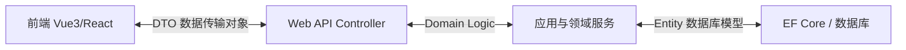
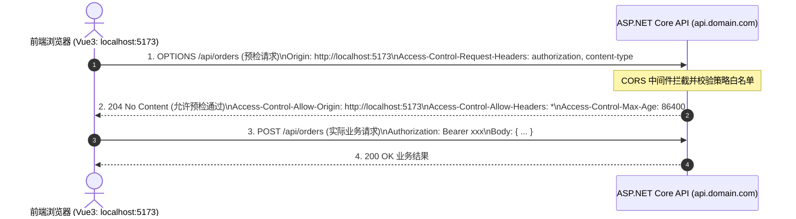

> [!IMPORTANT]
> **本篇定位**：针对企业级后端开发中与前端（Vue3/React）团队协同脱节、API 契约不规范、接口联调低效等痛点，提供覆盖 RESTful、gRPC、GraphQL、OpenAPI、DTO 设计与 RFC 7807 标准化异常防御的工程化落地全景方案。

<details open class="in-post-toc-card border border-neutral-200/80 dark:border-neutral-700/80 rounded-xl p-4 my-4 bg-neutral-50/50 dark:bg-neutral-800/30">
<summary class="font-bold text-base cursor-pointer select-none text-neutral-800 dark:text-neutral-200 flex items-center justify-between outline-none">
📑 本篇目录（点击收起 / 展开）
</summary>

<div class="max-h-72 overflow-y-auto mt-3 pt-2 border-t border-neutral-200/60 dark:border-neutral-700/60 hide-scrollbar">

## 目录

- [1. 现代化 RESTful 规范与 HTTP 谓词语义矩阵](#1-现代化-restful-规范与-http-谓词语义矩阵)
  - [1.1 动词语义、幂等性与安全性边界设计](#11-动词语义幂等性与安全性边界设计)
  - [1.2 企业级 URI 资源建模与 API 版本控制（Versioning）](#12-企业级-uri-资源建模与-api-版本控制versioning)
- [2. Swagger / OpenAPI 3.0 企业级工程化定制](#2-swagger--openapi-30-企业级工程化定制)
  - [2.1 XML 注释、SchemaFilter 扩展与枚举友好渲染](#21-xml-注释schemafilter-扩展与枚举友好渲染)
  - [2.2 契约驱动协同：基于 OpenAPI 的前后端并行 Mock 方案](#22-契约驱动协同基于-openapi-的前后端并行-mock-方案)
  - [2.3 JWT Bearer 鉴权闭环与多环境隔离配置](#23-jwt-bearer-鉴权闭环与多环境隔离配置)
  - [2.4 前端 Vue 3 (Vite + TypeScript) 契约自动化与工程化协同](#24-前端-vue-3-vite--typescript-契约自动化与工程化协同)
- [3. 数据契约与协同体系：DTO 设计与零开销映射](#3-数据契约与协同体系dto-设计与零开销映射)
  - [3.1 为什么坚决禁止暴露 Entity：安全与架构隔离底线](#31-为什么坚决禁止暴露-entity安全与架构隔离底线)
  - [3.2 高性能对象映射选型：Mapster vs AutoMapper 底层与实战](#32-高性能对象映射选型mapster-vs-automapper-底层与实战)
- [4. 多维通信协议深度对比与落地：RESTful vs gRPC vs GraphQL](#4-多维通信协议深度对比与落地restful-vs-grpc-vs-graphql)
  - [4.1 三大通信体系全景架构选型矩阵](#41-三大通信体系全景架构选型矩阵)
  - [4.2 gRPC 实战：Protobuf 强类型契约与微服务流式调用](#42-grpc-实战protobuf-强类型契约与微服务流式调用)
  - [4.3 GraphQL 实战：基于 HotChocolate 解决前端数据过载查询](#43-graphql-实战基于-hotchocolate-解决前端数据过载查询)
- [5. 前后端联调深度避坑与序列化极致调优](#5-前后端联调深度避坑与序列化极致调优)
  - [5.1 跨域（CORS）底层预检机制与企业生产避坑指南](#51-跨域cors底层预检机制与企业生产避坑指南)
  - [5.2 System.Text.Json 生产级配置与循环引用解决方案](#52-systemtextjson-生产级配置与循环引用解决方案)
  - [5.3 零反射极致性能：JSON Source Generators（源生成器）实战](#53-零反射极致性能json-source-generators源生成器实战)
- [6. 企业级统一响应模型与 RFC 7807 错误防御体系](#6-企业级统一响应模型与-rfc-7807-错误防御体系)
  - [6.1 传统 ApiResponse&lt;T&gt; 封装的弊端与 RFC 7807 标准解构](#61-传统-apiresponset-封装的弊端与-rfc-7807-标准解构)
  - [6.2 .NET 8+ 原生 IExceptionHandler 全局防御工程落地](#62-net-8-原生-iexceptionhandler-全局防御工程落地)

</div>
</details>

---

## 1. 现代化 RESTful 规范与 HTTP 谓词语义矩阵

### 1.1 动词语义、幂等性与安全性边界设计

在很多中小型团队中，常将所有操作泛化为 `POST /api/doSomething`，将 HTTP 协议退化为单一的 RPC 管道，彻底丢失了 HTTP 缓存、代理重试机制以及 API 的语义自解释性。

| HTTP 动词 | 语义定义 | 安全性 (Safe) | 幂等性 (Idempotent) | 状态码范式 | 生产级业务场景 |
| :--- | :--- | :---: | :---: | :--- | :--- |
| **GET** | 获取资源，无副作用 |  |  | 200 OK / 404 Not Found | 列表查询、详情拉取、报表导出 |
| **POST** | 创建新从属资源 / 提交动作 | ❌ | ❌ | 201 Created (带 Location) / 200 OK | 新增设备、提交订单、触发批处理 |
| **PUT** | 全量覆盖已有资源 | ❌ |  | 200 OK / 204 NoContent | 完整配置更新（传入全量字段） |
| **PATCH** | 增量/部分字段修改 | ❌ | ❌ (通常) | 200 OK / 204 NoContent | 仅修改开关状态、仅更新密码 |
| **DELETE** | 移除特定资源 | ❌ |  | 200 OK / 204 NoContent | 删除工单、注销终端 |

> [!NOTE]
> **幂等性判定准则**：所谓幂等（Idempotent），是指在相同入参下，连续调用一次与连续调用 N 次，**对系统产生的外部状态影响完全一致**。
> - `DELETE /api/devices/101` 第一次执行返回 204（已删除），第二次执行返回 404（不存在）或 204，系统里 101 号设备均处于被删除状态，因此具备幂等性。
> - 网关层（如 Nginx、Envoy）只对具备幂等性的请求（GET/PUT/DELETE）允许安全开启网络超时自动重试。若将有副作用的业务全写为 POST，重试会导致重复扣款或数据重复插入！

---

### 1.2 企业级 URI 资源建模与 API 版本控制（Versioning）

#### A. 资源 URI 命名规范
- **使用复数名词**表达集合，避免动词：`GET /api/v1/devices` 而非 `GET /api/v1/getAllDevices`。
- **层级关系建模**：`GET /api/v1/factories/{factoryId}/lines/{lineId}/devices` 代表从属层级。
- **过滤与分页收拢至 Query**：不要把查询条件拼入 Path，采用 `GET /api/v1/devices?status=running&page=1&pageSize=20`。

#### B. API 版本控制实战（API Versioning）
随着版本迭代，API 破坏性变更在所难免。在 ASP.NET Core 中，推荐使用官方库 `Asp.Versioning.Mvc`：

```csharp
// Program.cs
builder.Services.AddApiVersioning(options =>
{
    options.DefaultApiVersion = new ApiVersion(1, 0);
    options.AssumeDefaultVersionWhenUnspecified = true;
    options.ReportApiVersions = true; // 响应头返回 api-supported-versions
    // 支持 URL 路径版本 (v1) 与 Header 版本 (X-Api-Version)
    options.ApiVersionReader = ApiVersionReader.Combine(
        new UrlSegmentApiVersionReader(),
        new HeaderApiVersionReader("X-Api-Version"));
}).AddApiExplorer(options =>
{
    options.GroupNameFormat = "'v'VVV"; // 格式化为 v1.0
    options.SubstituteApiVersionInUrl = true;
});
```

控制器多版本分离：
```csharp
[ApiController]
[ApiVersion("1.0")]
[ApiVersion("2.0")]
[Route("api/v{version:apiVersion}/[controller]")]
public class OrdersController : ControllerBase
{
    [HttpGet]
    [MapToApiVersion("1.0")]
    public IActionResult GetV1() => Ok(new { Version = "1.0", Data = "旧版结构" });

    [HttpGet]
    [MapToApiVersion("2.0")]
    public IActionResult GetV2() => Ok(new { Version = "2.0", Data = "新版结构(带扩展字段)" });
}
```

---

## 2. Swagger / OpenAPI 3.0 企业级工程化定制

在现代前后端协同架构中，Swagger（OpenAPI 规范）不仅是供前端开发查阅的在线网页，更是**团队协同的唯一契约源头**。

```mermaid
flowchart LR
    CS[C# Controller & DTO] -->|SwaggerGen + XML| OAS[OpenAPI 3.0 Specification\n(swagger.json)]
    OAS --> WebUI[Swagger UI 交互测试]
    OAS --> Mock[Prism / Apifox Mock 服务]
    OAS --> FrontGen[openapi-generator\n自动生成前端 TypeScript 类型]
    FrontGen --> Vue3[Vue3 / React 页面调用]
```

### 2.1 XML 注释、SchemaFilter 扩展与枚举友好渲染

默认情况下，Swagger 对 C# `enum` 的展示常体现为无意义的数字（0, 1, 2）。通过实现自定义 `ISchemaFilter`，可将枚举名称与注释统一注入 Schema：

```csharp
public class EnumDescriptionSchemaFilter : ISchemaFilter
{
    public void Apply(OpenApiSchema schema, SchemaFilterContext context)
    {
        if (context.Type.IsEnum)
        {
            schema.Enum.Clear();
            var enumDescriptions = new StringBuilder();
            
            foreach (var value in Enum.GetValues(context.Type))
            {
                var name = Enum.GetName(context.Type, value);
                var field = context.Type.GetField(name!);
                var descriptionAttr = field?.GetCustomAttribute<DescriptionAttribute>();
                var desc = descriptionAttr != null ? descriptionAttr.Description : name;
                
                schema.Enum.Add(new OpenApiString(name));
                enumDescriptions.AppendLine($"- `{Convert.ToInt64(value)}` = **{name}**: {desc}");
            }

            schema.Description += $"\n\n**可用枚举取值**：\n{enumDescriptions}";
        }
    }
}
```

在 `Program.cs` 挂载配置并加载 XML 文档：
```csharp
builder.Services.AddSwaggerGen(c =>
{
    c.SwaggerDoc("v1", new OpenApiInfo { Title = "工业物联网平台 API", Version = "v1" });
    
    // 1. 加载主工程与 DTO 库的 XML 注释
    var xmlFile = $"{Assembly.GetExecutingAssembly().GetName().Name}.xml";
    var xmlPath = Path.Combine(AppContext.BaseDirectory, xmlFile);
    if (File.Exists(xmlPath)) c.IncludeXmlComments(xmlPath);

    // 2. 注入枚举增强过滤器
    c.SchemaFilter<EnumDescriptionSchemaFilter>();
});
```

---

### 2.2 契约驱动协同：基于 OpenAPI 的前后端并行 Mock 方案

#### 痛点场景：
传统开发流程中，前端必须等待后端编写完接口代码并发布测试环境后才能开始联调，一旦后端排期延期，整个项目交付直接延误。

#### 现代化并行开发体系（Contract-First）：
1. **统一契约定义**：前后端架构师共同商定 DTO 与接口签名，后端优先提交定义好 DTO 与 Action 骨架（只声明路由、参数并返回静态伪数据）的代码。
2. **导出 OpenAPI 契约**：CI 自动化构建导出 `swagger.json`。
3. **前端工具链接入**：
   - 使用开源轻量 Mock 引擎（如 **Prism CLI**）：
     ```bash
     prism mock https://localhost:7001/swagger/v1/swagger.json
     ```
   - 前端切换 baseURL 到 Prism Mock 端口，根据契约规范自动生成动态假数据，直接进行页面交互与组件开发。
   - 使用 `@openapitools/openapi-generator-cli` 或 `swagger-typescript-api`，一键根据契约生成前端全量 TypeScript Interface 与 Axios 请求代码，实现前后端类型绝对一致性。

---

### 2.3 JWT Bearer 鉴权闭环与多环境隔离配置

为了在 Swagger UI 中直接模拟携带 Token 的接口调试，必须注入安全方案：

```csharp
builder.Services.AddSwaggerGen(c =>
{
    // 配置 Bearer 授权方案
    var securityScheme = new OpenApiSecurityScheme
    {
        Name = "Authorization",
        Description = "请输入 JWT Bearer Token (格式: Bearer {token})",
        In = ParameterLocation.Header,
        Type = SecuritySchemeType.Http,
        Scheme = "bearer",
        BearerFormat = "JWT",
        Reference = new OpenApiReference
        {
            Type = ReferenceType.SecurityScheme,
            Id = "Bearer"
        }
    };

    c.AddSecurityDefinition("Bearer", securityScheme);
    c.AddSecurityRequirement(new OpenApiSecurityRequirement
    {
        { securityScheme, Array.Empty<string>() }
    });
});
```

---

### 2.4 前端 Vue 3 (Vite + TypeScript) 契约自动化与工程化协同

当后端 OpenAPI 契约（`swagger.json`）确立后，前端 Vue 3 工程如何最优雅、最高效地消费该契约？

#### A. Vite 开发服务器代理（彻底解决本地跨域开发）
在前端本地开发阶段，通过 `vite.config.ts` 的 `server.proxy` 将 `/api` 请求直接反向代理到本地 ASP.NET Core 服务（如 `https://localhost:7001`），完全规避浏览器的 CORS 跨域限制，且上线后无需改动代码：

```typescript
// vite.config.ts
import { defineConfig } from 'vite';
import vue from '@vitejs/plugin-vue';

export default defineConfig({
  plugins: [vue()],
  server: {
    port: 5173,
    proxy: {
      '/api': {
        target: 'https://localhost:7001', // ASP.NET Core 后端服务地址
        changeOrigin: true,
        secure: false, // 允许自签名开发证书
        // 支持 WebSocket / SignalR 反向代理
        ws: true,
      }
    }
  }
});
```

#### B. 基于 OpenAPI 自动生成 TypeScript 类型契约
杜绝前端开发人员对照接口文档“人肉手写” TypeScript interface。使用 `openapi-typescript` 工具链：
```bash
# package.json scripts 中配置
"scripts": {
  "api:gen": "openapi-typescript https://localhost:7001/swagger/v1/swagger.json --output src/api/schema.d.ts"
}
```
运行后自动生成强类型的后端 DTO 映射：
```typescript
// src/api/schema.d.ts (自动生成)
export interface paths {
  "/api/v1/devices/{id}": {
    get: {
      parameters: { path: { id: string } };
      responses: {
        200: { content: { "application/json": components["schemas"]["DeviceDetailDto"] } };
        404: { content: { "application/problem+json": components["schemas"]["ProblemDetails"] } };
      };
    };
  };
}
```

#### C. Vue 3 统一处理 RFC 7807 ProblemDetails 的 Axios 封装
结合 Element Plus，将后端的标准错误转为一致的 UI 呈现：

```typescript
// src/utils/request.ts
import axios, { type AxiosError } from 'axios';
import { ElNotification } from 'element-plus';

// 定义 RFC 7807 强类型错误结构
export interface ProblemDetails {
  type?: string;
  title: string;
  status: number;
  detail?: string;
  instance?: string;
  errorCode?: string; // 扩展业务错误码
  errors?: Record<string, string[]>; // 模型校验失败明细
}

const service = axios.create({
  baseURL: import.meta.env.VITE_APP_BASE_API || '/api',
  timeout: 10000,
});

service.interceptors.response.use(
  (response) => response.data,
  (error: AxiosError<ProblemDetails>) => {
    const problem = error.response?.data;
    const status = error.response?.status;

    if (problem) {
      // 1. 处理 400 模型校验错误 (FluentValidation / DataAnnotations)
      if (status === 400 && problem.errors) {
        const errorMsgs = Object.values(problem.errors).flat().join('<br/>');
        ElNotification.error({
          title: problem.title || '参数校验失败',
          dangerouslyUseHTMLString: true,
          message: errorMsgs,
        });
      } else {
        // 2. 处理业务异常或系统错误
        ElNotification.error({
          title: `[${problem.errorCode || status}] ${problem.title}`,
          message: problem.detail || '系统发生未知异常，请联系管理员',
        });
      }
    } else {
      ElNotification.error({
        title: '网络通信故障',
        message: error.message || '无法连接至远程服务',
      });
    }

    return Promise.reject(error);
  }
);

export default service;
```

---

## 3. 数据契约与协同体系：DTO 设计与零开销映射

### 3.1 为什么坚决禁止暴露 Entity：安全与架构隔离底线

在初级开发者代码中，常能见到直接在 Action 中接受或返回 EF Core 的 Entity（如 `public async Task<Device> UpdateDevice(Device entity)`）。在企业级架构中，这种做法存在严重安全隐患：

1. **过量提交漏洞（Over-Posting / Mass Assignment Vulnerability）**：
   Entity 往往包含敏感内部字段（如 `IsAdmin`, `Balance`, `TenantId`, `AuditSecret`）。黑客只需抓包在 JSON 中追加 `"isAdmin": true`，模型绑定器会自动反序列化并赋值，若直接更新到数据库将引发严重安全事故。
2. **循环引用与序列化崩溃**：
   Entity 通常包含导航属性（如 `Order -> OrderItems -> Order`），直接序列化会触发 `JsonException: A possible object cycle was detected`。
3. **架构强耦合与数据库结构泄露**：
   内部数据库表字段的微调会直接破坏前端已经上线的页面代码；外部前端需要的展示字段与内部持久化存储结构严重脱节。



---

### 3.2 高性能对象映射选型：Mapster vs AutoMapper 底层与实战

在多层架构中，Entity 与 DTO 之间的属性互转是最高频的操作。
- **AutoMapper**：功能极为丰富，但历史上依赖大量运行时反射，学习曲线复杂且存在隐式性能开销。
- **Mapster**：现代高性能映射库首选。在编译期或首次运行时基于**表达式树（Expression Trees）**直接生成与手动编写几乎相同性能的 IL 代码，内存分配接近于零，性能比 AutoMapper 快 3~5 倍。

```csharp
// 1. 安装 Mapster.DependencyInjection
// 2. 编写轻量领域转换规则 (支持通用企业 ERP/电商订单与高精工控)
public class MappingRegister : IRegister
{
    public void Register(TypeAdapterConfig config)
    {
        // 通用企业级订单 DTO 映射 (计算总金额、脱敏手机号、映射状态文本)
        config.NewConfig<OrderEntity, OrderDetailDto>()
            .Map(dest => dest.StatusText, src => src.Status.ToString())
            .Map(dest => dest.CustomerMaskedPhone, src => 
                string.IsNullOrEmpty(src.CustomerPhone) ? "" : 
                string.Concat(src.CustomerPhone.AsSpan(0, 3), "****", src.CustomerPhone.AsSpan(7)))
            .Map(dest => dest.ItemsCount, src => src.Items.Count)
            .Map(dest => dest.FormattedTotalAmount, src => $"¥{src.TotalAmount:N2}");
    }
}
```

在 Controller / Service 中注入调用：
```csharp
[HttpGet("{id:guid}")]
public async Task<ActionResult<OrderDetailDto>> GetOrderById(Guid id, [FromServices] AppDbContext db)
{
    // 利用 ProjectToType 实现高效 SQL 投影查询 (仅从数据库 SELECT 目标列，避免全表宽列与关联大字段传输)
    var dto = await db.Orders
        .AsNoTracking()
        .Where(x => x.Id == id)
        .ProjectToType<OrderDetailDto>()
        .FirstOrDefaultAsync();

    return dto is null ? NotFound() : Ok(dto);
}
```

---

## 4. 多维通信协议深度对比与落地：RESTful vs gRPC vs GraphQL

现代后端架构早已突破了单一 RESTful 的局限。不同通信协议在不同业务链路中具有鲜明的优劣势。

### 4.1 三大通信体系全景架构选型矩阵

| 维度 | RESTful (JSON) | gRPC (Protobuf) | GraphQL |
| :--- | :--- | :--- | :--- |
| **底层协议** | HTTP/1.1 或 HTTP/2 | **HTTP/2 强绑定** | HTTP/1.1 或 HTTP/2 |
| **序列化载体** | 文本 JSON（人类可读，体积极大） | **Protobuf 二进制（极小体积）** | 文本 JSON |
| **契约强弱** | 弱契约（依赖 Swagger 软约束） | **强类型强契约（.proto 代码生成）** | **强类型（GraphQL Schema）** |
| **通信模式** | 单向 Request-Response | 单向、客户端流、服务端流、**双向流** | 查询 (Query)、变更 (Mutation)、订阅 (Subscription) |
| **最佳场景** | Web/移动端公网 API、第三方开放平台 | **微服务内部 RPC、金融支付/OTA 运价极速核算、工业低延迟推流** | **复杂前台多端聚合查询、ERP/CRM 报表按需灵活投影** |

---

### 4.2 gRPC 实战：Protobuf 强类型契约与微服务极速 RPC / 流式调用

在企业微服务内部通信（如 **OTA 机票预订中的 PNR 解析与实时运价核算、金融支付划扣**）或工业监控中，gRPC 是追求低延迟吞吐的首选。

#### A. 定义契约：`flight_pricing.proto`（以 OTA 航司运价计算为例）
```protobuf
syntax = "proto3";

option csharp_namespace = "Enterprise.Pricing.Grpc";

package pricing;

service FlightPricingService {
  // 单向极速 RPC：根据航程与舱位即时计算运价
  rpc CalculatePrice (PriceRequest) returns (PriceReply);
  // 服务端实时流式：大促或动态库存运价波动推送 (Server-Streaming)
  rpc StreamPriceFluctuation (FlightStreamRequest) returns (stream PricePoint);
}

message PriceRequest {
  string flight_no = 1;
  string cabin_code = 2; // 舱位代码 (如 Y / C / F)
  string pnr_code = 3;   // 旅客订座记录编号
  string departure_date = 4;
}

message PriceReply {
  string flight_no = 1;
  double base_fare = 2; // 基础运价
  double fuel_tax = 3;  // 燃油机建附加费
  double total_price = 4;
  bool is_available = 5;
}

message FlightStreamRequest {
  string origin = 1;
  string destination = 2;
}

message PricePoint {
  string flight_no = 1;
  double current_price = 2;
  int64 timestamp = 3;
}
```

#### B. 服务端流式推送与单向 RPC 实现
```csharp
public class FlightPricingServiceImpl : FlightPricingService.FlightPricingServiceBase
{
    // 1. 单向极速 RPC：计算运价
    public override Task<PriceReply> CalculatePrice(PriceRequest request, ServerCallContext context)
    {
        // 模拟运价引擎根据舱位与 PNR 计算底价与税费
        double baseFare = request.CabinCode == "F" ? 4800.0 : 1200.0;
        double fuelTax = 120.0;

        return Task.FromResult(new PriceReply
        {
            FlightNo = request.FlightNo,
            BaseFare = baseFare,
            FuelTax = fuelTax,
            TotalPrice = baseFare + fuelTax,
            IsAvailable = true
        });
    }

    // 2. 服务端流式推送 (Server-Streaming)：实时推送运价动态波动
    public override async Task StreamPriceFluctuation(
        FlightStreamRequest request, 
        IServerStreamWriter<PricePoint> responseStream, 
        ServerCallContext context)
    {
        while (!context.CancellationToken.IsCancellationRequested)
        {
            var point = new PricePoint
            {
                FlightNo = "CA1832",
                CurrentPrice = 1200 + Random.Shared.Next(-50, 100),
                Timestamp = DateTimeOffset.UtcNow.ToUnixTimeMilliseconds()
            };

            // 高性能二进制流式推入 HTTP/2 多路复用帧
            await responseStream.WriteAsync(point);
            await Task.Delay(500, context.CancellationToken);
        }
    }
}
```

---

### 4.3 GraphQL 实战：基于 HotChocolate 解决前端数据过载查询

#### 痛点场景：
在电商、CRM 客户全景或复杂 ERP 系统中，前端页面通常需要一个高度定制的聚合视图（例如：同时展示客户基本信息、会员等级、最近 3 笔订单、可用优惠券与关联收货地址）。
- *REST 方案*：前端要么连续发起 4~5 次独立 HTTP 请求引发严重的网络瀑布流延迟，要么后端必须为每一个特定页面定制编写庞大臃肿的专属聚合 DTO，前后端接口频繁返工。
- *GraphQL 方案*：后端定义实体模型与导航关系，**前端按需声明所需字段，由 GraphQL 引擎自动下推 SQL 查询**。

```csharp
// Program.cs
builder.Services
    .AddGraphQLServer()
    .AddQueryType<Query>()
    .AddFiltering()
    .AddSorting()
    .AddProjections(); // 开启投影下推

// Query.cs (企业级通用订单与客户图谱)
public class Query
{
    [UseProjection] // 仅将前端索取的字段生成进 SQL SELECT，杜绝查询全量列
    [UseFiltering]
    [UseSorting]
    public IQueryable<OrderEntity> GetOrders([Service] AppDbContext db) => db.Orders.AsNoTracking();
}
```

前端 Vue3 / React 只需发起一次 GraphQL 报文，自由按需索取：
```graphql
query {
  orders(where: { status: { eq: "Paid" } }) {
    id
    orderNo
    totalPrice
    # 嵌套关联查询：按需获取客户与订单条目，未声明的字段数据库不会 JOIN 也不会下发
    customer {
      name
      phone
    }
    items {
      productName
      quantity
      unitPrice
    }
  }
}
```

---

## 5. 前后端联调深度避坑与序列化极致调优

### 5.1 跨域（CORS）底层预检机制与企业生产避坑指南

#### A. CORS 底层交互流转
现代浏览器在发起跨域且非“简单请求”（例如包含了自定义请求头 `Authorization` 或 `Content-Type: application/json`）时，**会先自动发起一次 HTTP OPTIONS 预检请求（Preflight Request）**。



#### B. 生产环境两大高频翻车点：
1. **中间件管道编排顺序颠倒**：
   必须确保 `app.UseCors()` 位于 `app.UseAuthentication()` 与 `app.UseAuthorization()` **之前**！
   如果将 `UseCors` 放在了认证之后，OPTIONS 预检请求由于不携带 Token，会被 `UseAuthorization` 直接拦截并返回 401/403，导致浏览器抛出诡异的 CORS 错误。
2. **`AllowAnyOrigin()` 与 `AllowCredentials()` 互斥冲突**：
   W3C 规范严禁在设置了 `AllowCredentials()`（携带 Cookie）的同时设置 `Access-Control-Allow-Origin: *`。必须显式通过 `WithOrigins("https://portal.domain.com")` 指定可信来源。

---

### 5.2 System.Text.Json 生产级配置与循环引用解决方案

ASP.NET Core 默认集成 `System.Text.Json`。为了让前后端接口符合现代化 JavaScript 交互规范，需在全局做如下收拢：

```csharp
builder.Services.AddControllers()
    .AddJsonOptions(options =>
    {
        // 1. 采用小驼峰命名规范 (camelCase)
        options.JsonSerializerOptions.PropertyNamingPolicy = JsonNamingPolicy.CamelCase;
        
        // 2. 解决对象循环引用问题 (选择忽略循环节点)
        options.JsonSerializerOptions.ReferenceHandler = ReferenceHandler.IgnoreCycles;
        
        // 3. 支持字符串转数值等宽容模式 (防止前端将 "123" 作为 number 提交报错)
        options.JsonSerializerOptions.NumberHandling = JsonNumberHandling.AllowReadingFromString;
        
        // 4. 自定义 DateTime 序列化格式 (yyyy-MM-dd HH:mm:ss)
        options.JsonSerializerOptions.Converters.Add(new DateTimeJsonConverter("yyyy-MM-dd HH:mm:ss"));
    });
```

---

### 5.3 零反射极致性能：JSON Source Generators（源生成器）实战

传统序列化库（包括旧版 Newtonsoft.Json）在反序列化时高度依赖**运行时反射**，需要动态分析类的元数据并构建属性存取器。这在高并发微服务启动阶段以及原生 AOT（Ahead-Of-Time）剪裁编译时是性能与稳定性的瓶颈。

.NET 6+ 引入了编译期 **Source Generator（源生成器）**：在 Roslyn 编译代码时直接生成针对特定 DTO 的硬编码序列化逻辑，实现**零运行时反射**与极限吞吐。

```csharp
// 1. 定义 DTO 契约
public record DeviceTelemetryRecord(string DeviceId, double Voltage, double Current, DateTime Timestamp);

// 2. 声明源生成器上下文
[JsonSourceGenerationOptions(
    WriteIndented = false, 
    PropertyNamingPolicy = JsonKnownNamingPolicy.CamelCase)]
[JsonSerializable(typeof(DeviceTelemetryRecord))]
[JsonSerializable(typeof(List<DeviceTelemetryRecord>))]
public partial class TelemetryJsonContext : JsonSerializerContext
{
}
```

在 Minimal API 或 Controller 中使用，性能提升显著并可完美支持 Native AOT：
```csharp
app.MapPost("/api/telemetry", (DeviceTelemetryRecord data) =>
{
    // 底层直接利用静态生成的 TelemetryJsonContext 处理，毫无反射开销
    return Results.Ok(data);
}).WithSerializerOptions(TelemetryJsonContext.Default.Options);
```

---

## 6. 企业级统一响应模型与 RFC 7807 错误防御体系

### 6.1 传统 ApiResponse&lt;T&gt; 封装的弊端与 RFC 7807 标准解构

很多团队习惯将所有接口返回包装为统一信封模式：
```json
// 传统自定义包装：
{
  "code": 200,
  "message": "success",
  "data": { ... }
}
```
**这种模式的潜在缺陷**：
- **抹平了 HTTP 协议语义**：接口发生 500 崩溃或 401 未登录时，HTTP 状态码依然返回 `200 OK`，导致公网 CDN、反向代理、云原生健康检查探针以及前端 Axios 无法基于原生 HTTP 状态码做出熔断或重定向决策。
- **与国际行业标准割裂**：第三方集成或 OpenAPI 标准工具链无法识别自定义的 `code: 50001`。

#### 现代化工业标准：RFC 7807 (Problem Details for HTTP APIs)
IETF 制定的 RFC 7807 规范已成为现代 RESTful API 错误响应的黄金标准，ASP.NET Core 原生全面支持：

```json
{
  "type": "https://api.domain.com/errors/device-offline",
  "title": "Device Is Offline",
  "status": 409,
  "detail": "当前设备处于断开状态，无法执行远程下发重置指令",
  "instance": "/api/v1/devices/dev-8891/reboot",
  "traceId": "00-84c13a3036c-01",
  "errorCode": "ERR_IOT_0921" // 自定义扩展属性
}
```

---

### 6.2 .NET 8+ 原生 IExceptionHandler 全局防御工程落地

在 .NET 8 中，引入了 `IExceptionHandler` 接口，它取代了传统编写麻烦的 `app.UseExceptionHandler` 委托，提供了结构化、类型安全且易于单元测试的全局错误拦截模式。

```csharp
public class GlobalExceptionHandler : IExceptionHandler
{
    private readonly IProblemDetailsService _problemDetailsService;
    private readonly ILogger<GlobalExceptionHandler> _logger;

    public GlobalExceptionHandler(
        IProblemDetailsService problemDetailsService, 
        ILogger<GlobalExceptionHandler> logger)
    {
        _problemDetailsService = problemDetailsService;
        _logger = logger;
    }

    public async ValueTask<bool> TryHandleAsync(
        HttpContext httpContext, 
        Exception exception, 
        CancellationToken cancellationToken)
    {
        _logger.LogError(exception, "全局未捕获异常: {Message}", exception.Message);

        var (statusCode, title, errorCode) = exception switch
        {
            BusinessException bEx => (StatusCodes.Status400BadRequest, bEx.Message, bEx.ErrorCode),
            KeyNotFoundException => (StatusCodes.Status404NotFound, "请求的资源不存在", "ERR_NOT_FOUND"),
            UnauthorizedAccessException => (StatusCodes.Status403Forbidden, "当前操作未授权", "ERR_FORBIDDEN"),
            _ => (StatusCodes.Status500InternalServerError, "服务端内部未知故障", "ERR_INTERNAL_SERVER")
        };

        httpContext.Response.StatusCode = statusCode;

        // 利用官方 ProblemDetails 规范写入响应流
        var problemDetails = new ProblemDetails
        {
            Status = statusCode,
            Title = title,
            Detail = exception.Message,
            Instance = httpContext.Request.Path
        };
        problemDetails.Extensions["errorCode"] = errorCode;
        problemDetails.Extensions["traceId"] = httpContext.TraceIdentifier;

        return await _problemDetailsService.TryWriteAsync(new ProblemDetailsContext
        {
            HttpContext = httpContext,
            ProblemDetails = problemDetails,
            Exception = exception
        });
    }
}
```

在 `Program.cs` 极简装配：
```csharp
builder.Services.AddProblemDetails(); // 注册 ProblemDetails 基础服务
builder.Services.AddExceptionHandler<GlobalExceptionHandler>(); // 注册全局处理器

var app = builder.Build();

app.UseExceptionHandler(); // 开启异常拦截管道
app.MapControllers();
app.Run();
```
无论在 Controller 还是业务服务层，只需自由抛出 `throw new BusinessException("库存不足", "ERR_STOCK_EMPTY")`，全局防御体系会自动将其转化为兼具**标准 HTTP 状态码**与**规范错误报文**的 RFC 7807 响应，极大简化了业务代码的分支判断复杂度。
