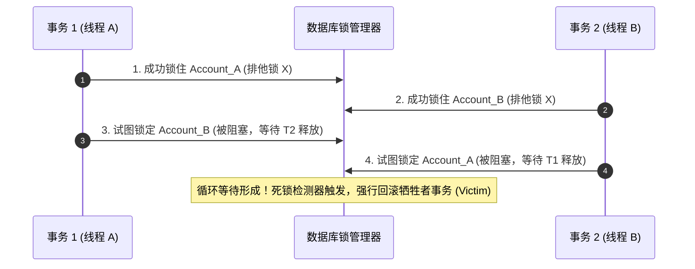
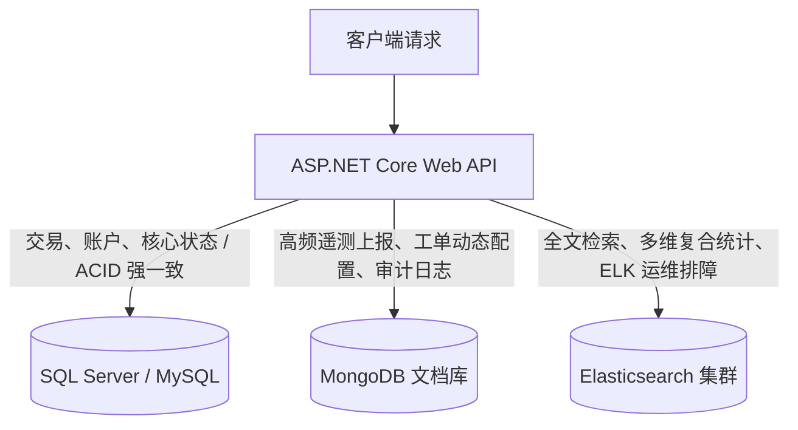

> [!IMPORTANT]
> **本篇定位**：在实际企业系统（ERP、MES、OA 及高并发业务）中，80% 的性能瓶颈最终都归结于数据访问层。本篇深入数据库底层存储、索引寻址机制、ORM 性能暗坑以及 NoSQL 架构选型，提供中高级工程师必备的数据库设计与调优硬核方法论。

<details open class="in-post-toc-card border border-neutral-200/80 dark:border-neutral-700/80 rounded-xl p-4 my-4 bg-neutral-50/50 dark:bg-neutral-800/30">
<summary class="font-bold text-base cursor-pointer select-none text-neutral-800 dark:text-neutral-200 flex items-center justify-between outline-none">
📑 本篇目录（点击收起 / 展开）
</summary>

<div class="max-h-72 overflow-y-auto mt-3 pt-2 border-t border-neutral-200/60 dark:border-neutral-700/60 hide-scrollbar">

## 目录

- [1. 企业级关系型数据库建模与设计权衡](#1-企业级关系型数据库建模与设计权衡)
  - [1.1 范式设计（3NF）与反范式折衷策略](#11-范式设计3nf与反范式折衷策略)
  - [1.2 主键选型大权衡：自增 ID vs GUID vs 雪花算法（Snowflake）](#12-主键选型大权衡自增-id-vs-guid-vs-雪花算法snowflake)
  - [1.3 字段类型精细化：存储密度与时区陷阱](#13-字段类型精细化存储密度与时区陷阱)
- [2. SQL 调优与索引底层硬核解析（SQL Server / MySQL）](#2-sql-调优与索引底层硬核解析sql-server--mysql)
  - [2.1 B+Tree 存储架构：聚簇索引 vs 二级索引底层图解](#21-btree-存储架构聚簇索引-vs-二级索引底层图解)
  - [2.2 回表查询（Lookup）与覆盖索引（Covering Index）实战](#22-回表查询lookup与覆盖索引covering-index实战)
  - [2.3 最左前缀原则与索引失效的 8 大生产陷阱](#23-最左前缀原则与索引失效的-8-大生产陷阱)
  - [2.4 执行计划（Execution Plan）深度诊断与深分页优化](#24-执行计划execution-plan深度诊断与深分页优化)
  - [2.5 死锁（Deadlock）根因排查与防御代码准则](#25-死锁deadlock根因排查与防御代码准则)
- [3. ORM 生产级极限调优：EF Core vs Dapper 双剑合璧](#3-orm-生产级极限调优ef-core-vs-dapper-双剑合璧)
  - [3.1 EF Core 性能陷阱：1+N 查询、笛卡尔积与 AsSplitQuery](#31-ef-core-性能陷阱1n-查询笛卡尔积与-assplitquery)
  - [3.2 性能杀手：跟踪开销！全面启用 AsNoTracking 深度技巧](#32-性能杀手跟踪开销全面启用-asnotracking-深度技巧)
  - [3.3 批量写操作突破：EFCore.BulkExtensions 实战](#33-批量写操作突破efcorebulkextensions-实战)
  - [3.4 报表与高频读：集成 Dapper 轻量极速映射](#34-报表与高频读集成-dapper-轻量极速映射)
- [4. 并发控制与事务一致性保障](#4-并发控制与事务一致性保障)
  - [4.1 悲观锁 vs 乐观并发控制（RowVersion / Timestamp）](#41-悲观锁-vs-乐观并发控制rowversion--timestamp)
  - [4.2 本地事务传播与分布式柔性事务 Saga 概览](#42-本地事务传播与分布式柔性事务-saga-概览)
- [5. NoSQL 混合存储场景落地：MongoDB 与 Elasticsearch](#5-nosql-混合存储场景落地mongodb-与-elasticsearch)
  - [5.1 MongoDB 实战：动态表单、电商 SKU 规格与时序数据落地](#51-mongodb-实战动态表单电商-sku-规格与时序数据落地)
  - [5.2 Elasticsearch 实战：倒排索引原理与千万级全文检索/日志排查](#52-elasticsearch-实战倒排索引原理与千万级全文检索日志排查)

</div>
</details>

---

## 1. 企业级关系型数据库建模与设计权衡

### 1.1 范式设计（3NF）与反范式折衷策略

在大学教程中，第三范式（3NF：消灭传递依赖）被奉为圭臬。但在企业高并发与中大型 ERP/MES 架构中，**教条式遵循 3NF 往往会导致严重的性能灾难**。

```mermaid
flowchart LR
    subgraph 纯 3NF 模式
        O[Orders 订单表] -->|JOIN 关联查询| C[Customers 客户表]
        O -->|JOIN 关联查询| P[Products 产品表]
        O -->|JOIN 关联查询| S[Suppliers 供应商表]
    end

    subgraph 反范式优化设计 (适度冗余)
        O_Opt["Orders 订单宽表\n(直接冗余客户名、商品快照名、单价)"]
    end
```

- **纯 3NF 的代价**：一次简单的订单列表查询需要 JOIN 5~8 张表，在高并发或大表场景下，数据库优化器计算连接驱动表的成本极高，极易引发全表扫描与缓存击穿。
- **反范式（Denormalization）实战准则**：
  1. **历史快照数据必须冗余**：例如“订单表中的商品单价与商品名称”。商品表里的价格未来会发生变动，订单生成那一瞬间的数据本身就是历史快照，冗余存储不仅避免了 JOIN，更是业务逻辑正确的唯一方式。
  2. **高频只读字段允许冗余**：在读写比达到 9:1 以上的场景，可适度将冗余字段维护在主表中，但必须通过领域事件或数据库事务确保一致性更新。

---

### 1.2 主键选型大权衡：自增 ID vs GUID vs 雪花算法（Snowflake）

主键选型直接决定了 B+Tree 索引底层的数据物理存储形态。

| 主键类型 | 存储体积 | 索引写入特性 | 分布式环境适用性 | 业务暴露风险 | 生产建议评级 |
| :--- | :--- | :--- | :--- | :--- | :--- |
| **自增整数 (BIGINT)** | 8 字节 | **极佳**（递增写入，页分裂极少） | 差（分库分表易碰撞） | 高（对外暴露容易被爬取猜测） | 内部中小型单库系统推荐 |
| **原生 GUID (`Guid.NewGuid()`)** | 16 字节 | **极差**（完全随机无序，引发高频页分裂） | 极佳 | 极低 | **严禁作为聚簇索引主键** |
| **有序 GUID (SequentialGuid)** | 16 字节 | 良好（在尾部追加递增时间戳） | 极佳 | 低 | 混合架构折衷选择 |
| **雪花算法 (Snowflake ID)** | 8 字节 | **极佳**（时间递增，空间仅 64 位） | **极佳（原生多机房多 Worker 隔离）** | 低 | **高并发与微服务首选推荐** |

#### 深度揭秘：为什么无序 GUID 会彻底搞垮聚簇索引？
聚簇索引（Clustered Index）决定了表物理数据的存储顺序。
- 自增或时间有序的主键，新插入的数据永远追加在最后一个数据页（Page）的末尾，页面写满后自然分配新页。
- 随机 GUID 主键会导致新数据被**随机插入到已经写满的中间数据页**中。此时数据库存储引擎必须执行**页分裂（Page Split）**：开辟新页并将原页 50% 的数据迁移过去，引发大量的磁盘随机 I/O、产生大量索引碎片并导致 Buffer Pool 命中率雪崩！

```csharp
// 生产级有序雪花 ID 生成器 (IdGen / Yitter.IdGenerator 模式)
public static class IdWorker
{
    // 64-bit: 1bit(0) + 41bits(时间戳) + 10bits(机器节点ID) + 12bits(序列号)
    private static readonly IdGeneratorOptions Options = new(1) { WorkerIdBitLength = 6 };
    static IdWorker() => YitIdHelper.SetIdGenerator(Options);

    public static long NextId() => YitIdHelper.NextId();
}
```

---

### 1.3 字段类型精细化：存储密度与时区陷阱

1. **字符串类型选型（VARCHAR vs NVARCHAR）**：
   - 在 SQL Server 中，`VARCHAR` 占用 1 字节（ASCII/单字节字符集），`NVARCHAR` 占用 2 字节（Unicode）。若存储纯英文字符或设备编码，滥用 `NVARCHAR` 会导致索引体积翻倍，使单个 8KB 数据页所能容纳的行数减半。
2. **金融精度（DECIMAL vs DOUBLE）**：
   - 涉及金额、账单或高精度工业配方，**坚决杜绝 `float` 或 `double`**（存在 IEEE 754 浮点二进制舍入误差）。必须采用 `decimal(18, 4)`，在数据库与 C# 中均保持定点数运算。
3. **时区陷阱（DateTime vs DateTimeOffset）**：
   - `DateTime` 本身不记录时区信息。在多机房、跨国部署或云上容器环境中，必须使用 `DateTimeOffset` 或将数据库字段统一规定为 UTC 时间戳存储。

---

## 2. SQL 调优与索引底层硬核解析（SQL Server / MySQL）

### 2.1 B+Tree 存储架构：聚簇索引 vs 二级索引底层图解

在 MySQL (InnoDB) 与 SQL Server 中，核心索引引擎均基于 B+Tree 实现。

```mermaid
flowchart TD
    subgraph 聚簇索引树 (Clustered Index Tree)
        R1[根节点: Page 10] --> N1[枝节点: Page 20]
        R1 --> N2[枝节点: Page 21]
        N1 --> L1["叶子节点: Page 30\n【物理数据行: Id=1, Name, Age, CreateTime】"]
        N1 --> L2["叶子节点: Page 31\n【物理数据行: Id=2, Name, Age, CreateTime】"]
    end

    subgraph 二级非聚簇索引树 (Index on Age)
        R2[根节点: Page 40] --> N3[枝节点: Page 50]
        N3 --> L3["叶子节点: Page 60\n【存储: Age=25, 对应主键 Id=1】"]
    end

    L3 -.->|回表查询 (Key Lookup)| L1
```

- **聚簇索引（Clustered Index）**：
  叶子节点存储的就是**整行完整的物理数据**。一张表只能有一个聚簇索引（通常为主键）。
- **二级非聚簇索引（Secondary Index）**：
  叶子节点**不包含完整数据行**，仅存储该索引列的值以及对应的**主键 ID（聚集索引键）**。

---

### 2.2 回表查询（Lookup）与覆盖索引（Covering Index）实战

#### 什么是回表查询（Key Lookup）？
当你执行：
```sql
SELECT Id, Name, Age, CreateTime FROM Users WHERE Age = 25;
```
如果我们在 `Age` 字段上建立了普通索引：
1. 数据库首先在 `Age` 二级索引树中寻址，找到匹配的记录，得到叶子节点中的主键 `Id = 1`。
2. 数据库拿着 `Id = 1`，**必须重新到聚簇索引树从根节点再查一次**，以获取未包含在二级索引中的 `Name` 和 `CreateTime` 字段。
3. **痛点**：若查询命中 10,000 条记录，数据库将触发 10,000 次随机 I/O 回表，效率极其低下。

#### 终极优化：覆盖索引（Covering Index）
让二级索引的叶子节点直接涵盖查询所需的全部字段，**彻底消除回表**！

```sql
-- SQL Server 黄金特性：包含列索引 (INCLUDE)
-- 仅按 Age 排序构建索引树，而在叶子节点冗余挂载 Name 和 CreateTime
CREATE NONCLUSTERED INDEX IX_Users_Age_Covering 
ON Users(Age) 
INCLUDE (Name, CreateTime);

-- MySQL 覆盖索引组合
CREATE INDEX idx_users_age_covering ON Users(Age, Name, CreateTime);
```
此时执行查询，数据库只需扫描二级索引叶子节点即可直接返回所有列，执行计划直接显示为最纯粹高效的 **Index Scan / Seek**，性能提升数倍至数十倍。

---

### 2.3 最左前缀原则与索引失效的 8 大生产陷阱

在复合索引（如 `INDEX(TenantId, Status, CreateTime)`）中，数据库必须严格遵守**最左前缀匹配原则**。在实际代码中，以下操作会瞬间导致索引失效走全表扫描：

1. **左侧前导列丢失**：
   - ❌ `WHERE Status = 1`（跳过了 `TenantId`，复合索引完全无法使用）。
2. **前置模糊匹配**：
   - ❌ `WHERE DeviceCode LIKE '%ABC'`（B+Tree 是按字典序排序的，未知前缀无法二分查找）。
   -  `WHERE DeviceCode LIKE 'ABC%'`（可正常走 Index Range Scan）。
3. **对索引列进行函数或表达式运算**：
   - ❌ `WHERE YEAR(CreateTime) = 2026`
   -  `WHERE CreateTime >= '2026-01-01' AND CreateTime < '2027-01-01'`
4. **隐式类型转换（Type Coercion）**：
   - ❌ 当 `Phone` 字段为 `VARCHAR` 类型，执行 `WHERE Phone = 13800000000`（数字未加单引号），数据库底层会自动调用隐式转换函数 `CAST(Phone AS INT)`，导致整列索引失效。
5. **OR 连接条件未覆盖全部索引**：
   - ❌ `WHERE ColA = 1 OR ColB = 2`（若只有 ColA 有索引而 ColB 无索引，数据库只能放弃索引全表扫描）。
6. **不等于（!= 或 <>）与 NOT IN**：
   - 负向查询通常无法利用索引树的有序范围进行高效剪枝。
7. **范围查询后面的列失效**：
   - 在复合索引 `(A, B, C)` 中，若写 `WHERE A = 1 AND B > 10 AND C = 2`，则 `C` 字段无法再利用索引排序。
8. **违反数据分布的选择性（Selectivity）阈值**：
   - 若某字段（如 `Gender` 或 `IsDeleted`）只有两种取值，优化器评估通过索引回表的成本甚至高于全表扫描，会自动放弃走该索引。

---

### 2.4 执行计划（Execution Plan）深度诊断与深分页优化

#### A. 执行计划三大核心算子评级
1. **Index Seek（索引寻址）**： 最优。基于 B+Tree 直接二分查找定位叶子节点。
2. **Index Scan（索引扫描）**：⚠️ 中等。遍历整颗索引树，虽然比扫物理表快，但说明未命中前缀范围。
3. **Table Scan / Clustered Index Scan（全表扫描）**：❌ 最差。逐行逐页扫描磁盘，必须重点优化。

#### B. 亿级大表深分页性能调优（Deep Paging）
在分页场景下，当执行：
```sql
-- 典型慢查询：OFFSET 1000000 导致数据库先扫描并回表 1000020 行，最后丢弃前 1000000 行
SELECT * FROM Orders ORDER BY Id ASC LIMIT 1000000, 20;
```

#### 生产优化方案一：Seek 分页法（基于最后游标）
如果前端是流式瀑布流下拉（如手机 App）：
```sql
-- 耗时 < 1ms，永远保持 Index Seek
SELECT * FROM Orders 
WHERE Id > 1000000 
ORDER BY Id ASC LIMIT 20;
```

#### 生产优化方案二：延迟关联（Deferred Join）
如果前端必须跳转任意页码，先利用二级索引覆盖扫描分页拿主键，再回表关联：
```sql
SELECT o.* 
FROM Orders o
INNER JOIN (
    SELECT Id FROM Orders ORDER BY Id ASC LIMIT 1000000, 20
) AS tmp ON o.Id = tmp.Id;
```

---

### 2.5 死锁（Deadlock）根因排查与防御代码准则

高并发交易系统中，死锁是最常见的线上故障。



#### 防御死锁的三大军规：
1. **加锁顺序保持全局绝对一致**：
   - 比如转账业务（A 转 B 与 B 转 A 并发执行）：代码中必须在加锁前**对两个账户的 ID 进行统一排序**，永远优先锁定 `Math.Min(IdA, IdB)`，再锁定 `Math.Max(IdA, IdB)`，彻底打破循环等待条件。
2. **极短事务原则**：
   - 严禁在数据库事务代码块内包含远程 HTTP 接口调用、文件 I/O 或耗时计算，最大程度缩短行锁持有时间。
3. **显式死锁抓取与重试机制**：
   - 使用 Polly 在捕获到 `SqlException (Number 1205)` 或 `MySqlException (1213)` 时进行退避重试。

---

## 3. ORM 生产级极限调优：EF Core vs Dapper 双剑合璧

### 3.1 EF Core 性能陷阱：1+N 查询、笛卡尔积与 AsSplitQuery

#### A. 1+N 延迟加载陷阱（Lazy Loading）
若开启了 Lazy Loading，遍历主表时每一次访问导航属性都会向数据库发起一次独立的 SQL 查询：
```csharp
// 灾难：若查询 100 条订单，将向数据库连续执行 1 + 100 = 101 次网络通信！
var orders = await db.Orders.ToListAsync();
foreach(var order in orders)
{
    Console.WriteLine(order.Customer.Name); // 触发独立 SQL SELECT
}

// 正确方案：显式 Eager Loading
var orders = await db.Orders.Include(x => x.Customer).ToListAsync();
```

#### B. 笛卡尔积爆炸与拆分查询（`AsSplitQuery`）
当一个实体包含多个一对多关联集合时：
```csharp
var orders = await db.Orders
    .Include(x => x.OrderItems)
    .Include(x => x.PaymentLogs)
    .ToListAsync();
```
默认情况下，EF Core 会生成单个庞大的 `LEFT JOIN` 查询。如果一个订单有 10 个 OrderItems 和 5 个 PaymentLogs，数据库返回的结果集行数将瞬间放大为 $10 \times 5 = 50$ 倍，导致巨大的网络传输和内存反序列化压力！

**解决方案：.NET 5+ 引入的拆分查询**：
```csharp
var orders = await db.Orders
    .Include(x => x.OrderItems)
    .Include(x => x.PaymentLogs)
    .AsSplitQuery() // 关键优化：自动拆分为 3 条高效简单的单表 SQL
    .ToListAsync();
```

---

### 3.2 性能杀手：跟踪开销！全面启用 AsNoTracking 深度技巧

在 Web API 的查询只读场景中，EF Core 默认的 **变更跟踪器（ChangeTracker）** 会为每一个拉取出来的实体深拷贝一份快照保存在内存中，不仅耗费巨量 CPU，还极大增加了 GC 负担。

```csharp
// 规范：所有只读查询必须显式 AsNoTracking()
var devices = await db.Devices
    .AsNoTracking()
    .Where(d => d.Status == DeviceStatus.Active)
    .ToListAsync();
```

> [!TIP]
> 如果一个查询包含了重复实体的复杂图（如多个订单属于同一个客户），使用普通的 `AsNoTracking()` 会导致客户实体在内存中被重复创建多次。此时可使用 `AsNoTrackingWithIdentityResolution()`：既享受无跟踪的极速写入，又保证内存中相同 ID 实体的单例复用。

---

### 3.3 批量写操作突破：EFCore.BulkExtensions 实战

若要向数据库批量插入 50,000 条传感器日志：
```csharp
// ❌ 灾难：逐条 Add 并 SaveChanges，底层生成 50,000 条 INSERT 语句，耗时数分钟
foreach(var log in logs) db.DeviceLogs.Add(log);
await db.SaveChangesAsync();

//  现代高效方案：EFCore.BulkExtensions (底层调用 SqlBulkCopy 或 MySQL LOAD DATA)
// 50,000 条数据批量落库仅需 300~500 毫秒！
await db.BulkInsertAsync(logs, options => 
{
    options.BatchSize = 5000;
    options.EnableStreaming = true;
});
```

---

### 3.4 报表与高频读：集成 Dapper 轻量极速映射

在复杂多表聚合、BI 统计报表或每秒万级 QPS 的高频读接口中，直接使用 **Dapper** 配合原生精心编写的 SQL 是业界最佳实践架构（**CQS 读写分离**：写用 EF Core 保证领域完整性，复杂读走 Dapper 追求极限吞吐）。

```csharp
public class OrderReportService
{
    private readonly IDbConnectionFactory _dbConnectionFactory;

    public OrderReportService(IDbConnectionFactory dbConnectionFactory)
    {
        _dbConnectionFactory = dbConnectionFactory;
    }

    public async Task<IEnumerable<OrderSummaryDto>> GetMonthlyReportAsync(int year, int month)
    {
        using var conn = _dbConnectionFactory.CreateConnection();
        const string sql = @"
            SELECT 
                o.WorkshopCode, 
                COUNT(o.Id) AS TotalOrders, 
                SUM(o.TotalPrice) AS TotalRevenue,
                AVG(o.ProductionDuration) AS AvgDuration
            FROM Orders o WITH (NOLOCK)
            WHERE o.CreateTime >= @StartDate AND o.CreateTime < @EndDate
            GROUP BY o.WorkshopCode";

        return await conn.QueryAsync<OrderSummaryDto>(sql, new 
        { 
            StartDate = new DateTime(year, month, 1), 
            EndDate = new DateTime(year, month, 1).AddMonths(1) 
        });
    }
}
```

---

## 4. 并发控制与事务一致性保障

### 4.1 悲观锁 vs 乐观并发控制（RowVersion / Timestamp）

在高并发秒杀或库存扣减场景下，如何保证并发安全？

#### A. 悲观并发控制（Pessimistic Concurrency）
假定一定会发生冲突，在读取时直接加互斥锁：
```csharp
// SQL Server: UPDLOCK, ROWLOCK
// MySQL: SELECT ... FOR UPDATE
```
- **缺点**：锁持有时间长，吞吐量低下，极易引发锁升级（Row Lock 升级为 Page/Table Lock）及死锁。

#### B. 乐观并发控制（Optimistic Concurrency - 推荐）
假定冲突概率较低，不加锁，在更新提交时比对版本号：

```csharp
public class Inventory
{
    public Guid Id { get; set; }
    public int StockCount { get; set; }

    // 并发控制令牌：每次该行发生 UPDATE 时，数据库驱动会自动生成全新的行版本值
    [Timestamp]
    public byte[] RowVersion { get; set; } = null!;
}
```

更新时 EF Core 会自动在生成的 SQL 中追加条件：
```sql
UPDATE Inventory SET StockCount = @StockCount
WHERE Id = @Id AND RowVersion = @OriginalRowVersion;
```
若此时有并发写操作修改了数据，`RowVersion` 已变动，影响行数返回 0，EF Core 立即抛出 `DbUpdateConcurrencyException`。业务层只需捕获该异常，重新拉取最新库存进行业务重试即可，完全无需持有重量级锁。

---

### 4.2 本地事务传播与分布式柔性事务 Saga 概览

- **单库强一致性事务**：使用 `using var transaction = await db.Database.BeginTransactionAsync();`，保障多表变更在物理数据库层面满足 ACID 属性。
- **跨库 / 微服务分布式事务**：
  在微服务拆分后，跨数据库的 2PC（两阶段提交 / MSDTC）由于强阻塞、单点故障和云原生不支持已被全面淘汰。
  企业级标准方案是采用 **Saga 模式** 或 **本地消息表（Outbox Pattern）** 实现**最终一致性（Eventual Consistency）**：
  1. 服务 A 在本地事务中保存业务数据并向 `OutboxTable` 插入一条待发布消息。
  2. 后台守护线程扫描 `OutboxTable` 并将消息推入 RabbitMQ。
  3. 服务 B 消费消息执行后续业务；若服务 B 发生不可逆故障，则逆向发布补偿事件驱动服务 A 执行业务冲正。

---

## 5. NoSQL 混合存储场景落地：MongoDB 与 Elasticsearch

在现代化企业系统中，关系型数据库不再包揽一切，而是与 NoSQL 组成多级混合存储矩阵。



### 5.1 MongoDB 实战：动态表单、电商 SKU 规格与时序数据落地

#### 核心适用场景剖析：
1. **企业 OA / CRM 动态自定义表单与审批工单**：
   在不同部门或流程中，工单字段完全由运营人员在后台动态拖拽生成（如“采购审批单”包含供货商、物料清单；“请假审批单”包含病历附件、代班人）。若在关系型数据库（RDBMS）中实现，要么需要频繁执行危险的 `ALTER TABLE`，要么必须设计结构复杂的 EAV（Entity-Attribute-Value）纵表模型，查询时需要自身 JOIN 多次，性能极其低下。MongoDB 的 BSON 动态无模式（Schemaless）特性天然支持任意结构的 JSON 文档持久化。
2. **电商多类目 SPU / SKU 动态规格属性**：
   数码手机包含“屏幕尺寸、CPU型号、RAM、快充功率”，服饰鞋帽包含“尺码、面料成分、版型”。MongoDB 嵌套数组与子文档能一次性将商品规格及图文详情完整读写，彻底消除多表关联。
3. **海量行为埋点与 IoT 遥测时序**：
   支持超高并发写入与基于 TTL 索引的自动过期清理。

```csharp
public class MongoDynamicFormRepository
{
    private readonly IMongoCollection<BsonDocument> _collection;

    public MongoDynamicFormRepository(IMongoClient client)
    {
        var database = client.GetDatabase("EnterpriseERP");
        _collection = database.GetCollection<BsonDocument>("CustomFormSubmissions");
    }

    public async Task SubmitFormAsync(string formDefinitionId, string submitterId, Dictionary<string, object> dynamicData)
    {
        var doc = new BsonDocument
        {
            { "formId", formDefinitionId },
            { "submitterId", submitterId },
            { "submitTime", DateTime.UtcNow },
            { "status", "PendingReview" },
            // 将前端 Vue3 动态表单组件提交的任意键值对直接转为 BsonDocument，无需硬编码 C# 类属性
            { "formData", new BsonDocument(dynamicData) }
        };

        // 极高写入吞吐与无约束存储
        await _collection.InsertOneAsync(doc);
    }
}
```

---

### 5.2 Elasticsearch 实战：倒排索引原理与千万级全文检索/日志排查

#### 为什么关系数据库 `LIKE '%keyword%'` 在大数据量下必然崩盘？
关系型数据库基于 B+Tree 索引，只能针对正向排序的数据进行前缀匹配。包含通配符的模糊搜索必然导致遍历每一行的每一个字符做字符串匹配，复杂度为 $O(N)$。

#### Elasticsearch 核心：倒排索引（Inverted Index）
Elasticsearch 将文本分词并建立单词到文档 ID 的映射字典：
- 检索时直接查找 Term 字典，复杂度接近 $O(1)$。

```csharp
// 基于 NEST / Elastic.Clients.Elasticsearch 实战复合检索
public async Task<SearchResultDto> SearchLogsAsync(string queryText, LogLevel level, int page, int size)
{
    var response = await _elasticClient.SearchAsync<SystemAuditLog>(s => s
        .Index("audit-logs-*")
        .From((page - 1) * size)
        .Size(size)
        .Query(q => q
            .Bool(b => b
                .Must(m => m.Match(match => match.Field(f => f.Message).Query(queryText)))
                .Filter(f => f.Term(t => t.Field(f => f.Level).Value(level.ToString())))
            )
        )
        .Sort(sort => sort.Descending(f => f.Timestamp))
    );

    return new SearchResultDto
    {
        Total = response.Total,
        Items = response.Documents.ToList()
    };
}
```
通过将高频高耗能的检索与聚合操作卸载到 Elasticsearch，数据库 CPU 占用率可瞬间下降 70% 以上，保障了核心交易链路的稳健运行。
