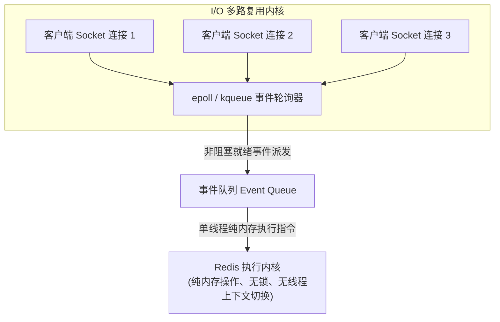
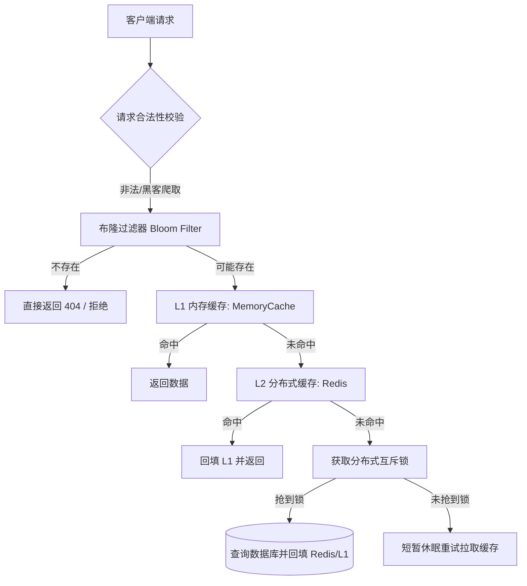
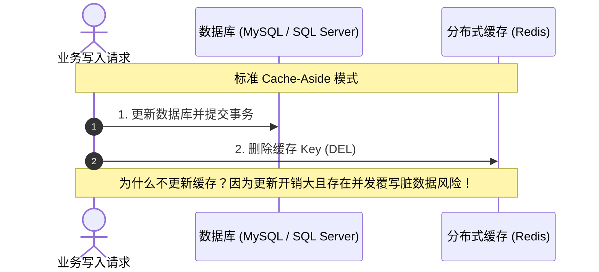
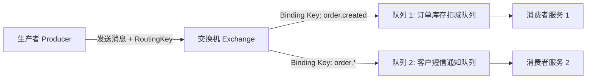
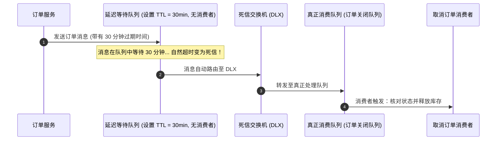
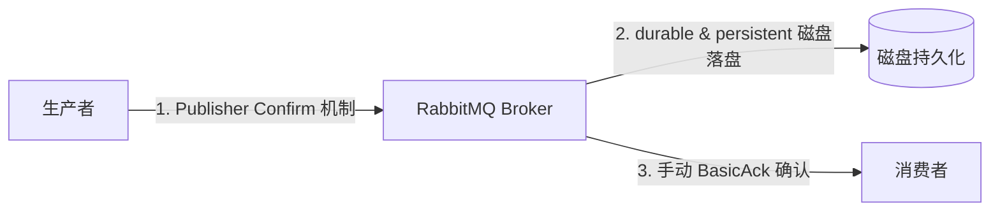

> [!IMPORTANT]
> **本篇定位**：在高并发与分布式系统中，缓存与消息队列是抵御流量洪峰、实现服务异步解耦的核心两翼。本篇面向生产环境，深度拆解 Redis 内存架构与高可用防御实战，以及 RabbitMQ 消息可靠性端到端闭环工程设计。

<details open class="in-post-toc-card border border-neutral-200/80 dark:border-neutral-700/80 rounded-xl p-4 my-4 bg-neutral-50/50 dark:bg-neutral-800/30">
<summary class="font-bold text-base cursor-pointer select-none text-neutral-800 dark:text-neutral-200 flex items-center justify-between outline-none">
📑 本篇目录（点击收起 / 展开）
</summary>

<div class="max-h-72 overflow-y-auto mt-3 pt-2 border-t border-neutral-200/60 dark:border-neutral-700/60 hide-scrollbar">

## 目录

- [1. Redis 生产级进阶与核心数据结构选型](#1-redis-生产级进阶与核心数据结构选型)
  - [1.1 为什么 Redis 如此快？单线程多路复用与内存架构](#11-为什么-redis-如此快单线程多路复用与内存架构)
  - [1.2 五大基础与高级数据结构企业级业务映射](#12-五大基础与高级数据结构企业级业务映射)
  - [1.3 StackExchange.Redis 生产级连接池与超时避坑](#13-stackexchangeredis-生产级连接池与超时避坑)
- [2. 高并发缓存四大金刚防御全景方案与实战](#2-高并发缓存四大金刚防御全景方案与实战)
  - [2.1 缓存穿透（Cache Penetration）：布隆过滤器 vs 空值缓存](#21-缓存穿透cache-penetration布隆过滤器-vs-空值缓存)
  - [2.2 缓存击穿（Cache Breakdown）：互斥锁 vs 逻辑过期后台异步刷新](#22-缓存击穿cache-breakdown互斥锁-vs-逻辑过期后台异步刷新)
  - [2.3 缓存雪崩（Cache Avalanche）：随机 TTL 与多级缓存（L1+L2）](#23-缓存雪崩cache-avalanche随机-ttl-与多级缓存l1l2)
  - [2.4 双写一致性（Cache Consistency）：Cache-Aside 与延迟双删深度剖析](#24-双写一致性cache-consistencycache-aside-与延迟双删深度剖析)
- [3. 生产级 Redis 分布式锁闭环实战](#3-生产级-redis-分布式锁闭环实战)
  - [3.1 单机 SETNX 的致命缺陷：死锁与误删他人锁](#31-单机-setnx-的致命缺陷死锁与误删他人锁)
  - [3.2 工业级分布式锁三要素：原子加锁 + 唯一 Token + Lua 释放](#32-工业级分布式锁三要素原子加锁--唯一-token--lua-释放)
  - [3.3 锁续期（Watchdog）与 RedLock 算法争议剖析](#33-锁续期watchdog与-redlock-算法争议剖析)
- [4. 消息中间件 RabbitMQ 核心架构与路由拓扑](#4-消息中间件-rabbitmq-核心架构与路由拓扑)
  - [4.1 核心概念模型：Exchange, Queue, Binding 与虚拟主机](#41-核心概念模型exchange-queue-binding-与虚拟主机)
  - [4.2 四大交换机类型与业务路由拓扑设计](#42-四大交换机类型与业务路由拓扑设计)
  - [4.3 死信队列（DLX）与延迟任务架构落地](#43-死信队列dlx与延迟任务架构落地)
- [5. 异步解耦企业级保证：消息可靠性投递与消费幂等闭环](#5-异步解耦企业级保证消息可靠性投递与消费幂等闭环)
  - [5.1 消息端到端防丢设计（生产端 Confirm + 存储持久化 + 消费端 Manual Ack）](#51-消息端到端防丢设计生产端-confirm--存储持久化--消费端-manual-ack)
  - [5.2 消费端幂等性（Idempotency）防重设计：唯一业务 ID + 排重表](#52-消费端幂等性idempotency防重设计唯一业务-id--排重表)
  - [5.3 分布式事务最终一致性：本地消息表（Outbox Pattern）企业落地](#53-分布式事务最终一致性本地消息表outbox-pattern企业落地)

</div>
</details>

---

## 1. Redis 生产级进阶与核心数据结构选型

### 1.1 为什么 Redis 如此快？单线程多路复用与内存架构

Redis 能在单机达成 100,000+ QPS 的超高吞吐，其底层核心源于三大工程设计：



1. **纯内存数据结构**：所有操作直接在 RAM 内存中完成，无磁盘寻道开销。
2. **非阻塞 I/O 多路复用（I/O Multiplexing）**：使用单线程轮询数十万个客户端连接的读写就绪事件，彻底消除了多线程并发中的锁竞争（Lock Contention）与 CPU 线程上下文切换开销。
3. **高效的数据底层编码**：针对不同数据量级自适应降级编码（如 SDS 动态字符串、ziplist 压缩列表、skiplist 跳表）。

---

### 1.2 五大基础与高级数据结构企业级业务映射

在很多初级实践中，开发者将 Redis 简化为“带过期时间的 Key-Value 字典”，所有对象序列化为 JSON 存入 `String`。在复杂生产场景下，这是严重的资源浪费与性能隐患。

| 数据结构 | 底层实现 | 企业级最佳业务场景 | 生产避坑准则 |
| :--- | :--- | :--- | :--- |
| **String** | SDS (Simple Dynamic String) | 简单热点缓存、分布式锁、计数器（INCR） | 严禁存储超过 100KB 的大对象（引发网络瓶颈与慢查询） |
| **Hash** | ziplist / hashtable | **高频单个属性读取更新**（如用户画像、设备实时工况） | **代替全量 String JSON**：只需修改一个温度字段时，直接 `HSET`，无需全量反序列化 |
| **List** | quicklist (双向链表+压缩列表) | 简易消息队列、最新动态时间线（LPUSH + LTRIM） | 谨防无限增长导致 OOM，必须配合 `LTRIM` 限制长度 |
| **Set** | intset / hashtable | 抽奖系统、共同好友、设备去重统计（SINTER / SDIFF） | 集合运算复杂度高，严禁在主库对超大 Set 做求交集操作 |
| **Sorted Set (ZSet)** | skiplist + hashtable | **延迟任务调度**（Score 为执行时间戳）、排行榜 | Score 使用双精度浮点数，高并发 `ZRANGEBYSCORE` 需控制分页区间 |
| **Bitmap** | 位图（基于 String 实现） | 亿级用户打卡、传感器在线状态位图 | 空间极小（1 亿个布尔位仅占用约 12MB 内存） |
| **HyperLogLog** | 基数统计概率算法 | 网站海量独立访客（UV）统计 | 占用固定 12KB 内存，存在 0.81% 标准误差，不可倒查明细 |
| **Stream** | Radix Tree (基数树) | 具备消费组（Consumer Group）与持久化确认的轻量消息流 | 需配合 XADD 与 XTRIM 定期裁剪历史已消费消息 |

---

### 1.3 StackExchange.Redis 生产级连接池与超时避坑

在 C# 中，`StackExchange.Redis` 是官方推荐的底层驱动。它的核心特性是**全异步多路复用（ConnectionMultiplexer）**。

#### 生产三大避坑原则：
1. **ConnectionMultiplexer 必须全局单例（Singleton）**：
   严禁在每次请求或仓储中 `using var conn = ConnectionMultiplexer.Connect(...)`！建立 TCP 连接与握手极其沉重，频繁新建会导致端口耗尽与内存泄漏。
2. **高并发下应对 ThreadPool 饥饿导致 Timeout**：
   当出现 `Timeout awaiting response...` 时，80% 的原因并非 Redis 慢，而是 C# 线程池工作线程耗尽（ThreadPool Starvation）。
   - **解决**：启动时提升最小工作线程数：
     ```csharp
     ThreadPool.SetMinThreads(workerThreads: 200, completionPortThreads: 200);
     ```
3. **启用连接重试与保活机制**：
   ```csharp
   var configuration = ConfigurationOptions.Parse("127.0.0.1:6379,password=securepass");
   configuration.AbortOnConnectFail = false; // 启动时即使 Redis 短暂不可用也不要崩溃应用
   configuration.ConnectTimeout = 5000;
   configuration.SyncTimeout = 3000;
   configuration.KeepAlive = 60;

   builder.Services.AddSingleton<IConnectionMultiplexer>(ConnectionMultiplexer.Connect(configuration));
   ```

---

## 2. 高并发缓存四大金刚防御全景方案与实战

在每秒数万甚至数十万 QPS 的大型系统中，缓存策略的微小疏漏都会直接将底层关系型数据库瞬间打垮。



### 2.1 缓存穿透（Cache Penetration）：布隆过滤器 vs 空值缓存

#### 定义：
客户端持续请求**数据库与缓存中均不存在的数据**（如恶意黑客用 `id = -99999` 连续发起攻击）。由于缓存不命中，所有请求全量穿透打到底层数据库，引发数据库 CPU 飙升。

#### 生产防御闭环：
1. **短 TTL 空值缓存（Cache Null）**：
   当数据库查询为 null 时，依然向 Redis 写入空标识（如 `"{}"`），但设置极短过期时间（如 30~60 秒）：
   ```csharp
   if (dataFromDb == null)
   {
       await _redis.StringSetAsync(cacheKey, "NULL_PLACEHOLDER", TimeSpan.FromSeconds(30));
       return null;
   }
   ```
2. **布隆过滤器（Bloom Filter）前置阻断**：
   对于上亿级别的主键集合，通过高效哈希位图预检。**若布隆过滤器判定不存在，则绝对不存在**，直接在内存层拦截短路。

---

### 2.2 缓存击穿（Cache Breakdown）：互斥锁 vs 逻辑过期后台异步刷新

#### 定义：
**某一个被超高频访问的热点 Key（如秒杀爆品、重大突发新闻）在失效瞬间**，数万并发请求同时未命中缓存，瞬间涌入数据库执行 SQL 查询并重建缓存，将数据库直接砸死。

#### 方案一：分布式互斥锁（强一致性优先）
只允许抢到分布式锁的第一个请求去查询数据库，其余并发请求自旋等待：
```csharp
public async Task<DeviceConfigDto?> GetConfigWithMutexAsync(string deviceId)
public async Task<ProductDetailDto?> GetHotProductWithMutexAsync(string productId)
{
    string cacheKey = $"cache:product:detail:{productId}";
    var cached = await _redis.StringGetAsync(cacheKey);
    if (cached.HasValue) return JsonSerializer.Deserialize<ProductDetailDto>(cached!);

    // 未命中，尝试获取互斥锁 (防止瞬时万级并发打穿数据库)
    string lockKey = $"lock:product:detail:{productId}";
    string lockToken = Guid.NewGuid().ToString("N");

    // 仅持锁 5 秒
    if (await _redis.StringSetAsync(lockKey, lockToken, TimeSpan.FromSeconds(5), When.NotExists))
    {
        try
        {
            // 双重校验 (Double-Check)，防止排队线程重复查 DB
            cached = await _redis.StringGetAsync(cacheKey);
            if (cached.HasValue) return JsonSerializer.Deserialize<ProductDetailDto>(cached!);

            var dbData = await _db.Products.FindAsync(productId);
            var serialized = JsonSerializer.Serialize(dbData);
            await _redis.StringSetAsync(cacheKey, serialized, TimeSpan.FromMinutes(30));
            return dbData;
        }
        finally
        {
            // Lua 原子释放锁
            await ReleaseLockAsync(lockKey, lockToken);
        }
    }
    else
    {
        // 没抢到锁，等待 50ms 重新递归读取缓存
        await Task.Delay(50);
        return await GetHotProductWithMutexAsync(productId);
    }
}
```

#### 方案二：逻辑过期（高可用极限性能优先）
物理上在 Redis 中永不过期（TTL = Infinite），但在存储的模型中内置一个 `LogicalExpireTime` 字段：
- 当业务发现当前时间超过了 `LogicalExpireTime`：
  1. 当前请求直接**立即返回旧数据**（降级保障可用性，0 延迟）。
  2. 异步向后台 `Channel` 或 `Task.Run` 派发一个刷新任务，由后台单一线程去查询 DB 并更新 Redis，完全消除前端等待。

---

### 2.3 缓存雪崩（Cache Avalanche）：随机 TTL 与多级缓存（L1+L2）

#### 定义：
**大量缓存数据被设置了完全相同的过期时间**，在某一时刻集中失效；或者 Redis 集群整体宕机，导致海量请求全量倾泻到数据库。

#### 生产防御措施：
1. **TTL 散列与随机抖动（Jitter）**：
   在基准过期时间（如 30 分钟）上，附加随机偏移量（$\pm 1\sim 5$ 分钟），让 Key 的失效时间在时间轴上均匀打散：
   ```csharp
   int randomSeconds = Random.Shared.Next(60, 300);
   TimeSpan dynamicTtl = TimeSpan.FromMinutes(30) + TimeSpan.FromSeconds(randomSeconds);
   await _redis.StringSetAsync(key, value, dynamicTtl);
   ```
2. **多级缓存架构（L1 本地内存 + L2 Redis）**：
   使用进程内高速缓存（如 `IMemoryCache`）作为 L1（过期时间 10~30 秒），Redis 作为 L2。即便 Redis 波动或失效，本地内存也能扛住 95% 以上的高并发读。

---

### 2.4 双写一致性（Cache Consistency）：Cache-Aside 与延迟双删深度剖析

当数据发生变更时，是先更新数据库还是先更新缓存？



#### 为什么是“先写 DB，再删缓存”而不是“更新缓存”？
- **原因一：惰性计算与开销控制**：如果一个写频繁但读较少的字段，每次更新 DB 都去计算并更新缓存，会造成大量的无用计算。删除缓存让读操作按需加载更高效。
- **原因二：并发更新脏数据覆盖**：线程 A 更新 DB，线程 B 更新 DB；但由于网络延迟，线程 B 先更新了缓存，线程 A 后更新了缓存，导致 Redis 中永久保留了线程 A 的旧数据。

#### 终极一致性：延迟双删（Delayed Double-Delete）
在存在主从复制架构（MySQL Master-Slave）时，先删缓存、更新主库后，主从同步存在毫秒级延迟。此时若有读请求读取了从库的旧数据并回填缓存，会导致缓存中再次变为脏数据。

```csharp
public async Task UpdateProductPriceAsync(string productId, decimal newPrice)
{
    string cacheKey = $"cache:product:detail:{productId}";

    // 1. 先删缓存
    await _redis.KeyDeleteAsync(cacheKey);

    // 2. 更新数据库
    await _db.UpdatePriceAsync(productId, newPrice);

    // 3. 异步延迟双删 (等待主从复制与并发读完成)
    _ = Task.Run(async () =>
    {
        await Task.Delay(500); // 延迟 500ms
        await _redis.KeyDeleteAsync(cacheKey);
    });
}
```

> [!TIP]
> **强一致性终极解法**：在金融级业务中，可采用阿里巴巴开源的 **Canal** 或 Debezium 监听数据库底层 Binlog，异步解析行变更事件并精准清理 Redis 缓存，与业务代码彻底解耦。

---

## 3. 生产级 Redis 分布式锁闭环实战

### 3.1 单机 SETNX 的致命缺陷：死锁与误删他人锁

很多开发者编写的简陋分布式锁：
```csharp
// ❌ 灾难代码：两步非原子操作引发死锁
if (await _redis.StringSetAsync(key, "1", when: When.NotExists))
{
    await _redis.KeyExpireAsync(key, TimeSpan.FromSeconds(10)); // 若此时应用被重启或崩溃，锁将永久无法释放，引发死锁！
}
```
还有一种致命场景：**误删他人锁**。
- 线程 A 获得锁，业务耗时 12 秒，但锁的过期时间是 10 秒。
- 10 秒后锁被 Redis 自动清理；线程 B 抢到了新锁。
- 此时线程 A 执行完毕，调用 `KeyDeleteAsync(key)`，直接把**线程 B 正在持有的锁给删除了**！

---

### 3.2 工业级分布式锁三要素：原子加锁 + 唯一 Token + Lua 释放

要保证分布式锁的安全，必须满足三项黄金原则：
1. **原子加锁与设超时**：使用 `SET key value NX PX timeout` 单条指令完成。
2. **唯一标识 Token**：每个线程生成唯一的 GUID 作为 Value，释放时必须比对 Value 是否为当前线程持有。
3. **原子释放（Lua 脚本）**：比对 Token 与执行 DEL 必须在 Redis 服务端原子完成。

```csharp
public class RedisDistributedLock : IAsyncDisposable
{
    private readonly IDatabase _db;
    private readonly string _lockKey;
    private readonly string _lockToken;
    private bool _isAcquired;

    // 核心 Lua 脚本：只有当 key 对应的 value 等于传参 token 时才允许删除
    private const string ReleaseLockLuaScript = @"
        if redis.call('get', KEYS[1]) == ARGV[1] then
            return redis.call('del', KEYS[1])
        else
            return 0
        end";

    private RedisDistributedLock(IDatabase db, string lockKey, string lockToken)
    {
        _db = db;
        _lockKey = lockKey;
        _lockToken = lockToken;
    }

    public static async Task<RedisDistributedLock?> TryAcquireAsync(
        IDatabase db, 
        string resourceKey, 
        TimeSpan expiry)
    {
        string lockKey = $"lock:{resourceKey}";
        string token = Guid.NewGuid().ToString("N");

        // SET NX PX 原子指令
        bool success = await db.StringSetAsync(lockKey, token, expiry, When.NotExists);
        if (!success) return null;

        return new RedisDistributedLock(db, lockKey, token) { _isAcquired = true };
    }

    public async ValueTask DisposeAsync()
    {
        if (_isAcquired)
        {
            // 执行 Lua 脚本安全释放
            await _db.ScriptEvaluateAsync(
                ReleaseLockLuaScript, 
                keys: new RedisKey[] { _lockKey }, 
                values: new RedisValue[] { _lockToken });
            _isAcquired = false;
        }
    }
}
```

业务端使用体验（优雅的 `await using` 语法糖）：
```csharp
await using (var distLock = await RedisDistributedLock.TryAcquireAsync(_redisDb, "order:1001", TimeSpan.FromSeconds(5)))
{
    if (distLock == null)
    {
        throw new BusinessException("系统繁忙，请勿重复提交", "ERR_CONCURRENT");
    }

    // 线程安全的核心业务
    await ProcessPaymentAsync();
} // 退出代码块时自动触发 DisposeAsync 安全释放锁
```

---

### 3.3 锁续期（Watchdog）与 RedLock 算法争议剖析

1. **看门狗锁续期（Watchdog Renewal）**：
   若业务执行时间难以预估，可以在获得锁后，启动一个后台定时器（如每隔 1/3 超时时间），向 Redis 发送 Lua 脚本刷新锁的 TTL，直到业务执行完成显式取消定时器。
2. **RedLock 算法争议**：
   在 Redis 哨兵或集群模式下，主从同步是异步的。若 Master 节点刚写完锁尚未同步到 Slave 节点就宕机，Slave 晋升为 Master 后锁丢失，导致两个客户端同时持有锁。
   Martin Kleppmann（分布式专家）与 Salvatore Sanfilippo（Redis 作者）曾为此展开著名辩论。在企业实践中：
   - 若业务对一致性有绝对刚性要求（严禁任何双重扣款），建议使用 **ZooKeeper / Consul（强一致性 CP 模型）** 或数据库排他锁。
   - 对大多数互联网与企业业务，具备唯一 Token + Lua 的单节点/主从 Redis 锁已足够高效可靠。

---

## 4. 消息中间件 RabbitMQ 核心架构与路由拓扑

在微服务拆分和高并发解耦中，消息队列（MQ）承担着削峰填谷（Peak Clipping）与异步通知的重任。

### 4.1 核心概念模型：Exchange, Queue, Binding 与虚拟主机



- **Exchange（交换机）**：接收生产者的消息，并不存储消息，仅根据路由规则转发到绑定的队列中。
- **Queue（队列）**：实际存储消息的缓冲区，消费者直接从队列拉取或被推送消息。
- **Binding（绑定）**：交换机与队列之间的连接纽带，定义了路由键（Routing Key）的匹配模式。
- **Virtual Host（虚拟主机）**：RabbitMQ 内部的逻辑租户隔离单元（类似数据库实例）。

---

### 4.2 四大交换机类型与业务路由拓扑设计

| 交换机类型 | 路由规则 | 匹配性能 | 企业级典型场景 |
| :--- | :--- | :---: | :--- |
| **Direct** | 严格精确匹配 RoutingKey | **极高** | 单一业务精准分发（如 `payment.success`） |
| **Fanout** | 忽略 RoutingKey，广播给所有绑定队列 | **最高** | 全员广播通知（如系统停机维护、全节点本地缓存失效） |
| **Topic** | 支持通配符匹配（`*` 匹配单个单词，`#` 匹配零或多个） | 高 | 复杂多维订阅（如 `iot.sensor.temperature.*`） |
| **Headers** | 基于 Message Header 键值对匹配 | 低 | 较少使用 |

---

### 4.3 死信队列（DLX）与延迟任务架构落地

在 RabbitMQ 中，没有开箱即用的延迟队列功能，但在企业级生产中（如“订单 30 分钟未支付自动取消”），通常有两种主流方案：

#### 方案一：基于死信交换机（DLX）+ TTL 实现延迟队列


#### 方案二：使用官方插件 `rabbitmq_delayed_message_exchange`（更推荐）
无需设置冗余的中转死信队列，直接在消息头声明 `x-delay: 1800000`（毫秒），由交换机在本地存储并延时投递。

---

## 5. 异步解耦企业级保证：消息可靠性投递与消费幂等闭环

### 5.1 消息端到端防丢设计（生产端 Confirm + 存储持久化 + 消费端 Manual Ack）

消息丢失可能发生在链路的三个节点上，必须实现全链路闭环防御：



1. **生产端防丢（Publisher Confirm）**：
   开启生产者确认模式。Broker 收到消息并完成落盘或路由后，向生产者异步回传 Ack；若路由失败或写入异常，回传 Nack，触发生产者重试。
2. **Broker 存储防丢（持久化）**：
   - 交换机声明为持久化：`durable: true`
   - 队列声明为持久化：`durable: true`
   - 消息投递模式设置为持久化：`BasicProperties.Persistent = true`（DeliveryMode = 2）
3. **消费端防丢（手动 Ack）**：
   **坚决关闭自动确认（`autoAck = false`）**！
   必须在业务逻辑（如写数据库）执行成功后，才显式调用 `channel.BasicAck(ea.DeliveryTag, multiple: false)`。
   若消费过程中进程崩溃，未 Ack 的消息会自动被 Broker 重新放回队列（Requeue）派发给其他实例。

---

### 5.2 消费端幂等性（Idempotency）防重设计：唯一业务 ID + 排重表

由于网络抖动，Broker 发送给生产者的 Confirm 丢包，或者消费者业务执行完毕后发送 BasicAck 丢包，**MQ 协议天然只能保障“At Least Once（至少投递一次）”，而无法保障“Exactly Once”**。

因此，**消费者代码必须强制实现幂等性防重！**

#### 生产级通用防重模板（Redis SETNX / 数据库排重表）：

```csharp
public class OrderCreatedConsumer : AsyncDefaultBasicConsumer
{
    private readonly IServiceProvider _serviceProvider;
    private readonly IDatabase _redis;

    public OrderCreatedConsumer(IModel channel, IServiceProvider serviceProvider, IConnectionMultiplexer redis) 
        : base(channel)
    {
        _serviceProvider = serviceProvider;
        _redis = redis.GetDatabase();
    }

    public override async Task HandleBasicDeliver(
        string consumerTag, 
        ulong deliveryTag, 
        bool redelivered, 
        string exchange, 
        string routingKey, 
        IBasicProperties properties, 
        ReadOnlyMemory<byte> body)
    {
        // 1. 提取消息全局唯一标识 (MessageId)
        string messageId = properties.MessageId;
        if (string.IsNullOrWhiteSpace(messageId))
        {
            Model.BasicReject(deliveryTag, requeue: false); // 无标识垃圾报文丢弃
            return;
        }

        // 2. 利用 Redis SETNX 进行原子去重校验 (防重有效期 24 小时)
        string deduplicationKey = $"mq:consumed:{messageId}";
        bool isFirstTime = await _redis.StringSetAsync(
            deduplicationKey, 
            "1", 
            TimeSpan.FromHours(24), 
            When.NotExists);

        if (!isFirstTime)
        {
            // 说明此消息之前已经成功消费过，直接 Ack 短路，避免重复执行业务
            Model.BasicAck(deliveryTag, multiple: false);
            return;
        }

        try
        {
            // 3. 执行真正的业务操作
            using var scope = _serviceProvider.CreateScope();
            var orderService = scope.ServiceProvider.GetRequiredService<IOrderService>();
            
            var payload = JsonSerializer.Deserialize<OrderCreatedEvent>(body.Span);
            await orderService.ProcessOrderCreatedAsync(payload!);

            // 4. 业务成功，手动 Ack
            Model.BasicAck(deliveryTag, multiple: false);
        }
        catch (Exception ex)
        {
            // 业务异常：删除 Redis 去重标记，并拒收消息或进入重试死信队列
            await _redis.KeyDeleteAsync(deduplicationKey);
            Model.BasicNack(deliveryTag, multiple: false, requeue: redelivered == false);
        }
    }
}
```

---

### 5.3 分布式事务最终一致性：本地消息表（Outbox Pattern）企业落地

#### 为什么严禁在 Controller 或 Service 中把“写数据库”与“发送 MQ”写在一起？
```csharp
// ❌ 严重隐患代码：
await _db.SaveChangesAsync();
await _mqPublisher.PublishAsync(eventMsg); // 若此时网络闪断、RabbitMQ 宕机或进程断电，消息永远丢失，下游永远无法收到通知！
```

#### 企业落地：Transactional Outbox 模式
将“待发送的消息”直接作为一张业务表（`OutboxMessages`），与业务数据**在同一个本地数据库事务中一起持久化**：

```mermaid
flowchart TD
    subgraph 业务服务本地事务 (ACID 强保证)
        S1[写入业务数据: Orders] --> Tx[同一个数据库本地事务]
        S2["写入待发事件: OutboxMessages\n(Status: Pending)"] --> Tx
    end
    Tx -->|提交成功| DB[(应用数据库)]

    subgraph 后台异步轮询发布器 (Worker)
        Worker[BackgroundService / Debezium] -->|扫描 Pending 消息| DB
        Worker -->|成功投递| RMQ[RabbitMQ Broker]
        Worker -->|更新状态为 Published| DB
    end
```

- 若数据库事务失败，业务数据与 Outbox 记录同时回滚，不会产生脏消息。
- 一旦事务提交成功，后台常驻线程（或基于 Binlog 的 CDC 工具）持续扫描 Outbox 表，保证消息被**绝对可靠地投递至 RabbitMQ**，达成跨服务的分布式最终一致性闭环。
