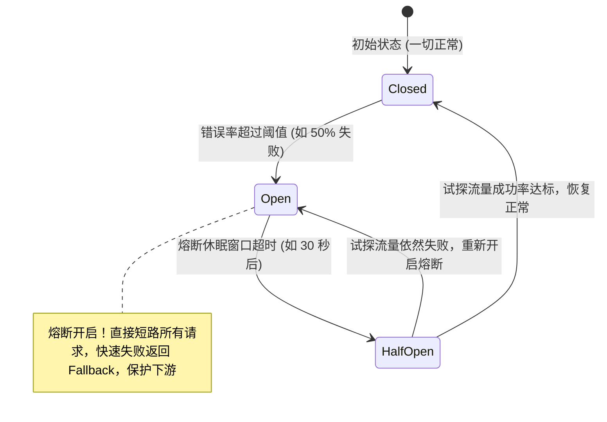
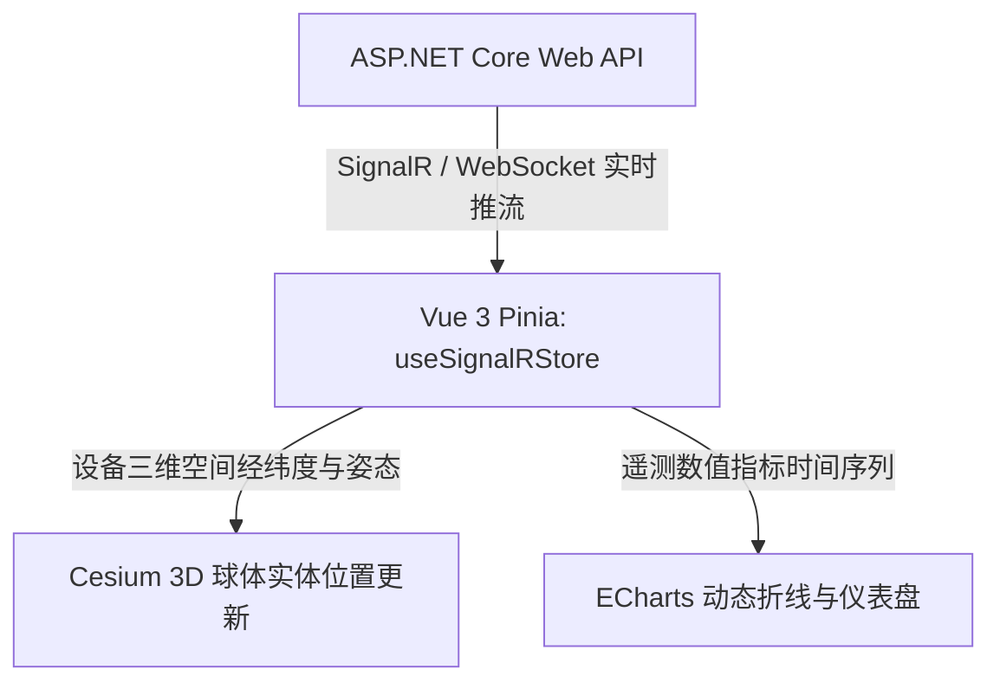

> [!IMPORTANT]
> **本篇定位**：作为系列收官之作，本篇贯通现代化企业级全栈工程师的核心高阶能力：从高并发服务的弹性容错（Polly / RateLimiting）、容器微服务基础设施，到工业 IoT 实时通讯、大模型与 RAG（检索增强生成）智能化赋能，以及全栈协同与自动化质量防御。

<details open class="in-post-toc-card border border-neutral-200/80 dark:border-neutral-700/80 rounded-xl p-4 my-4 bg-neutral-50/50 dark:bg-neutral-800/30">
<summary class="font-bold text-base cursor-pointer select-none text-neutral-800 dark:text-neutral-200 flex items-center justify-between outline-none">
📑 本篇目录（点击收起 / 展开）
</summary>

<div class="max-h-72 overflow-y-auto mt-3 pt-2 border-t border-neutral-200/60 dark:border-neutral-700/60 hide-scrollbar">

## 目录

- [1. 高并发系统弹性容错体系（Polly & .NET 8 RateLimiter）](#1-高并发系统弹性容错体系polly--net-8-ratelimiter)
  - [1.1 熔断降级三态机模型：Closed, Open 与 Half-Open](#11-熔断降级三态机模型closed-open-与-half-open)
  - [1.2 Polly v8 弹性流水线实战：退避重试、熔断与降级回退](#12-polly-v8-弹性流水线实战退避重试熔断与降级回退)
  - [1.3 .NET 8 原生 System.Threading.RateLimiting 工业级限流](#13-net-8-原生-systemthreadingratelimiting-工业级限流)
- [2. 容器化微服务基础设施（Docker & 健康检查）](#2-容器化微服务基础设施docker--健康检查)
  - [2.1 Docker 多阶段构建与 Ubuntu Chiseled 极简镜像瘦身](#21-docker-多阶段构建与-ubuntu-chiseled-极简镜像瘦身)
  - [2.2 企业级 Docker-Compose 综合编排实战](#22-企业级-docker-compose-综合编排实战)
  - [2.3 容器探针：ASP.NET Core 健康检查（Liveness & Readiness）](#23-容器探针aspnet-core-健康检查liveness--readiness)
- [3. 企业级高频实时交互与数据通道（协同办公、大屏、长连接与物联网）](#3-企业级高频实时交互与数据通道协同办公大屏长连接与物联网)
  - [3.1 System.Threading.Channels 高性能无锁生产-消费削峰通道](#31-systemthreadingchannels-高性能无锁生产-消费削峰通道)
  - [3.2 SignalR 生产级实战：WebSocket 升级与分布式 Redis Backplane 扩展](#32-signalr-生产级实战websocket-升级与分布式-redis-backplane-扩展)
  - [3.3 客户端与云端通信链路：HttpClient 弹性流式拉取深度最佳实践](#33-客户端与云端通信链路httpclient-弹性流式拉取深度最佳实践)
- [4. 现代化 AI 赋能：大模型与 RAG 在 .NET 平台落地](#4-现代化-ai-赋能大模型与-rag-在-net-平台落地)
  - [4.1 微软官方 Semantic Kernel 架构与原生 Plugin 扩展](#41-微软官方-semantic-kernel-架构与原生-plugin-扩展)
  - [4.2 联动 Dify / LangChain 构建 RAG 知识库与 Server-Sent Events (SSE) 流式打字机](#42-联动-dify--langchain-构建-rag-知识库与-server-sent-events-sse-流式打字机)
  - [4.3 VibeCoding 工程化落地：AI 辅助编程的研发效能跃升法则](#43-vibecoding-工程化落地ai-辅助编程的研发效能跃升法则)
- [5. 全栈协同、质量工程与企业系统架构演进](#5-全栈协同质量工程与企业系统架构演进)
  - [5.1 前后端全栈协同闭环：Vue 3 Pinia + Router 全套 JWT 鉴权与无感刷新拦截器](#51-前后端全栈协同闭环vue-3-pinia--router-全套-jwt-鉴权与无感刷新拦截器)
  - [5.2 空间数据大屏联动：Vue 3 + Cesium 三维与 ECharts 响应式动态供数](#52-空间数据大屏联动vue-3--cesium-三维与-echarts-响应式动态供数)
  - [5.3 自动化测试防御网：xUnit + Moq + Testcontainers 真实容器集成测试](#53-自动化测试防御网xunit--moq--testcontainers-真实容器集成测试)
  - [5.4 企业级系统（ERP/OA/MES/OTA票务）架构模式与 Code Review 黄金规范](#54-企业级系统erpoamesota票务架构模式与-code-review-黄金规范)

</div>
</details>

---

## 1. 高并发系统弹性容错体系（Polly & .NET 8 RateLimiter）

在分布式与微服务架构中，“网络是不可靠的”是一切设计的先决条件。当下游服务（如第三方支付、物流、内网工控 PLC）响应超时或崩溃时，如果缺乏容错机制，将迅速耗尽上游调用方的线程池资源，导致**雪崩效应（Cascading Failure）**。

### 1.1 熔断降级三态机模型：Closed, Open 与 Half-Open

断路器（Circuit Breaker）是保障系统可用性的最后道闸：



- **Closed（闭合）**：流量正常通行。断路器实时统计失败比率，若失败率超标，立即切换为 Open。
- **Open（断开/熔断）**：拦截所有外部调用，不再发起真实网络请求，直接返回本地降级数据（Fallback），使依赖方免遭流量二次冲击。
- **Half-Open（半开）**：经过设定的冷却期后，允许少量“探针流量”试探下游。若恢复，切换回 Closed；若依然报错，立即重置熔断时长。

---

### 1.2 Polly v8 弹性流水线实战：退避重试、熔断与降级回退

在 .NET 8 中，微软与 Polly 团队推出了全新的 **Polly v8（ResiliencePipeline）**，性能相比旧版提升数倍，并深度与 `Microsoft.Extensions.Resilience` 集成。

```csharp
// 1. 安装 Microsoft.Extensions.Resilience 与 Microsoft.Extensions.Http.Resilience
builder.Services.AddHttpClient("DeviceGatewayClient", client =>
{
    client.BaseAddress = new Uri("https://iot-gateway.internal/");
    client.Timeout = TimeSpan.FromSeconds(10);
})
.AddResilienceHandler("CustomPipeline", pipelineBuilder =>
{
    // 策略 1：并发隔离限制 (Rate Limiter / Bulkhead)
    pipelineBuilder.AddConcurrencyLimiter(100);

    // 策略 2：指数退避重试 (带抖动，防止雷鸣群效应)
    pipelineBuilder.AddRetry(new HttpRetryStrategyOptions
    {
        MaxRetryAttempts = 3,
        BackoffType = DelayBackoffType.Exponential,
        UseJitter = true, // 关键：加入随机抖动
        Delay = TimeSpan.FromMilliseconds(500)
    });

    // 策略 3：断路器 (Circuit Breaker)
    pipelineBuilder.AddCircuitBreaker(new HttpCircuitBreakerStrategyOptions
    {
        SamplingDuration = TimeSpan.FromSeconds(30),
        FailureRatio = 0.5, // 50% 失败率触发熔断
        MinimumThroughput = 20, // 至少采样 20 次请求
        BreakDuration = TimeSpan.FromSeconds(15) // 熔断 15 秒
    });

    // 策略 4：全局超时控制
    pipelineBuilder.AddTimeout(TimeSpan.FromSeconds(3));
});
```

---

### 1.3 .NET 8 原生 System.Threading.RateLimiting 工业级限流

.NET 8 内置了跨平台的强类型限流框架，摆脱了以往依赖第三方库的尴尬，提供了 4 大限流算法：
1. **ConcurrencyLimiter**：限制最大并发执行数（资源保护）。
2. **TokenBucketRateLimiter（令牌桶）**：恒定速率发令牌，允许短时间突发流量（Burst）。
3. **SlidingWindowRateLimiter（滑动窗口）**：精确平滑限流，防止窗口临界点双倍流量。
4. **FixedWindowRateLimiter（固定窗口）**：最简单的基数限流。

#### 生产级多租户/IP 限流中间件配置：

```csharp
builder.Services.AddRateLimiter(options =>
{
    options.RejectionStatusCode = StatusCodes.Status429TooManyRequests;
    
    // 自定义 429 响应报文 (符合 RFC 7807)
    options.OnRejected = async (context, token) =>
    {
        context.HttpContext.Response.ContentType = "application/problem+json";
        await context.HttpContext.Response.WriteAsJsonAsync(new ProblemDetails
        {
            Status = StatusCodes.Status429TooManyRequests,
            Title = "Too Many Requests",
            Detail = "请求频次超标，请稍后重试。"
        }, cancellationToken: token);
    };

    // 基于客户端 IP 的滑动窗口限流策略
    options.AddPolicy("IpSlidingWindow", httpContext =>
    {
        var clientIp = httpContext.Connection.RemoteIpAddress?.ToString() ?? "unknown";
        return RateLimitPartition.GetSlidingWindowLimiter(clientIp, key => new SlidingWindowRateLimiterOptions
        {
            PermitLimit = 100, // 每个时间窗口允许 100 次
            Window = TimeSpan.FromMinutes(1),
            SegmentsPerWindow = 6, // 窗口划分为 6 格 (每格 10 秒)
            QueueProcessingOrder = QueueProcessingOrder.OldestFirst,
            QueueLimit = 10 // 允许排队等待的请求数
        });
    });
});

var app = builder.Build();
app.UseRateLimiter();

// 针对核心结算或下单接口应用限流
app.MapPost("/api/orders/pay", () => Results.Ok("Payment Success"))
   .RequireRateLimiting("IpSlidingWindow");
```

---

## 2. 容器化微服务基础设施（Docker & 健康检查）

### 2.1 Docker 多阶段构建与 Ubuntu Chiseled 极简镜像瘦身

很多初级 Dockerfile 直接使用 `mcr.microsoft.com/dotnet/sdk:8.0` 作为最终运行时，导致构建出的镜像体积高达 **800MB~1.2GB**，严重拖慢 CI/CD 镜像拉取与 K8s Pod 弹性扩容速度。

#### 现代化最佳实践：多阶段构建 + Ubuntu Chiseled 极简运行时
- 编译阶段使用完整 SDK。
- 运行阶段采用微软与 Canonical 联合推出的 **Chiseled（无包管理器、无 shell、非 root、极度安全）** 极简运行时，**最终镜像仅约 80MB-110MB**，攻击面近乎为零！

```dockerfile
# === 阶段 1：编译与发布 ===
FROM mcr.microsoft.com/dotnet/sdk:8.0 AS build
WORKDIR /src

# 先单独拷贝 csproj 文件并 restore，充分利用 Docker 缓存层
COPY ["MyApp.Api/MyApp.Api.csproj", "MyApp.Api/"]
COPY ["MyApp.Core/MyApp.Core.csproj", "MyApp.Core/"]
RUN dotnet restore "MyApp.Api/MyApp.Api.csproj"

# 拷贝全量源码并编译
COPY . .
WORKDIR "/src/MyApp.Api"
RUN dotnet publish "MyApp.Api.csproj" -c Release -o /app/publish \
    --no-restore \
    -p:PublishReadyToRun=true

# === 阶段 2：极简运行时 (Chiseled 安全无 root 镜像) ===
FROM mcr.microsoft.com/dotnet/aspnet:8.0-jammy-chiseled AS final
WORKDIR /app
EXPOSE 8080

# 拷贝阶段 1 的产物
COPY --from=build /app/publish .

# 遵循非 root 用户运行规范
USER $APP_UID
ENTRYPOINT ["dotnet", "MyApp.Api.dll"]
```

---

### 2.2 企业级 Docker-Compose 综合编排实战

在本地研发与私有化部署中，通过 `docker-compose.yml` 快速拉起包含 API、MySQL、Redis 与 RabbitMQ 的全套拓扑：

```yaml
version: '3.8'

services:
  api:
    build:
      context: .
      dockerfile: Dockerfile
    ports:
      - "5000:8080"
    environment:
      - ASPNETCORE_ENVIRONMENT=Production
      - ConnectionStrings__DefaultDb=Server=mysql;Database=erp_db;User=root;Password=SecretPassword123;
      - Redis__ConnectionString=redis:6379,password=RedisSecret123
      - RabbitMQ__HostName=rabbitmq
    depends_on:
      mysql:
        condition: service_healthy
      redis:
        condition: service_started
      rabbitmq:
        condition: service_healthy

  mysql:
    image: mysql:8.0
    command: --default-authentication-plugin=mysql_native_password
    environment:
      MYSQL_ROOT_PASSWORD: SecretPassword123
      MYSQL_DATABASE: erp_db
    ports:
      - "3306:3306"
    volumes:
      - mysql_data:/var/lib/mysql
    healthcheck:
      test: ["CMD", "mysqladmin", "ping", "-h", "localhost"]
      interval: 5s
      timeout: 3s
      retries: 10

  redis:
    image: redis:7.2-alpine
    command: redis-server --requirepass RedisSecret123
    ports:
      - "6379:6379"

  rabbitmq:
    image: rabbitmq:3.13-management-alpine
    ports:
      - "5672:5672"
      - "15672:15672"
    environment:
      RABBITMQ_DEFAULT_USER: admin
      RABBITMQ_DEFAULT_PASS: RabbitSecret123
    healthcheck:
      test: ["CMD", "rabbitmq-diagnostics", "-q", "ping"]
      interval: 10s
      timeout: 5s
      retries: 5

volumes:
  mysql_data:
```

---

### 2.3 容器探针：ASP.NET Core 健康检查（Liveness & Readiness）

Kubernetes 与负载均衡器需要精准探针获知容器状态：
- **Liveness（存活探针）**：当前容器进程是否挂死？若失败，K8s 会直接杀死并重启 Pod。
- **Readiness（就绪探针）**：数据库、Redis、MQ 依赖是否准备就绪？若失败，网关暂停将流量导入此 Pod，但不会重启。

```csharp
// Program.cs
builder.Services.AddHealthChecks()
    .AddCheck("self", () => HealthCheckResult.Healthy(), tags: new[] { "live" })
    .AddMySql(builder.Configuration.GetConnectionString("DefaultDb")!, tags: new[] { "ready" })
    .AddRedis(builder.Configuration["Redis:ConnectionString"]!, tags: new[] { "ready" });

var app = builder.Build();

// 暴露独立的存活与就绪端点供 K8s 探针巡检
app.MapHealthChecks("/health/live", new HealthCheckOptions
{
    Predicate = check => check.Tags.Contains("live")
});

app.MapHealthChecks("/health/ready", new HealthCheckOptions
{
    Predicate = check => check.Tags.Contains("ready"),
    ResponseWriter = UIResponseWriter.WriteHealthCheckUIResponse
});
```

---

## 3. 企业级高频实时交互与数据通道（协同办公、大屏、长连接与物联网）

在现代企业级应用中，高频数据交互无处不在：既包括**协同办公中即时消息通知、在线协同编辑、客服工单实时推流、扫码登录状态双向通知、大促实时订单战报**，也涵盖**工控 MES 遥测上报与智慧水利数字孪生**。系统面临瞬时爆发的写入流量与高并发长连接维持压力。

### 3.1 System.Threading.Channels 高性能无锁生产-消费削峰通道

当面对高频点位上报，**严禁在 Controller 中逐条发起数据库插入或网络请求**。
`System.Threading.Channels` 是 .NET 内部实现的超高性能无锁（Lock-Free）内存队列，吞吐量远超旧式 `BlockingCollection`。

```csharp
// 1. 注册全局有界通道 (限制最大堆积 50,000 条，超出则通过 DropOldest 策略保护内存)
builder.Services.AddSingleton(Channel.CreateBounded<DeviceMetricPayload>(new BoundedChannelOptions(50_000)
{
    FullMode = BoundedChannelFullMode.DropOldest,
    SingleReader = true, // 单消费者极致优化
    SingleWriter = false
}));

// 2. 高频接收 Action：毫秒级投递至内存 Channel，瞬间返回 202 Accepted
[HttpPost("metrics")]
public async Task<IActionResult> IngestMetrics(
    [FromBody] DeviceMetricPayload payload, 
    [FromServices] Channel<DeviceMetricPayload> channel)
{
    await channel.Writer.WriteAsync(payload);
    return Accepted();
}

// 3. 后台批处理 Worker：批量读取并执行 BulkInsert 批量落库
public class MetricsConsumerWorker : BackgroundService
{
    private readonly Channel<DeviceMetricPayload> _channel;
    private readonly IServiceScopeFactory _scopeFactory;

    public MetricsConsumerWorker(Channel<DeviceMetricPayload> channel, IServiceScopeFactory scopeFactory)
    {
        _channel = channel;
        _scopeFactory = scopeFactory;
    }

    protected override async Task ExecuteAsync(CancellationToken stoppingToken)
    {
        var batch = new List<DeviceMetricPayload>(1000);
        while (await _channel.Reader.WaitToReadAsync(stoppingToken))
        {
            // 贪婪拉取当前缓冲区的所有积压数据
            while (_channel.Reader.TryRead(out var item))
            {
                batch.Add(item);
                if (batch.Count >= 1000) break;
            }

            if (batch.Count > 0)
            {
                using var scope = _scopeFactory.CreateScope();
                var db = scope.ServiceProvider.GetRequiredService<AppDbContext>();
                await db.BulkInsertAsync(batch, cancellationToken: stoppingToken);
                batch.Clear();
            }
        }
    }
}
```

---

### 3.2 SignalR 生产级实战：WebSocket 升级与分布式 Redis Backplane 扩展

#### A. 强类型 Hub 契约设计
避免硬编码方法名字符串，通过接口定义客户端方法：

```csharp
public interface IDeviceDashboardClient
{
    Task ReceiveMetricUpdate(string deviceCode, double temperature, double vibration);
    Task ReceiveAlarmAlert(string message, string severity);
}

public class DeviceDashboardHub : Hub<IDeviceDashboardClient>
{
    public async Task JoinWorkshopGroup(string workshopId)
    {
        // 将客户端连接添加到特定车间分组
        await Groups.AddToGroupAsync(Context.ConnectionId, $"Workshop_{workshopId}");
    }
}
```

#### B. 多服务器集群部署与 Redis Backplane（底板总线）
在生产微服务集群部署时，客户端 A 连在 Server 1，客户端 B 连在 Server 2。当 Server 1 上的业务触发群发推送时，如果不使用底板总线，Server 2 上的客户端将无法收到消息。

```csharp
// 通过 Redis 实现跨服务器 SignalR 消息广播
builder.Services.AddSignalR()
    .AddStackExchangeRedis("redis-host:6379,password=Secret", options =>
    {
        options.Configuration.ChannelPrefix = "SignalR_IoT";
    });
```

#### C. Vue 3 + Pinia 生产级 SignalR 客户端封装
前端通过官方包 `@microsoft/signalr` 与后端强类型 Hub 建立全双工长连接，配合 Pinia 进行全局响应式状态同步：

```typescript
// src/stores/useSignalRStore.ts
import { defineStore } from 'pinia';
import { ref } from 'vue';
import * as signalR from '@microsoft/signalr';

export interface DeviceMetric {
  deviceCode: string;
  temperature: number;
  vibration: number;
}

export const useSignalRStore = defineStore('signalr', () => {
  const connection = ref<signalR.HubConnection | null>(null);
  const isConnected = ref(false);
  const metricsMap = ref<Record<string, DeviceMetric>>({});

  // 初始化并建立连接
  const initConnection = async (workshopId: string) => {
    if (connection.value) return;

    connection.value = new signalR.HubConnectionBuilder()
      .withUrl('/api/hubs/device-dashboard', {
        // 动态传递 JWT Token
        accessTokenFactory: () => localStorage.getItem('access_token') || '',
        transport: signalR.HttpTransportType.WebSockets,
        skipNegotiation: true, // 直连 WebSocket 减少一次 HTTP 协商
      })
      // 生产重连策略：立即、2s、5s、10s、30s 后重试
      .withAutomaticReconnect([0, 2000, 5000, 10000, 30000])
      .configureLogging(signalR.LogLevel.Warning)
      .build();

    // 1. 监听后端推流事件
    connection.value.on('ReceiveMetricUpdate', (deviceCode: string, temperature: number, vibration: number) => {
      metricsMap.value[deviceCode] = { deviceCode, temperature, vibration };
    });

    // 2. 监听重连成功事件 (自动重新加入车间分组)
    connection.value.onreconnected(async () => {
      isConnected.value = true;
      await connection.value?.invoke('JoinWorkshopGroup', workshopId);
    });

    connection.value.onclose(() => { isConnected.value = false; });

    try {
      await connection.value.start();
      isConnected.value = true;
      // 加入目标车间组
      await connection.value.invoke('JoinWorkshopGroup', workshopId);
    } catch (err) {
      console.error('SignalR 连接建立失败:', err);
    }
  };

  // 销毁并断开连接
  const stopConnection = async () => {
    if (connection.value) {
      await connection.value.stop();
      connection.value = null;
      isConnected.value = false;
    }
  };

  return { connection, isConnected, metricsMap, initConnection, stopConnection };
});
```

在 Vue 3 组件中挂载与清理：
```vue
<!-- src/views/WorkshopDashboard.vue -->
<script setup lang="ts">
import { onMounted, onUnmounted } from 'vue';
import { useSignalRStore } from '@/stores/useSignalRStore';

const signalRStore = useSignalRStore();

onMounted(() => {
  // 页面进入时建立连接并加入 101 车间
  signalRStore.initConnection('101');
});

onUnmounted(() => {
  // 页面卸载时优雅断开，防止显存与网络连接泄露
  signalRStore.stopConnection();
});
</script>

<template>
  <div class="dashboard">
    <div v-for="(metric, code) in signalRStore.metricsMap" :key="code" class="card">
      <h3>设备: {{ code }}</h3>
      <p>温度: {{ metric.temperature.toFixed(1) }} °C</p>
      <p>振动: {{ metric.vibration.toFixed(2) }} mm/s</p>
    </div>
  </div>
</template>
```

---

### 3.3 工业上位机与云端通信链路：HttpClient 弹性流式拉取深度最佳实践

上位机与云端交互时，大文件（如日志压缩包、固件 OTA 镜像）拉取的标准内存安全范式：

```csharp
public async Task DownloadLargeFirmwareAsync(string downloadUrl, string destinationPath, CancellationToken ct)
{
    var client = _httpClientFactory.CreateClient("ResilientClient");

    // 关键优化：HttpCompletionOption.ResponseHeadersRead
    // 读完 Header 后立即返回，严禁将数 GB 的文件预先缓存在内存中
    using var response = await client.GetAsync(downloadUrl, HttpCompletionOption.ResponseHeadersRead, ct);
    response.EnsureSuccessStatusCode();

    await using var networkStream = await response.Content.ReadAsStreamAsync(ct);
    await using var fileStream = new FileStream(destinationPath, FileMode.Create, FileAccess.Write, FileShare.None, bufferSize: 81920, useAsync: true);

    // 零多余内存占用的流式直接拷贝
    await networkStream.CopyToAsync(fileStream, ct);
}
```

---

## 4. 现代化 AI 赋能：大模型与 RAG 在 .NET 平台落地

在当前技术生态中，大语言模型（LLM）正在深度重构企业系统的交互范式。掌握如何在 .NET 生态中集成 AI 与 RAG 已成为核心竞争力。

```mermaid
flowchart LR
    User[用户自然语言提问] --> API[ASP.NET Core Web API]
    API -->|1. Embedding 向量化| VecDB[(向量数据库 / Milvus / Qdrant)]
    VecDB -->|2. 余弦相似度召回 Top-K 业务文档| API
    API -->|3. 拼装 Prompt 上下文| LLM[DeepSeek / OpenAI 大模型]
    LLM -->|4. 流式 Server-Sent Events (SSE) 输出| API
    API -->|5. 打字机逐字推流| Front[Vue3 / React 前端]
```

### 4.1 微软官方 Semantic Kernel 架构与原生 Plugin 扩展

**Semantic Kernel（SK）** 是微软开源的企业级大模型编排框架（类似 Python 的 LangChain，但提供工业级的 C# 强类型与依赖注入支持）。

```csharp
// 1. 注册 Semantic Kernel 服务
builder.Services.AddKernel();
builder.Services.AddOpenAIChatCompletion("deepseek-chat", endpoint: new Uri("https://api.deepseek.com"), apiKey: "sk-xxx");

// 2. 编写具备 Native Function 的业务插件 (Plugin)
public class IndustrialMaintenancePlugin
{
    [KernelFunction, Description("根据设备编号查询该设备的最新实时告警列表")]
    public async Task<string> GetActiveAlarmsAsync(
        [Description("工业设备编号，如 DEV-1002")] string deviceId, 
        [FromServices] IDeviceAlarmService alarmService)
    {
        var alarms = await alarmService.GetAlarmsByDeviceIdAsync(deviceId);
        return JsonSerializer.Serialize(alarms);
    }
}
```

在控制器中实现**工具自动调用（Function Calling）**：
```csharp
[HttpPost("chat")]
public async Task<IActionResult> ChatWithAi([FromBody] string prompt, [FromServices] Kernel kernel)
{
    // 将业务插件挂载入 Kernel
    kernel.Plugins.AddFromType<IndustrialMaintenancePlugin>("Maintenance");

    // 开启大模型自动规划并调用本地 C# 函数
    var executionSettings = new OpenAIPromptExecutionSettings
    {
        ToolCallBehavior = ToolCallBehavior.AutoInvokeKernelFunctions
    };

    var chatService = kernel.GetRequiredService<IChatCompletionService>();
    var history = new ChatHistory();
    history.AddUserMessage(prompt);

    var response = await chatService.GetChatMessageContentAsync(history, executionSettings, kernel);
    return Ok(new { Answer = response.Content });
}
```

---

### 4.2 联动 Dify / LangChain 构建 RAG 知识库与 Server-Sent Events (SSE) 流式打字机

当企业内部已有搭建好的 **Dify** 或本地知识库时，后端通过 ASP.NET Core 编写流式透传接口，为前端提供无缝打字机体验。

```csharp
[HttpGet("rag/stream")]
public async Task StreamRagAnswer([FromQuery] string query, CancellationToken ct)
{
    // 设置 HTTP 协议头以支持 SSE 流式推流
    Response.Headers.Append("Content-Type", "text/event-stream");
    Response.Headers.Append("Cache-Control", "no-cache");
    Response.Headers.Append("Connection", "keep-alive");

    var client = _httpClientFactory.CreateClient("DifyClient");
    var request = new HttpRequestMessage(HttpMethod.Post, "https://dify.company.internal/v1/chat-messages")
    {
        Content = JsonContent.Create(new { query, response_mode = "streaming", user = "emp-001" })
    };

    using var response = await client.SendAsync(request, HttpCompletionOption.ResponseHeadersRead, ct);
    await using var stream = await response.Content.ReadAsStreamAsync(ct);
    using var reader = new StreamReader(stream);

    while (!reader.EndOfStream && !ct.IsCancellationRequested)
    {
        var line = await reader.ReadLineAsync(ct);
        if (string.IsNullOrWhiteSpace(line)) continue;

        // 透传写入前端 SSE 响应流并实时刷新缓冲区
        await Response.WriteAsync($"{line}\n\n", ct);
        await Response.Body.FlushAsync(ct);
    }
}
```

#### B. Vue 3 前端流式打字机组件实现（Fetch + ReadableStream）
浏览器原生 `EventSource` 仅支持 GET 请求且无法自定义 Header（如携带 Authorization Bearer Token）。在企业级实践中，前端通常使用原生 `fetch` 结合 `ReadableStreamDefaultReader` 逐块解码推流：

```vue
<!-- src/components/AiChatStream.vue -->
<script setup lang="ts">
import { ref } from 'vue';

const queryText = ref('');
const answerContent = ref('');
const isStreaming = ref(false);

const startStreaming = async () => {
  if (!queryText.value.trim() || isStreaming.value) return;

  isStreaming.value = true;
  answerContent.value = '';

  try {
    const response = await fetch(`/api/rag/stream?query=${encodeURIComponent(queryText.value)}`, {
      method: 'GET',
      headers: {
        'Accept': 'text/event-stream',
        'Authorization': `Bearer ${localStorage.getItem('access_token') || ''}`,
      },
    });

    if (!response.ok || !response.body) {
      throw new Error(`HTTP error! status: ${response.status}`);
    }

    // 采用 UTF-8 流解码器
    const reader = response.body.getReader();
    const decoder = new TextDecoder('utf-8');

    while (true) {
      const { done, value } = await reader.read();
      if (done) break;

      // 实时解码二进制块为文本
      const chunk = decoder.decode(value, { stream: true });
      const lines = chunk.split('\n\n');

      for (const line of lines) {
        if (line.startsWith('data:')) {
          const rawData = line.replace('data:', '').trim();
          if (rawData === '[DONE]') break;
          try {
            const parsed = JSON.parse(rawData);
            // 实时追加打字机字符并触发 Vue 响应式 DOM 渲染
            answerContent.value += (parsed.answer || parsed.delta || '');
          } catch {
            // 容错处理纯文本流
            answerContent.value += rawData;
          }
        }
      }
    }
  } catch (err) {
    console.error('SSE 流读取异常:', err);
    answerContent.value += '\n[网络通信中断，请重试]';
  } finally {
    isStreaming.value = false;
  }
};
</script>

<template>
  <div class="chat-container">
    <div class="input-bar">
      <input v-model="queryText" :disabled="isStreaming" placeholder="请输入工业设备排障提问..." @keyup.enter="startStreaming" />
      <button :disabled="isStreaming" @click="startStreaming">
        {{ isStreaming ? '正在生成...' : '发送' }}
      </button>
    </div>
    <div class="output-panel">
      <!-- 呈现打字机内容 -->
      <div class="markdown-body">{{ answerContent }}</div>
      <span v-if="isStreaming" class="cursor-blink">|</span>
    </div>
  </div>
</template>

<style scoped>
.cursor-blink {
  display: inline-block;
  animation: blink 1s infinite;
  font-weight: bold;
}
@keyframes blink { 0%, 100% { opacity: 1; } 50% { opacity: 0; } }
</style>
```

---

### 4.3 VibeCoding 工程化落地：AI 辅助编程的研发效能跃升法则

**VibeCoding（AI 结对工程化）** 并非盲目复制代码，而是建立人机协作的标准化研发流水线：
1. **DDD 骨架与实体快速生成**：给出清晰的业务上下文与表结构约束，引导 AI 快速生成富含领域驱动设计规范的 ValueObject、Entity、AggregateRoot 与 Mapster 映射契约。
2. **测试用例穷举与极端分支覆盖**：利用 AI 根据业务 Action 自动编写覆盖边界情况（如空指针、并发抢占、数值溢出）的 xUnit 单元测试。
3. **架构合规性扫描与 Prompt 约束**：通过为工程定制 `.cursorrules` 或 Antigravity Rules，强制要求 AI 辅助生成的代码必须满足 `AsNoTracking`、`CancellationToken` 贯穿与强类型 DTO 约束，实现团队研发能效的成倍跃升。

---

## 5. 全栈协同、质量工程与企业系统架构演进

### 5.1 前后端全栈协同闭环：Vue 3 Pinia + Router 全套 JWT 鉴权与无感刷新拦截器

在企业级微服务或 SaaS 权限体系中，Access Token（短期如 15 分钟）搭配 Refresh Token（长期如 7 天）是业界标准。前端 Vue 3 必须实现一套完整的状态机闭环：包含 Pinia 用户仓储、Axios 响应拦截无感续期队列、以及 Vue Router 4 全局导航守卫。

#### A. Pinia 用户凭证状态机
```typescript
// src/stores/useUserStore.ts
import { defineStore } from 'pinia';
import { ref } from 'vue';

export const useUserStore = defineStore('user', () => {
  const token = ref<string>(localStorage.getItem('access_token') || '');
  const refreshToken = ref<string>(localStorage.getItem('refresh_token') || '');
  const roles = ref<string[]>([]);

  const setTokens = (newAccessToken: string, newRefreshToken?: string) => {
    token.value = newAccessToken;
    localStorage.setItem('access_token', newAccessToken);
    if (newRefreshToken) {
      refreshToken.value = newRefreshToken;
      localStorage.setItem('refresh_token', newRefreshToken);
    }
  };

  const clearAuth = () => {
    token.value = '';
    refreshToken.value = '';
    roles.value = [];
    localStorage.removeItem('access_token');
    localStorage.removeItem('refresh_token');
  };

  return { token, refreshToken, roles, setTokens, clearAuth };
});
```

#### B. Axios 响应拦截器：401 无感并发刷新队列
当多个请求并发到达但 Access Token 恰好过期时，**只能触发一次向后端的 refresh-token 请求**，其余并发请求必须被挂起推入暂存队列，待新 Token 获取成功后顺序回放：

```typescript
// src/utils/request.ts
import axios, { type AxiosRequestConfig } from 'axios';
import { useUserStore } from '@/stores/useUserStore';

let isRefreshing = false;
let retryQueue: Array<(token: string) => void> = [];

const apiClient = axios.create({
  baseURL: import.meta.env.VITE_APP_BASE_API || '/api',
  timeout: 10000,
});

// 请求拦截器：动态注入最新 Bearer Token
apiClient.interceptors.request.use((config) => {
  const userStore = useUserStore();
  if (userStore.token && config.headers) {
    config.headers.Authorization = `Bearer ${userStore.token}`;
  }
  return config;
});

// 响应拦截器：401 无感自动续期与回放
apiClient.interceptors.response.use(
  (response) => response,
  async (error) => {
    const originalRequest = error.config as AxiosRequestConfig & { _retry?: boolean };
    const userStore = useUserStore();

    if (error.response?.status === 401 && !originalRequest._retry) {
      if (isRefreshing) {
        // 若当前已有请求正在向后端刷新 Token，将当前请求封包挂起推入队列
        return new Promise((resolve) => {
          retryQueue.push((newToken: string) => {
            if (originalRequest.headers) {
              originalRequest.headers.Authorization = `Bearer ${newToken}`;
            }
            resolve(apiClient(originalRequest));
          });
        });
      }

      originalRequest._retry = true;
      isRefreshing = true;

      try {
        // 调用后端刷新凭证接口
        const { data } = await axios.post('/api/auth/refresh-token', {
          refreshToken: userStore.refreshToken,
        });

        const newAccessToken = data.accessToken;
        const newRefreshToken = data.refreshToken;
        userStore.setTokens(newAccessToken, newRefreshToken);

        // 顺序释放队列中所有暂存的挂起请求
        retryQueue.forEach((callback) => callback(newAccessToken));
        retryQueue = [];

        if (originalRequest.headers) {
          originalRequest.headers.Authorization = `Bearer ${newAccessToken}`;
        }
        return apiClient(originalRequest);
      } catch (refreshErr) {
        // 长期凭据彻底失效，清理本地凭证并强行跳转登录页
        retryQueue = [];
        userStore.clearAuth();
        window.location.href = `/login?redirect=${encodeURIComponent(window.location.pathname)}`;
        return Promise.reject(refreshErr);
      } finally {
        isRefreshing = false;
      }
    }

    return Promise.reject(error);
  }
);

export default apiClient;
```

#### C. Vue Router 4 全局前置导航守卫
```typescript
// src/router/permission.ts
import router from '@/router';
import { useUserStore } from '@/stores/useUserStore';

const WHITE_LIST = ['/login', '/404', '/register'];

router.beforeEach(async (to, from, next) => {
  const userStore = useUserStore();

  if (userStore.token) {
    if (to.path === '/login') {
      next({ path: '/' });
    } else {
      // 鉴权角色与权限检查
      const requiredRoles = to.meta.roles as string[] | undefined;
      if (!requiredRoles || requiredRoles.some((r) => userStore.roles.includes(r))) {
        next();
      } else {
        next({ path: '/403' }); // 无权访问
      }
    }
  } else {
    if (WHITE_LIST.includes(to.path)) {
      next();
    } else {
      next(`/login?redirect=${to.path}`);
    }
  }
});
```

#### D. 企业级通用 RBAC 细粒度权限控制：Vue 3 自定义指令 `v-permission`
在 ERP、OA 与 CRM 等管理系统中，除了页面路由拦截外，页面内的“新增、导出、批量删除、审批通过”等操作按钮必须根据用户的具体权限标识（如 `order:export`, `finance:audit`）进行动态渲染：

```typescript
// src/directives/permission.ts
import type { Directive, DirectiveBinding } from 'vue';
import { useUserStore } from '@/stores/useUserStore';

export const permissionDirective: Directive = {
  mounted(el: HTMLElement, binding: DirectiveBinding<string | string[]>) {
    const { value } = binding;
    const userStore = useUserStore();
    const userPermissions = userStore.permissions; // 从后端 JWT Claims 中获取的权限列表

    if (value) {
      const requiredPermissions = Array.isArray(value) ? value : [value];
      const hasPermission = requiredPermissions.some((perm) =>
        userPermissions.includes(perm) || userPermissions.includes('*') // 支持超级管理员通配符
      );

      if (!hasPermission) {
        // 无权限则从 DOM 树中物理移除该按钮节点，彻底防止通过审查元素显示调用
        el.parentNode?.removeChild(el);
      }
    } else {
      throw new Error("使用 v-permission 必须绑定权限标识，如 v-permission=\"['order:delete']\"");
    }
  },
};
```

在管理后台组件中使用：
```vue
<template>
  <div class="action-bar">
    <el-button type="primary" v-permission="'order:create'">新建订单</el-button>
    <el-button type="success" v-permission="['order:export', 'admin']">导出财务报表</el-button>
    <el-button type="danger" v-permission="'order:delete'">危险删除</el-button>
  </div>
</template>
```

---

### 5.2 空间数据大屏联动：Vue 3 + Cesium 三维与 ECharts 响应式动态供数

在智慧水利、工业数字孪生与智慧园区大屏中，前端通常需要联动呈现三维空间地理数据（Cesium）与高频统计图表（ECharts）。



#### A. Cesium 在 Vue 3 中的核心避坑准则与生命周期管理
> [!CAUTION]
> **Vue 3 响应式代理（Proxy）毁灭性陷阱**：
> 坚决禁止将 Cesium 的 `Viewer` 对象赋值给 Vue 的 `ref()` 或 `reactive()`！
> Vue 3 的深度响应式 Proxy 会拦截 Cesium 内部的 WebGL 上下文、矩阵计算原型链以及数百个隐藏属性，导致页面帧率从 60 FPS 骤降至 5 FPS，并在更新实体时抛出 `TypeError: 'get' on proxy: property is read-only`，甚至引发毁灭性的 GPU 显存泄漏！
> **正确解法**：必须使用 **`shallowRef`** 或 **`markRaw`**，切断 Vue 的 Proxy 深度代理。

```vue
<!-- src/components/CesiumTwinViewer.vue -->
<script setup lang="ts">
import { onMounted, onBeforeUnmount, shallowRef, watch } from 'vue';
import * as Cesium from 'cesium';
import { useSignalRStore } from '@/stores/useSignalRStore';

const cesiumContainer = shallowRef<HTMLDivElement | null>(null);
// 关键点：使用 shallowRef 规避深度响应式代理
const viewer = shallowRef<Cesium.Viewer | null>(null);
const signalRStore = useSignalRStore();

onMounted(() => {
  if (!cesiumContainer.value) return;

  // 初始化 Cesium 球体
  viewer.value = new Cesium.Viewer(cesiumContainer.value, {
    terrainProvider: undefined,
    animation: false,
    timeline: false,
    baseLayerPicker: false,
    geocoder: false,
  });

  // 视角定位到厂区中心
  viewer.value.camera.flyTo({
    destination: Cesium.Cartesian3.fromDegrees(120.15, 30.28, 1500),
  });
});

// 监听 Pinia 中后端推送的遥测点位数据，动态刷新三维空间中的设备实体
watch(
  () => signalRStore.metricsMap,
  (metrics) => {
    if (!viewer.value) return;

    for (const [deviceCode, data] of Object.entries(metrics)) {
      let entity = viewer.value.entities.getById(deviceCode);
      if (!entity) {
        // 创建新的 3D 点位模型
        entity = viewer.value.entities.add({
          id: deviceCode,
          position: Cesium.Cartesian3.fromDegrees(120.15, 30.28, 10),
          point: { pixelSize: 12, color: Cesium.Color.GREEN },
          label: { text: deviceCode, font: '14px sans-serif' },
        });
      }

      // 根据温度指标动态变更渲染颜色 (告警变红)
      if (entity.point) {
        entity.point.color = (data.temperature > 80 ? Cesium.Color.RED : Cesium.Color.GREEN) as any;
      }
    }
  },
  { deep: true }
);

onBeforeUnmount(() => {
  // 关键：彻底销毁 WebGL 上下文，释放显存
  if (viewer.value && !viewer.value.isDestroyed()) {
    viewer.value.destroy();
    viewer.value = null;
  }
});
</script>

<template>
  <div ref="cesiumContainer" class="cesium-viewport"></div>
</template>

<style scoped>
.cesium-viewport { width: 100%; height: 100%; min-height: 500px; }
</style>
```

#### B. ECharts 响应式防抖重绘与数据流对接
在生产大屏中，浏览器窗口拉伸缩放必须触发图表 `resize`。使用 `ResizeObserver` 配合防抖（Debounce）函数，避免频繁触发重排（Reflow）：

```vue
<!-- src/components/TelemetryChart.vue -->
<script setup lang="ts">
import { ref, onMounted, onBeforeUnmount, watch } from 'vue';
import * as echarts from 'echarts';
import { useSignalRStore } from '@/stores/useSignalRStore';

const chartDom = ref<HTMLDivElement | null>(null);
let myChart: echarts.ECharts | null = null;
let resizeObserver: ResizeObserver | null = null;

const signalRStore = useSignalRStore();
const timeSeriesData = ref<number[]>([]);

onMounted(() => {
  if (!chartDom.value) return;
  myChart = echarts.init(chartDom.value);

  myChart.setOption({
    title: { text: '实时设备温度流 (SignalR)' },
    tooltip: { trigger: 'axis' },
    xAxis: { type: 'category', data: [] },
    yAxis: { type: 'value', min: 0, max: 120 },
    series: [{ name: '温度', type: 'line', smooth: true, data: [] }],
  });

  // 基于 ResizeObserver 实现自适应防抖重绘
  resizeObserver = new ResizeObserver(() => {
    myChart?.resize();
  });
  resizeObserver.observe(chartDom.value);
});

// 监听推流数据，增量更新 ECharts 视图
watch(
  () => signalRStore.metricsMap['DEV-1001']?.temperature,
  (newTemp) => {
    if (newTemp === undefined || !myChart) return;
    timeSeriesData.value.push(newTemp);
    if (timeSeriesData.value.length > 20) timeSeriesData.value.shift();

    myChart.setOption({
      series: [{ data: timeSeriesData.value }],
    });
  }
);

onBeforeUnmount(() => {
  resizeObserver?.disconnect();
  myChart?.dispose();
  myChart = null;
});
</script>

<template>
  <div ref="chartDom" class="chart-container"></div>
</template>

<style scoped>
.chart-container { width: 100%; height: 350px; }
</style>
```

---

### 5.3 自动化测试防御网：xUnit + Moq + Testcontainers 真实容器集成测试

只写 CRUD 不写测试是系统随迭代逐渐演变为“难以维护泥球”的根因。

#### 现代化测试三阶梯：
1. **单元测试（Unit Test）**：针对领域逻辑核心算法，使用 **xUnit + FluentAssertions**。
2. **Mock 隔离测试**：针对服务层，使用 **Moq** 模拟外部接口。
3. **集成测试（Integration Test - 终极方案）**：使用 **Testcontainers for .NET**。在本地测试运行时，通过 Docker 自动拉起真实的临时 MySQL / Redis 容器执行测试，测试完成后自动销毁，彻底消除“在内存数据库中测试通过、生产真实 SQL 报错”的痛点！

```csharp
public class OrderApiIntegrationTests : IAsyncLifetime
{
    // 自动在 Docker 中拉起真正的 MySQL 8.0 容器
    private readonly MySqlContainer _mySqlContainer = new MySqlBuilder()
        .WithImage("mysql:8.0")
        .Build();

    public async Task InitializeAsync() => await _mySqlContainer.StartAsync();
    public async Task DisposeAsync() => await _mySqlContainer.DisposeAsync();

    [Fact]
    public async Task CreateOrder_WithValidPayload_Returns201Created()
    {
        // 动态将真实容器连接字符串注入 WebApplicationFactory
        var factory = new WebApplicationFactory<Program>().WithWebHostBuilder(builder =>
        {
            builder.ConfigureServices(services =>
            {
                services.RemoveAll<DbContextOptions<AppDbContext>>();
                services.AddDbContext<AppDbContext>(opt => 
                    opt.UseMySql(_mySqlContainer.GetConnectionString(), ServerVersion.AutoDetect(_mySqlContainer.GetConnectionString())));
            });
        });

        var client = factory.CreateClient();
        var response = await client.PostAsJsonAsync("/api/orders", new CreateOrderDto { Amount = 199.9m });

        response.StatusCode.Should().Be(HttpStatusCode.Created);
    }
}
```

---

### 5.4 企业级系统（ERP/OA/MES/OTA票务）架构模式与 Code Review 黄金规范

在现代化全栈系统（无论是通用的企业 ERP/OA/CRM，还是高并发垂直领域的 OTA 机票电商）中，业务复杂度的治理是系统能否持续稳定演进的分水岭。

#### A. 核心行业架构专栏：OTA / 航司 / 机票代理与 GDS 系统核心业务架构
针对高并发票务与 OTA（Online Travel Agency）场景，必须掌握航空旅游业的核心业务模型：
1. **PNR（Passenger Name Record，旅客订座记录）生命周期**：
   - 航司系统与 GDS（全球分销系统，如 TravelSky 中航信、Amadeus、Sabre）通过 6 位大写字母/数字编码建立订座。
   - **核心要素（PRINT 六要素）**：Phone（联系方式）、Received-from（订座来源）、Itinerary（航段与航班/舱位）、Name（乘机人姓名/证件）、Ticketing-time-limit（出票时限）、Special Service Request（特殊服务）。
   - **状态机流转**：从订座占位（HK）、等待出票（TK）、已出票（RR）到取消/超时释放（XX）。
2. **动态运价计算引擎（Pricing Engine）**：
   - 航班票价并非静态数据库字段，而是由运价引擎基于航段、舱位等级（F/J/Y/B/M 等）、客票类型、预售天数、航司协议代码与燃油机建附加费（YQ/CN）实时动态算价。
   - **高并发防线**：运价接口 QPS 往往高达订座下单的 100 倍以上。核心架构必须采用 Redis 缓存航班基础运价，配合 gRPC 内部微服务调用实时校验舱位可用性（AV 指令），最后通过本地消息表实现订座成功后的异步出票。
3. **E-Ticket（电子客票）与票联状态闭环**：
   - 电子客票为 13 位标准数字（前 3 位为航司三字结算代码，如国航 999，东航 781；后 10 位为流水号）。
   - **票联核心状态**：`OPEN FOR USE`（可用待乘机） $\rightarrow$ `CHECKED IN`（已值机） $\rightarrow$ `USED/FLOWN`（已使用）。
   - **退改签业务**：涉及 **Void（当日作废）**、**Refund（退票退款）**、**Reissue / Exchange（改期换开新客票）**。必须在支付结算微服务与 GDS 出票微服务之间采用 Saga 柔性事务，确保“扣款成功但出票失败”时能够自动化触发全额原路退款或人工兜底告警。

#### B. 通用企业信息化系统（ERP / OA / CRM / MES）核心设计模式
1. **多租户（Multi-Tenancy）全局数据隔离**：
   - 采用“共享数据库、共享表架构、租户字段隔离（TenantId）”。
   - 利用 EF Core 的全局查询过滤器（Global Query Filter），在 `DbContext` 层面自动附加租户过滤，防止业务代码遗漏 `WHERE TenantId = xxx` 导致跨企业数据泄露：
     ```csharp
     protected override void OnModelCreating(ModelBuilder modelBuilder)
     {
         // 自动为所有实现 ITenantEntity 的实体附加全局租户过滤
         foreach (var entityType in modelBuilder.Model.GetEntityTypes())
         {
             if (typeof(ITenantEntity).IsAssignableFrom(entityType.ClrType))
             {
                 var parameter = Expression.Parameter(entityType.ClrType, "e");
                 var filter = Expression.Lambda(
                     Expression.Equal(
                         Expression.Property(parameter, nameof(ITenantEntity.TenantId)),
                         Expression.Property(Expression.Constant(this), nameof(CurrentTenantId))
                     ),
                     parameter);
                 modelBuilder.Entity(entityType.ClrType).HasQueryFilter(filter);
             }
         }
     }
     ```
2. **审批流状态机（Workflow State Machine）**：
   - 严禁使用硬编码的 `if-else` 维护多级审批（草稿 $\rightarrow$ 部门经理审批 $\rightarrow$ 财务审核 $\rightarrow$ 归档/驳回）。
   - 推荐使用状态模式（State Pattern）或开源工作流组件（如 Elsa Workflows），将审批规则、会签、加签与驳回抽象为有向无环图（DAG），解耦业务实体与流程流转。

#### C. 系统架构演进三阶段建议路径：
1. **阶段一：模块化单体（Modular Monolith）**
   - 绝大多数中大型系统在 QPS < 50,000 时，强拆几十个微服务只会带来灾难性的运维网络复杂度。
   - 最佳实践：单一物理进程，内部通过项目程序集（`Orders.Module`, `Inventory.Module`）严格分层隔离，各模块拥有独立的数据上下文与领域服务，通过内存事件通道通信。
2. **阶段二：读写分离与核心服务垂直剥离**
   - 将报表查询、大屏展示走独立只读副本；将高频核心模块（如支付中心、订单中心、运价中心）单独提取为微服务。
3. **阶段三：全面微服务与云原生（Cloud-Native）**
   - 引入 K8s 编排、服务网格（Service Mesh）、分布式链路追踪（OpenTelemetry）与统一 API 网关（YARP）。

#### D. 企业级 Code Review 黄金检查清单：
- [ ] **异步贯彻**：是否存在 `.Result`、`.Wait()` 或 `GetAwaiter().GetResult()` 引发的线程锁死风险？
- [ ] **资源释放**：所有的 `Stream`、`DbContext`、`IDisposable` 是否使用 `using` 或 `await using` 安全包裹？
- [ ] **作用域安全**：是否存在单例（Singleton）中直接注入 Scoped 服务的单例捕获陷阱？
- [ ] **数据库查询**：所有只读查询是否都声明了 `AsNoTracking()`？是否存在 1+N 延迟加载循环？
- [ ] **幂等与并发**：核心状态变更操作是否设计了乐观并发控制或 Redis 幂等防重？
- [ ] **租户隔离**：多租户实体是否严格继承租户接口并受全局过滤器管控？
- [ ] **日志合规**：异常日志是否完整记录了堆栈信息与上下文业务参数？是否避免了在生产日志中打印明文密码与身份证信息？
