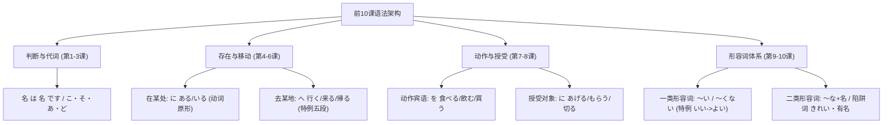

# 《新标日》初级上册核心语法精讲（第1~10课）

> 本文紧扣《新版 中日交流标准日本语》初级上册的编排节奏，精选**前 10 课**的核心语法。去除了死板的机械生词表，专注于“句型公式 + 助词本质 + 易懂解析”。
> **特别强化**：遇到动词或形容词时，同步梳理其**原形（辞书形）**、词类判定、特例陷阱与常用衍生扩展，让你不仅会背句型，更能看透日语活用的底层逻辑！

---

## 目录导览
- **第 1 课**：李さんは中国人です（名词判断句与「は・の」）
- **第 2 课**：これは本です（指示代词与「こ・そ・あ・ど」）
- **第 3 课**：ここがデパートです（场所表达与方位进阶）
- **第 4 课**：部屋に机といすがあります（存在句与动词原形「ある・いる」）
- **第 5 课**：森さんは７時に起きます（时间点、动词时态与原形分类初识）
- **第 6 课**：吉田さんは来月中国へ行きます（移动动词、工具与特例五段「帰る」）
- **第 7 课**：李さんは毎日コーヒーを飲みます（宾语「を」、动作场所与劝诱表达）
- **第 8 课**：李さんは小野さんに花をあげました（授受动词、手段与特例「切る」）
- **第 9 课**：四川料理は辛いです（一类形容词活用体系与特例「いい」）
- **第 10 课**：京都の紅葉は有名です（二类形容词活用与易混淆假名陷阱）

---

## 第 1 课：李さんは中国人です（小李是中国人）

> 本课是日语的敲门砖，核心是**名词谓语句（判断句）**。

### 1. 核心句型公式

| 句型分类 | 句型结构 | 含义 | 典型例句 |
| :--- | :--- | :--- | :--- |
| **肯定句** | `名1 は 名2 です` | 名1 是 名2 | 私は学生です。（我是学生。） |
| **否定句** | `名1 は 名2 ではありません` | 名1 不是 名2 | 彼は先生ではありません。（他不是老师。） |
| **疑问句** | `名1 は 名2 ですか` | 名1 是 名2 吗？ | あなたは王さんですか。（你是小王吗？） |
| **所属/修饰** | `名1 の 名2` | 名1 的 名2 | 日本の車 / 私の鍵（日本的车 / 我的钥匙） |

### 2. 助词极简解析
- **`は`（读作 wa）**：**主题提示助词**。它就像舞台上的聚光灯，打在前面的名词上：“关于前面这个人/事物嘛，接下来我要说明……”。
- **`か`**：**疑问助词**。日语疑问句不需要倒装语序，直接在句末加上「か」并带升调，相当于中文的“吗”。
- **`の`**：相当于中文的“的”，用于连接两个名词（属性、国籍、所属关系均可）。

### 3. 【原形与扩展】
- **「です」的原形（简体）**：
  - 「です」是敬体（礼貌体）。在朋友、家人等熟人闲聊时，它的原形（常体/简体）是 **`だ`**。
  - 否定「ではありません」的简体原形是 **`ではない`**（口语常说 **`じゃない`**）。
- **人称称呼后缀拓展**：
  - `～さん`：最通用的尊称（男女皆可，相当于某某先生/女士）。**注意：称呼自己绝对不能加さん！**
  - `～君（くん）`：常用于称呼男性晚辈、同学、后辈。
  - `～ちゃん`：常用于称呼小孩、小女孩、可爱的宠物或极其亲昵的女性好友。
  - 疑问词：询问“谁”为 `誰（だれ）`，更礼貌的敬称是 `どなた`。

---

## 第 2 课：这是书（指示代词体系）

> 本课建立起日语非常严密的**事物指示系统**。

### 1. 核心句型公式

| 句型分类 | 句型结构 | 含义 | 典型例句 |
| :--- | :--- | :--- | :--- |
| **指示代词句** | `これ / それ / あれ は 名 です` | 这个/那个/那是… | これは辞書です。（这是词典。） |
| **连体词修饰** | `この / その / あの ＋ 名 は ～ です` | 这部/那本…是… | この本は私のです。（这本书是我的。） |
| **选择疑问句** | `A ですか、B ですか` | 是 A 还是 B？ | これはペンですか、鉛筆ですか。（这是钢笔还是铅笔？） |

### 2. 「こ・そ・あ・ど」空间对应法则

日语的指示词根据与说话双方的距离划分得极为清楚：

```
[说话人] ---靠近说话人---> これ / この（近称）
[听话人] ---靠近听话人---> それ / その（中称）
[远  处] ---远离双方-----> あれ / あの（远称）
[不明确] ---未知提问-----> どれ / どの（疑问词）
```

> **口诀对比**：
> - `これ / それ / あれ / どれ` 本身就是**独立名词代词**，后面直接接助词（例：**これは**何ですか）。
> - `この / その / あの / どの` 是**连体词**，**屁股后面必须紧跟名词**，不能单独使用（例：**このカメラ**はいくらですか）。

### 3. 【原形与扩展】
- **回答确认事实**：
  - 别人问你“这是小李的吗？”，如果正确，常用：`そうです`（原形简体：`そうだ`）。
  - 如果不正确，礼貌回答：`いいえ、ちがいます`（原形是动词 **`違う（ちがう）`**，意思是“不一致、搞错了”）。
- **疑问词「何」的读音奥秘**：
  - 后面接「です、の、量词」时读作 **`なん`**（例：何（なん）ですか、何（なん）の本）。
  - 后面接其他助词或单独用时多读作 **`なに`**（例：何（なに）が）。

---

## 第 3 课：这里是大学（场所与方位进阶）

> 本课从“指物”拓展到了**“指场所、方向与敬语”**。

### 1. 核心句型公式

| 句式结构 | 含义 | 典型例句 |
| :--- | :--- | :--- |
| `ここ / そこ / あそこ は 名（场所）です` | 这里/那里是某地 | ここは教室です。（这里是教室。） |
| `名 は 名（场所）です` | 某人/某物在某地 | トイレはあそこです。（洗手间在那里。） |
| `名 も 名 です` | 某人/某物也是… | 私も中国人です。（我也是中国人。） |

### 2. 场所与方向代词速查

| 系列 | 场所（普通口语） | 方向 / 场所敬称 / 称人敬称 |
| :--- | :--- | :--- |
| **近称** | **ここ**（这里） | **こちら**（这边 / 这位 / 我公司） |
| **中称** | **そこ**（那里） | **そちら**（那边 / 那位 / 贵公司） |
| **远称** | **あそこ**（那里） | **あちら**（那边 / 那位） |
| **疑问** | **どこ**（哪里） | **どちら**（哪边 / 哪位 / 哪个学校或国家） |

### 3. 【原形与扩展】
- **「どちら」的超强敬语功能**：
  - 问对方的国家/公司：“您是哪个国家的？”不要说“あなたの国はどこですか”（不礼貌），而要说：
    `お国（くに）はどちらですか。`（礼貌、高雅）。
  - 介绍身边的人：“这位是小李”：`こちらは李さんです。`
- **助词「も」的拓展**：
  - 表达“也”：彼も学生です。（他也是学生。）
  - 后续第6课将学到“完全否定”：`疑问词 ＋ も ＋ 否定`（如：誰もいません 一个人也没有）。

---

## 第 4 课：房间里有桌子和椅子（存在句与动词原形初现）

> 本课开始**正式接触日语动词**，建立起日语最核心的“存在句”逻辑。

### 1. 核心句型公式

| 存在类型 | 主语特征 | 句式 1（某处有某物） | 句式 2（某物在某处） |
| :--- | :--- | :--- | :--- |
| **事物/植物** | **无自主生命意志** | `[场所] に [物体] が あります` | `[物体] は [场所] に あります` |
| **人 / 动物** | **有自主活动意志** | `[场所] に [人/动物] が います` | `[人/动物] は [场所] に います` |

> **例句对比**：
> - 庭に犬が**います**。（院子里有狗。—— 狗是动物，会动）
> - 部屋にテレビが**あります**。（房间里有电视。—— 电视是物品）
> - 李さんは事務所に**います**。（小李在办公室。）
> - 鍵は机の上に**あります**。（钥匙在桌子上。）

### 2. 助词「に」与「と / や」
- **`に`**：**存在的位置点**（附着点），相当于在某个地点“钉下钉子”。
- **`が`**：提示客观存在的自然现象或新发现的主体。
- **`と`**：完全列举（A 和 B，只有这两个）。
- **`や`**：不完全列举（A 和 B 等等，暗示还有其他东西）。

### 3. 【动词原形与分类扩展】
本课是日语动词的第一次重大考验，务必牢记两个最基本的存在动词：

| 敬体形态（ます形） | 原形（辞书形） | 动词类别 | 否定原形（简体） | 常见特例/注意事项 |
| :--- | :--- | :--- | :--- | :--- |
| **あります** | **ある** | **一类动词（五段）** | **ない**（★ 特例！） | **绝不能变あらない！**「ある」的原形否定直接就是「ない」 |
| **います** | **いる** | **二类动词（一段）** | **いない** | 去掉词尾「る」变「ない」 |

- **方位词组合公式**：
  `[名词] の 上（うえ）/ 下（した）/ 前（まえ）/ 後ろ（うしろ）/ 中（なか）/ 隣（となり）/ 近く（ちかく）`
  例：本棚の**隣に**あります。（在书架旁边。）

---

## 第 5 课：森先生 7 点起床（时间点、动词时态与原形）

> 本课正式引入**动词的四大时态敬体**以及动作发生的时间标记。

### 1. 核心句型公式

| 语法点 | 句式结构 | 典型例句 |
| :--- | :--- | :--- |
| **发生时间点** | `[具体数字时间] に 动词` | 私は毎朝7時**に**起きます。（我每天早上7点起床。） |
| **起点与终点** | `[时间/地点] から [时间/地点] まで` | 会社は9時**から**5時**まで**です。（公司从9点到5点。） |

> **「に」的加与不加**：
> - **必须加「に」**：带具体数字的时间（例：7時に、月曜日に、10月10日に）。
> - **绝不能加「に」**：相对时间词（例：今日、明日、昨日、毎日、毎朝、今）。

### 2. 动词四大时态敬体（ます体系）

| 时态 | 句尾标志 | 含义 | 例句（働く・工作） |
| :--- | :--- | :--- | :--- |
| **现在/将来 肯定** | `～ます` | 做 / 将要做 | 働きます（工作） |
| **现在/将来 否定** | `～ません` | 不做 / 将不做 | 働きません（不工作） |
| **过去 肯定** | `～ました` | 做了（已完成） | 働きました（工作过了） |
| **过去 否定** | `～ませんでした` | 过去没做 | 働きませんでした（没工作） |

### 3. 【动词原形与类别判定】
日语动词在词典里全是以**原形（辞书形，词尾在「う段」）**记录的。本课高频动词原形如下：

| ます形 | 原形（辞书形） | 动词分类 | 分类判定原因 | 词义 |
| :--- | :--- | :--- | :--- | :--- |
| **起きます** | **起きる（おきる）** | **二类动词** | 词尾是「る」，前一个假名「き」在 **い段** | 起床 |
| **寝ます** | **寝る（ねる）** | **二类动词** | 词尾是「る」，前一个假名「ね」在 **え段** | 睡觉 |
| **働きます** | **働く（はたらく）** | **一类动词** | 原形词尾是「く」，不是「る」 | 工作 |
| **休みます** | **休む（やすむ）** | **一类动词** | 原形词尾是「む」，不是「る」 | 休息 |
| **終わります** | **終わる（おわる）** | **一类动词** | 词尾虽然是「る」，但前一个假名「わ」在 **あ段** | 结束 |
| **勉強します** | **勉強する** | **三类动词** | 动作名词 ＋ **する**（サ变动词） | 学习 |

> **动词变形启蒙规则（一类动词）**：
> 一类动词在变「ます形」时，把词尾的**う段假名**变为**い段假名**再加「ます」：
> `働（く・ku）➔ 働（き・ki）ます`、`休（む・mu）➔ 休（み・mi）ます`。

---

## 第 6 课：吉田先生下个月去中国（移动动词与交通工具）

> 本课学习三大最核心的**移动动词**，以及交通工具、同行伙伴的表达。

### 1. 核心句型公式

| 语法点 | 句式结构 | 典型例句 |
| :--- | :--- | :--- |
| **移动目的地** | `[场所] へ 移动动词` *(へ 读音为 e)* | 来月日本**へ**行きます。（下个月去日本。） |
| **交通工具/方式** | `[交通工具] で 移动动词` | 新幹線**で**行きます。（坐新干线去。） |
| **伴随者/同伴** | `[人] と 移动动词` | 友達**と**帰ります。（和朋友一起回去。） |
| **全面否定** | `どこへも ＋ 移动动词否定` | 昨日はどこへも行きませんでした。（昨天哪都没去。） |

### 2. 助词辨析
- **`へ`（读作 e）**：表示移动的**方向与归着点**，就像一只箭头指向目的地（口语中经常也可用 `に` 代替）。
- **`で`**：表示**手段、工具、交通方式**（通过什么方式去）。
- **`と`**：表示共同行动的**对象**（和谁一起）。注意：自己一个人去时说 `一人（ひとり）で 行きます`，这里用「で」表示单人状态，不能用「と」。

### 3. 【动词原形与特例扩展】
本课包含日语最重要的三个移动动词，其中包含初学者的第一大“陷阱词”：

| ます形 | 原形（辞书形） | 动词类别 | 特别注意点 |
| :--- | :--- | :--- | :--- |
| **行きます** | **行く（いく）** | **一类动词** | 原形词尾为「く」。后续学“て形”时为特例促音便（行って） |
| **来ます（きます）** | **来る（くる）** | **三类动词（カ变）** | 极特殊的动词，原形读音为 **ku**ru，敬体读音变 **ki**masu |
| **帰ります** | **帰る（かえる）** | **★ 特例一类动词！** | **重点陷阱！** 外表倒数第二个字是「え（え段）」，极像二类动词，但它**骨子里是一类动词**！必须按五段活用变成帰ります（不是かえます） |

- **交通方式特例**：
  “步行去”不能说 `歩きで行きます`，而要说：**`歩いて行きます`**（原形动词是 `歩く（あるく）`，用的是其连用接续形）。

---

## 第 7 课：小李每天喝咖啡（动作宾语、动作场所与劝诱）

> 从这节课开始，日语真正进入了**他动词宾语动作句**，句型大大丰富。

### 1. 核心句型公式

| 语法点 | 句式结构 | 典型例句 |
| :--- | :--- | :--- |
| **动作直接宾语** | `[名词] を 他动词` *(を 读作 o)* | コーヒー**を**飲みます。（喝咖啡。） |
| **动作发生场所** | `[场所] で 动词` | 図書館**で**本を読みます。（在图书馆看书。） |
| **提议与劝诱** | `动词（去ます） ＋ ませんか` | 一緒にお茶を飲み**ませんか**。（要不要一起喝杯茶？） |
| **积极响应号召** | `动词（去ます） ＋ ましょう` | ええ、飲み**ましょう**。（好啊，一起喝吧！） |

### 2. 核心助词「で」vs「に」的本质区别
初学者最容易混淆「で」和「に」，牢记这一句即可：
- **`场所 ＋ に ＋ 存在动词`**：表示“静止的存在”（例：教室**に**学生がいます —— 教室里**有**学生）。
- **`场所 ＋ で ＋ 动作动词`**：表示“在某地进行动态活动”（例：教室**で**勉強します —— 在教室里**学习**）。

### 3. 【动词原形与扩充】
本课汇聚了日常生活中最常用的及物动词：

| ます形 | 原形（辞书形） | 动词分类 | 词义 | 原形活用小技巧 |
| :--- | :--- | :--- | :--- | :--- |
| **食べます** | **食べる（たべる）** | **二类动词** | 吃 | 去掉词尾「る」直接加ます |
| **飲みます** | **飲む（のむ）** | **一类动词** | 喝 | mu ➔ mi + ます |
| **買います** | **買う（かう）** | **一类动词** | 买 | u ➔ i + ます |
| **見ます** | **見る（みる）** | **二类动词** | 看 | 去掉「る」直接加ます |
| **聞きます** | **聞く（きく）** | **一类动词** | 听 / 问 | ku ➔ ki + ます |
| **読みます** | **読む（よむ）** | **一类动词** | 读 | mu ➔ mi + ます |
| **書きます** | **書く（かく）** | **一类动词** | 写 | ku ➔ ki + ます |
| **撮ります** | **撮る（とる）** | **一类动词** | 拍照 | ru ➔ ri + ます |

- **提议句型扩展**：
  - `～ませんか`：以委婉的否定疑问语气询问对方意愿（“要不要一起…？”），给对方留拒绝的余地，极其礼貌。
  - `～ましょう`：积极的提议或应答（“让我们一起…吧！”）。

---

## 第 8 课：小李送了花给小野女士（授受动词与手段）

> 本课深入学习日语中极具特色的**“物体的给予与接受”**，以及工具手段表达。

### 1. 核心句型公式

| 句型含义 | 句式结构 | 典型例句 |
| :--- | :--- | :--- |
| **我方给予他人（送出）** | `名1 は 名2 に 物 を あげます` | 私は小野さん**に**プレゼントを**あげました**。（我送了礼物给小野。） |
| **从他人处得到（接收）** | `名1 は 名2 に/から 物 を もらいます` | 私は森さん**に**本を**もらいました**。（我从小森那里得到了书。） |
| **工具/手段/语言材料** | `[工具/语言] で 动词` | 日本語**で**手紙を書きます。（用日语写信。） |
| **完成状态与尚未完成** | `もう 动词ました` / `まだです` | もう昼ご飯を食べましたか。— いいえ、**まだです**。（吃过午饭了吗？— 还没呢。） |

> **关键点**：
> - 给予他人（あげます）时，**接受者后面加「に」**（表示动作的目标指向）。
> - 从他人处获得（もらいます）时，**给予者后面加「に」或「から」**（表示来源）。
> - **注意**：第8课的「あげます」仅用于“自己给别人”或“别人给别人”，**绝对不能用于别人送给自己**（别人送给我后续会学「くれます」）。

### 2. 【动词原形与特例扩展】

| ます形 | 原形（辞书形） | 动词类别 | 特别说明 |
| :--- | :--- | :--- | :--- |
| **あげます** | **あげる** | **二类动词** | 给（词尾是る，前是げ在え段） |
| **もらいます** | **もらう** | **一类动词** | 得到、领受（词尾是う） |
| **切ります** | **切る（きる）** | **★ 特例一类动词！** | **重点陷阱！** 外表像二类，实际是一类！词尾 ru 变 ri 加ます |
| **貸します** | **貸す（かす）** | **一类动词** | **借出**（把我的东西借给别人） |
| **借ります** | **借りる（かりる）** | **二类动词** | **借入**（向别人借东西） |
| **教えます** | **教える（おしえる）** | **二类动词** | **教导**（输出知识） |
| **習います** | **習う（ならう）** | **一类动词** | **学习**（向他人请教习得） |

- **手段的「で」拓展**：
  - `箸（はし）で 食べます。`（用筷子吃。）
  - `メールで 送ります。`（用邮件发送。）

---

## 第 9 课：四川菜很辣（一类形容词活用体系）

> 日语的两大词性支柱是“动词”和“形容词”。从本课开始全面攻克**一类形容词（い形容词）**。

### 1. 什么是一类形容词？
原形词尾**必须且必定以假名「い」结尾**，用于表示事物的性质、状态或情感（如：高い、安い、辛い、甘い、新しい、古い）。

### 2. 一类形容词四大时态变形总览（以「辛い・からい・辣」为例）

| 状态时态 | 变形规则 | 敬体形态 | 简体原形 | 中文含义 |
| :--- | :--- | :--- | :--- | :--- |
| **现在肯定** | 直接接 です / 原形直接结句 | **辛いです** | **辛い** | 辣 |
| **现在否定** | 词尾「い」变 **「くない」** ＋ です | **辛くないです** *(或 辛くありません)* | **辛くない** | 不辣 |
| **过去肯定** | 词尾「い」变 **「かった」** ＋ です | **辛かったです** | **辛かった** | 过去辣 |
| **过去否定** | 词尾「い」变 **「くなかった」** ＋ です | **辛くなかったです** *(或 辛くありませんでした)* | **辛くなかった** | 过去不辣 |

> **修饰名词法则**：一类形容词修饰名词时，**词尾「い」保持不变，直接接名词**！
> 例：辛い料理（辣菜）、高い山（高山）、新しい車（新车）。

### 3. 【原形与特例扩展】
- **★ 全日语最大的形容词特例：「いい（好）」**：
  - 「いい」的现在肯定句是「いいです」。
  - 但是！**只要它发生任何变形（否定、过去），必须全部回归它的古代原形 ——「よい」！**
    - 否定（不好）：**よくないです**（× いからない）
    - 过去（曾经好）：**よかったです**（× いかった）
    - 过去否定（过去不好）：**よくなかったです**
- **程度副词的呼应规律**：
  - `とても` / `大変` ＋ **肯定**（非常…）：とても美味しいです。
  - `少し` / `ちょっと` ＋ **肯定**（稍微…）：少し寒いです。
  - `あまり` ＋ **否定**（不太…）：**あまり高くありません**。
  - `全然` ＋ **否定**（完全不…）：**全然辛くないです**。

---

## 第 10 课：京都的红叶很有名（二类形容词体系）

> 本课学习形容词家族的第二类 —— **二类形容词（な形容词 / 形容动词）**。

### 1. 什么是二类形容词？
词干本身不以「い」结尾，表示状态、性质。在词典中通常直接以词干收录（如：静か、有名、親切、便利、暇、元気）。

### 2. 二类形容词四大时态变形（以「有名・ゆうめい」为例）
二类形容词在句尾作谓语时，其变形规则**与第 1 课的名词判断句完全 100% 一致**！

| 状态时态 | 变形规则 | 敬体形式 | 简体形式 | 中文含义 |
| :--- | :--- | :--- | :--- | :--- |
| **现在肯定** | 词干 ＋ です | **有名です** | **有名だ** | 有名 |
| **现在否定** | 词干 ＋ ではありません / じゃありません | **有名ではありません** | **有名ではない** | 没有名 |
| **过去肯定** | 词干 ＋ でした | **有名でした** | **有名だった** | 过去有名 |
| **过去否定** | 词干 ＋ ではありませんでした | **有名ではありませんでした** | **有名ではなかった**| 过去没有名 |

> **⭐ 最核心区别：修饰名词时必须加「な」！**
> 这就是它被称为“な形容词”的原因：
> - 一类形容词：高い ＋ 本 ➔ `高い本`（直接加）
> - 二类形容词：有名 ＋ ＋ 人 ➔ **`有名な人`**（必须加 **な**！）
> - 静か ＋ 部屋 ➔ **`静かな部屋`**

### 3. 【原形与易混淆假名陷阱】
绝大多数以「い」结尾的是一类形容词，但**有几个极其高频的词外表以「い」结尾，骨子里却是二类形容词**！初学者极易踩坑：

| 陷阱词汇 | 假名读音 | 词性 | 修饰名词时（必须加 な） | 否定变形 |
| :--- | :--- | :--- | :--- | :--- |
| **きれい** | kirei | **二类形容词** | **きれいな景色**（× きれいい） | きれいではありません（× き烈くない） |
| **有名** | yūmei | **二类形容词** | **有名な町** | 有名ではありません |
| **嫌い** | kirai | **二类形容词** | **嫌いな食べ物** | 嫌いではありません |

- **疑问词「どんな」与「どう」的用法**：
  - `どうですか`：询问对方“觉得如何？”（例：日本の生活はどうですか —— 日本的生活怎么样？）。
  - `どんな ＋ 名词`：询问事物的具体性质“是怎样的一个……”（例：京都は**どんな町**ですか —— 京都（具体来说）是个什么样的城市？）。

---

## 总结：前 10 课语法与原形速查总纲



掌握了前 10 课的骨架，你就已经掌握了日语基础语法大厦的地基：**判断、代词、存在、移动、时态、动作、授受与两大形容词体系**！
每遇到一个新动词和形容词，切记先查出它的**原形（辞书形）**和**归属类别**，后续学到更复杂的变形（て形、ない形、た形）时便能轻松套用，水到渠成！