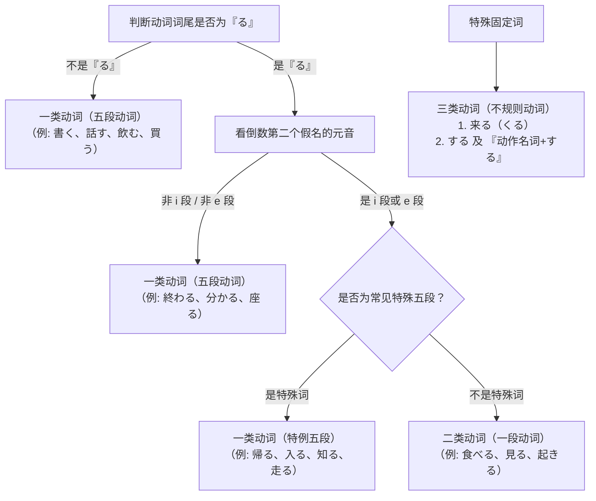

# 日语核心语法与动词活用速查手册

> 本篇笔记去除了冗长的词汇列表，聚焦于日语初级阶段的核心语法架构。包含句型基础、格助词速查、形容词活用，并重点深入梳理了**动词的三大类别、动词原形（辞书形）及核心变形体系（ます形、て形、ない形、た形）与常用句型**。

---

## 一、 基础句型与指示词体系

### 1.1 名词判断句（名 + です）

| 句型分类 | 句式结构 | 例句 | 中文含义 |
| :--- | :--- | :--- | :--- |
| **现在肯定** | 名詞1 は 名詞2 です。 | 私は学生です。 | 我是学生。 |
| **现在否定** | 名詞1 は 名詞2 ではありません。 *(口语: じゃありません)* | 彼は先生ではありません。 | 他不是老师。 |
| **一般疑问** | 名詞1 は 名詞2 ですか。 | あなたは王さんですか。 | 你是小王吗？ |
| **过去肯定** | 名詞1 は 名詞2 でした。 | 昨日は日曜日でした。 | 昨天是星期天。 |
| **过去否定** | 名詞1 は 名詞2 ではありませんでした。 | 昨日は雨ではありませんでした。 | 昨天不是雨天。 |
| **并列添加** | 名詞1 も 名詞2 です。 | 私も中国人です。 | 我也是中国人。 |
| **所属/修饰**| 名詞1 の 名詞2 | 日本の車 / 私の本 | 日本的车 / 我的书 |

> **要点解析**：
> - **は（读作 wa）**：提示主题助词，用于引出整句话谈论的话题。
> - **か**：终助词，接在句末相当于问号，疑问句语序无需倒装。

---

### 1.2 指示词体系（こ・そ・あ・ど 系列）

日语的指示代词根据与说话人（发话者）和听话人（受话者）的距离关系，分为四大系列：

| 类别 | 近称（こ系列） *(靠近说话人)* | 中称（そ系列） *(靠近听话人)* | 远称（あ系列） *(远离双方)* | 不定称（ど系列） *(疑问词)* |
| :--- | :--- | :--- | :--- | :--- |
| **事物（代词）** | **これ**（这个） | **それ**（那个） | **あれ**（那个） | **どれ**（哪个） |
| **连体词（+名词）** | **この** + 名词 | **その** + 名词 | **あの** + 名词 | **どの** + 名词 |
| **场所** | **ここ**（这里） | **そこ**（那里） | **あそこ**（那里） | **どこ**（哪里） |
| **方向/场所/敬称** | **こちら**（这边/这位） | **そちら**（那边/那位） | **あちら**（那边/那位） | **どちら**（哪边/哪位） |

> **例句对比**：
> - これは私の本です。（这是我的书。——指代具体物体）
> - この本は私のです。（这本书是我的。——「この + 名词」作修饰）
> - トイレはどこですか。（洗手间在哪里？）
> - あの方はどなたですか。（那位是谁？——「どなた」为「だれ」的敬称）

---

### 1.3 存在句（あります 与 います）

日语根据主语是否具有**自主活动意志**，使用不同的存在动词：

- **あります（物、植物等非意志存在）**
- **います（人、动物等具意志存在）**

#### 常见句式：
1. **某处有某物/人**：`[场所] に [物体/人] が あります / います。`
   - 机の上に本が**あります**。（桌子上有书。）
   - 教室に学生が**います**。（教室里有学生。）
2. **某物/人在某处**：`[物体/人] は [场所] に あります / います。`
   - 鍵は箱の中に**あります**。（钥匙在盒子里。）
   - 森さんは事務所に**います**。（森先生在办公室。）

#### 常用方位词组合：
`[名词] の 上（うえ）/ 下（した）/ 前（まえ）/ 後ろ（うしろ）/ 中（なか）/ 外（そと）/ 隣（となり）/ 近く（ちかく）`

---

## 二、 核心格助词速查

| 助词 | 核心功能 | 典型例句 |
| :---: | :--- | :--- |
| **は** | 提示句子的主题；表示对比 | 私は李です。（我是小李。） |
| **が** | 提示主语（强调主语本身）；眼前自然现象；能力/喜好/拥有的对象 | 雨が降ります。（下雨了。） 私は日本語が好きです。（我喜欢日语。） |
| **を** | 提示他动词的直接宾语（动作对象）；移动离开或经过的场所 | ご飯を食べます。（吃饭。） 公園を散歩します。（在公园散步。） |
| **に** | 动作发生的时间点；移动的目的地；存在的场所；动作对象（给谁） | 7時に起きます。（7点起床。） 日本に行きます。（去日本。） 友達に手紙を書きます。（给朋友写信。） |
| **で** | 动作发生的场所；工具、交通工具、手段；原材料；原因 | 図書館で勉強します。（在图书馆学习。） バスで行きます。（坐公交去。） 箸で食べます。（用筷子吃。） |
| **へ** | 移动的方向（读音为 e） | 西へ向かいます。（向西走。） |
| **と** | 并列列举（完全列举，和）；共同动作的伙伴（和谁一起） | 本とペンを買いました。（买了书和笔。） 友達と映画を見ます。（和朋友看电影。） |
| **も** | 表示“也”；疑问词 + も + 否定表示全面否定 | 彼も来ます。（他也来。） 誰もいません。（谁都不在。） |
| **から / まで** | 起点与终点（时间从…到… / 空间由…至…） | 会議は9時から5時までです。（会议从9点到5点。） |
| **ね / よ** | 终助词：ね表示求证赞同（对吧）；よ表示提醒告知（哦） | いい天気ですね。（天气真好呢。） これは私の傘ですよ。（这是我的伞哦。） |

---

## 三、 形容词活用体系

日语形容词分为**一类形容词（い形容词）**和**二类形容词（な形容词 / 形容动词）**两类。

### 3.1 一类形容词（い形容词）
词尾必以假名「い」结尾（如：高い、新しい、暑い）。

| 活用形态 | 变形规则 | 例（高い - 贵/高） | 例（いい - 好）*特例* |
| :--- | :--- | :--- | :--- |
| **肯定（现在）** | 词尾そのまま ＋ です | 高いです | いいです |
| **否定（现在）** | 词尾「い」变为 **「くない」** ＋ です | 高くないです / 高くありません | よくないです |
| **过去肯定** | 词尾「い」变为 **「かった」** ＋ です | 高かったです | よかったです |
| **过去否定** | 词尾「い」变为 **「くなかった」** ＋ です | 高くなかったです | よくなかったです |
| **修饰名词** | 词尾「い」直接接名词 | 高い本 | いい人 |
| **并列/中顿** | 词尾「い」变为 **「くて」** | 高くて美味しい | よくて便利 |
| **副词化（修饰动词）**| 词尾「い」变为 **「く」** ＋ 动词 | 高く売る / 早く起きる | よく分かる |

> **★ 特例提醒**：
> 「いい」（好）的所有活用变形均基于其古语词根「**よい**」（よい ➔ よくない ➔ よかった ➔ よくなかった ➔ よくて ➔ よく）。

---

### 3.2 二类形容词（な形容词）
词干不以「い」结尾（但有特例：きれい、有名、嫌い 等词尾音为い但属二类形容词），其句尾形式与名词极为相似。

| 活用形态 | 变形规则 | 例（静か - 安静） |
| :--- | :--- | :--- |
| **肯定（现在）** | 词干 ＋ です | 静かです |
| **否定（现在）** | 词干 ＋ ではありません / じゃありません | 静かではありません |
| **过去肯定** | 词干 ＋ でした | 静かでした |
| **过去否定** | 词干 ＋ ではありませんでした | 静かではありませんでした |
| **修饰名词** | 词干 ＋ **「な」** ＋ 名词 | 静か**な**部屋 |
| **并列/中顿** | 词干 ＋ **「で」** | 静か**で**きれい |
| **副词化（修饰动词）**| 词干 ＋ **「に」** ＋ 动词 | 静か**に**話します |

---

## 四、 动词分类与原形（辞书形）

动词是日语语法的核心骨架。学习动词变形前，**必须准确判定动词归属的分类**。

### 4.1 动词的三大类别与判定方法

#### 1. 一类动词（五段动词）
- **特征 1**：词尾假名不是「る」的所有动词。（如：買**う**、行**く**、話**す**、立**つ**、死**ぬ**、呼**ぶ**、飲**む**）
- **特征 2**：词尾虽是「る」，但倒数第二个假名属于「あ段 / う段 / お段」。（如：分か（ka）る、終（わ・wa）る、作（く・ku）る）
- **★ 常见特例五段动词（外观像二类，实际是一类）**：
  - 帰る（か**え**る・回家）
  - 入る（は**い**る・进入）
  - 知る（しる・知道）
  - 切る（きる・切/剪）
  - 走る（はしる・跑）
  - 減る（へる・减少）
  - 喋る（しゃべる・聊天）
  - 要る（いる・需要）

#### 2. 二类动词（一段动词）
- **特征**：词尾必须是「る」，且倒数第二个假名属于「い段（上一段）」或「え段（下一段）」。
  - い段 + る：見（み）る、起（おき）る、落（おち）る、降（お）りる
  - え段 + る：食（たべ）る、寝（ね）る、教（おしえ）る、忘（わす）れる

#### 3. 三类动词（不规则动词）
仅有两个基本动词，需单独记忆变形：
- **カ行变格活用（カ变）**：`来る`（くる・来）
- **サ行变格活用（サ变）**：`する`（做），以及所有“汉字名词 + する”复合动词（如：勉強する、散歩する、仕事する、運転する）。

---

### 4.2 动词原形（辞书形）与 ます形 互转

- **原形（辞书形 / 辞書形）**：动词在词典中检索的基本形态，句尾全落在「う段」上。在日常会话（简体）中，表示“现在或将来的肯定”。
- **ます形（连用形）**：表示郑重礼貌体（敬体）。

#### 辞书形 ➔ ます形 转换规则：

| 动词分类 | 规则 | 辞书形（原形） | ます形 | 意义 |
| :--- | :--- | :--- | :--- | :--- |
| **一类动词** *(五段)* | 将词尾 **「う段」** 假名变为该行的 **「い段」** 假名，再加上 **「ます」** | 買**う** (u) 書**く** (ku) 泳**ぐ** (gu) 話**す** (su) 待**つ** (tsu) 死**ぬ** (nu) 呼**ぶ** (bu) 飲**む** (mu) 取**る** (ru) 帰**る** *(特例)* | 買**い**ます 書**き**ます 泳**ぎ**ます 話**し**ます 待**ち**ます 死**に**ます 呼**び**ます 飲**み**ます 取**り**ます 帰**り**ます | 买 写 游泳 说话 等待 死 呼唤 喝 拿 回 |
| **二类动词** *(一段)* | 直接**去掉词尾「る」**，加上 **「ます」** | 食用（たべ）**る** 見（み）**る** 起（おき）**る** | 食べます 見ます 起きます | 吃 看 起床 |
| **三类动词** *(サ变/カ变)* | 特殊变化 | 来（く）る する 勉強する | **来（き）ます** **します** **勉強します** | 来 做 学习 |

> **ます形的否定与时态**：
> - 现在肯定：～ます（食べます）
> - 现在否定：～ません（食べません）
> - 过去肯定：～ました（食べました）
> - 过去否定：～ませんでした（食べませんでした）

---

## 五、 动词核心变形规则与常用句型

初级语法中最关键的四大基础变形为：**ます形、て形、ない形、た形**。掌握了这四种形态，就能组合绝大多数初级表达。

### 5.1 て形（连用接续形）

「て形」用于句子的中顿停顿、动作相继发生，以及承接大量的补助动词。

#### 变形口诀与规则（重点是一类动词的音便）：

| 动词分类 | 词尾假名 | 音便/变化规则 | 辞书形（原形） | て形 |
| :---: | :---: | :--- | :--- | :--- |
| **一类动词** | **う、つ、る** | **促音便**：去词尾变 **って** | 買**う** / 待**つ** / 帰**る** | 買**って** / 待**って** / 帰**って** |
| | **ぬ、ぶ、む** | **拨音便**：去词尾变 **んで** | 死**ぬ** / 遊**ぶ** / 飲**む** | 死**んで** / 遊**んで** / 飲**んで** |
| | **く** | **イ音便**：变 **いて** | 書**く** | 書**いて** |
| | **ぐ** | **イ音便（浊音）**：变 **いで** | 泳**ぐ** | 泳**いで** |
| | **★ 行く (特例)** | **特例为促音便** | 行**く** | **行（い）って** |
| | **す** | 变 **して** | 話**す** | 話**して** |
| **二类动词** | **る** | 去 **「る」** 直接加 **「て」** | 食べる / 見る | 食べて / 見て |
| **三类动词** | 不规则 | 来る ➔ **来て（きて）** する ➔ **して** | 来る / 散歩する | **来て** / **散歩して** |

#### 「て形」核心实用句型：
1. **～てください**：请……（请求、要求）
   - ここに名前を書いてください。（请在这里写上名字。）
2. **～ています**：
   - 正在进行：今テレビを見ています。（现在正在看电视。）
   - 结果状态的持续：私は結婚しています。（我已经结婚了。）/ 東京に住んでいます。（我住在东京。）
3. **～てもいいです**：可以……（允许、许可）
   - 写真を撮ってもいいですか。（可以拍照吗？）
4. **～てはいけません**：不可以……（禁止）
   - ここでタバコを吸ってはいけません。（这里禁止吸烟。）
5. **～てから**：……之后再……（动作的前后顺序）
   - 手を洗ってからご飯を食べます。（洗手之后再吃饭。）

---

### 5.2 ない形（未然否定形）

「ない形」为动词的简体否定式，用于否定及相关衍生句型。

#### 变形规则：
- **一类动词**：将词尾「う段」假名变为该行的**「あ段」**假名，再加「ない」。
  - **特别注意**：以「う」结尾的词，变成「**わ**」而不是「あ」。（買う ➔ 買**わ**ない）
  - 書く ➔ 書**か**ない / 飲む ➔ 飲**ま**ない / 話す ➔ 話**さ**ない / 帰る ➔ 帰**ら**ない
  - **★ 存在动词「ある」特例**：否定直接为 **「ない」**（不可变形为あらない）。
- **二类动词**：去「る」直接加「ない」。
  - 食べる ➔ 食べない / 見る ➔ 見ない
- **三类动词**：
  - 来（く）る ➔ **来（こ）ない** *(读音由 ku 变为 ko)*
  - する ➔ **しない**（勉強する ➔ 勉強しない）

#### 「ない形」核心实用句型：
1. **～ないでください**：请不要……
   - 教室で大声を出さないでください。（请不要在教室里大声喧哗。）
2. **～なければなりません**：必须……（不……不行）
   - 明日病院へ行かなければなりません。（明天必须去医院。）
3. **～なくてもいいです**：不……也可以
   - 明日は来なくてもいいです。（明天不来也可以。）

---

### 5.3 た形（过去完了形）

「た形」是动词的简体过去式。**其变形规律与「て形」完全一致**，只需将「て」替换为「た」，「で」替换为「だ」。

- 買って ➔ **買った**
- 飲んで ➔ **飲んだ**
- 書いて ➔ **書いた**
- 行って ➔ **行った**
- 食べて ➔ **食べた**
- 来て ➔ **来た（きた）**
- して ➔ **した**

#### 「た形」核心实用句型：
1. **～たことがあります**：曾经做过……（经历）
   - 富士山に登ったことがあります。（我曾经登过富士山。）
2. **～たほうがいいです**：最好……（建议劝告）
   - 早く寝たほうがいいです。（最好早点睡。）
3. **～たり、～たりします**：有时做……有时做……（动作列举）
   - 休日は本を読んだり、音楽を聞いたりします。（休息日读读书、听听音乐。）
4. **～たあとで**：在……之后
   - ご飯を食べたあとで、薬を飲みます。（吃完饭后吃药。）

---

### 5.4 辞书形（原形）核心句型速查

动词原形（辞书形）除了作为常体/简体使用外，还可以直接组合以下高频语法：

1. **～ことができます**：能够…… / 会……（能力或许可）
   - 私は日本語を話すことができます。（我会说日语。）
2. **～まえに（前に）**：在……之前
   - 寝る前に歯を磨きます。（睡觉前刷牙。）
3. **趣味は［动词辞书形 ＋ こと］です**：爱好是……（动词名词化）
   - 趣味は写真を撮ることです。（我的爱好是拍照。）

---

## 六、 高频常用动词活用全景速查表

| 词类 | 辞书形（原形） | ます形 | て形 | ない形 | た形 | 词义 |
| :---: | :---: | :---: | :---: | :---: | :---: | :---: |
| **一类** | **買（か）う** | 買います | 買って | 買わない | 買った | 买 |
| **一类** | **行（い）く** | 行きます | **行って** *(特)*| 行かない | **行った** *(特)*| 去 |
| **一类** | **書（か）く** | 書きます | 書いて | 書かない | 書いた | 写 |
| **一类** | **泳（およ）ぐ** | 泳ぎます | 泳いで | 泳がない | 泳いだ | 游泳 |
| **一类** | **話（はな）す** | 話します | 話して | 話さない | 話した | 说/谈 |
| **一类** | **待（ま）つ** | 待ちます | 待って | 待たない | 待った | 等待 |
| **一类** | **死（し）ぬ** | 死にます | 死んで | 死なない | 死んだ | 死 |
| **一类** | **遊（あそ）ぶ** | 遊びます | 遊んで | 遊ばない | 遊んだ | 玩耍 |
| **一类** | **飲（の）む** | 飲みます | 飲んで | 飲まない | 飲んだ | 喝/饮 |
| **一类** | **取（と）る** | 取ります | 取って | 取らない | 取った | 拿/取 |
| **一类** *(特)* | **帰（かえ）る** | 帰ります | 帰って | 帰らない | 帰った | 回去 |
| **一类** *(特)* | **入（はい）る** | 入ります | 入って | 入らない | 入った | 进入 |
| **一类** *(特)* | **知（し）る** | 知ります | 知って | 知らない | 知った | 知道 |
| **二类** | **食（た）べる** | 食べます | 食べて | 食べない | 食べた | 吃 |
| **二类** | **見（み）る** | 見ます | 見て | 見ない | 見た | 看 |
| **二类** | **起（お）きる** | 起きます | 起きて | 起きない | 起きた | 起床 |
| **二类** | **寝（ね）る** | 寝ます | 寝て | 寝ない | 寝た | 睡觉 |
| **三类** | **来（く）る** | **来（き）ます** | **来（き）て** | **来（こ）ない** | **来（き）た** | 来 |
| **三类** | **する** | **します** | **して** | **しない** | **した** | 做 |
| **三类** | **勉強する** | 勉強します | 勉強して | 勉強しない | 勉強した | 学习 |