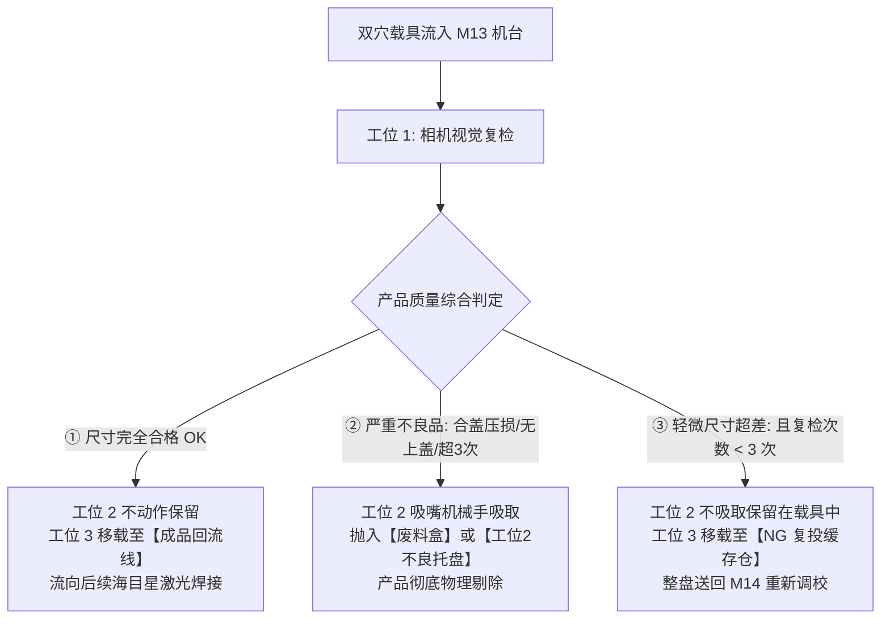
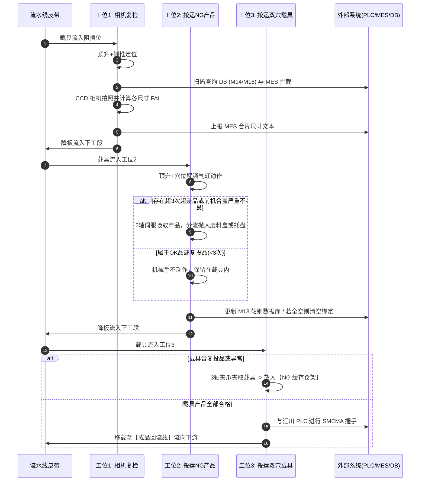
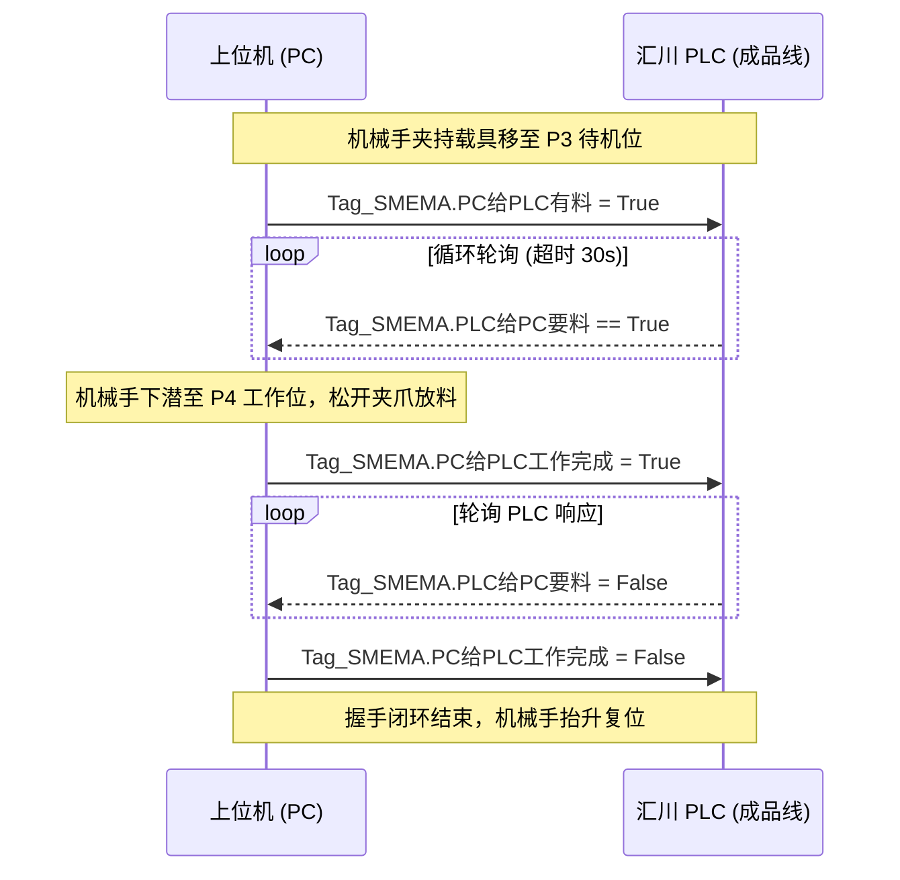

# M13 均热板尺寸视觉复检与 NG 智能剔除设备工艺流程与核心源码全景解析

---

<details open class="in-post-toc-card border border-neutral-200/80 dark:border-neutral-700/80 rounded-xl p-4 my-4 bg-neutral-50/50 dark:bg-neutral-800/30">
<summary class="font-bold text-base cursor-pointer select-none text-neutral-800 dark:text-neutral-200 flex items-center justify-between outline-none">
📑 本篇目录（点击收起 / 展开）
</summary>

<div class="max-h-72 overflow-y-auto mt-3 pt-2 border-t border-neutral-200/60 dark:border-neutral-700/60 hide-scrollbar">

## 目录

- [项目背景与设备定位](#1-项目背景与设备定位)
- [核心物料流向与“柔性复投”决策树](#2-核心物料流向与柔性复投决策树)
- [系统硬件与运动轴系配置](#3-系统硬件与运动轴系配置)
- [三大工位工艺流程与核心代码解析](#4-三大工位工艺流程与核心代码解析)
   - [4.1 工位 1：Task01_相机复检（视觉测量与全流程质检）](#41-工位-1task01_相机复检视觉测量与全流程质检)
   - [4.2 工位 2：Task02_搬运NG产品（智能挑废与产品精准剔除）](#42-工位-2task02_搬运ng产品智能挑废与产品精准剔除)
   - [4.3 工位 3：Task03_搬运双穴载具（整盘移载与分流）](#43-工位-3task03_搬运双穴载具整盘移载与分流)
   - [4.4 辅助工位：料仓自动化管理（产品与载具 NG 仓）](#44-辅助工位料仓自动化管理产品与载具-ng-仓)
- [跨系统通讯时序与数据闭环](#5-跨系统通讯时序与数据闭环)
   - [5.1 汇川 PLC 与 PC 的 SMEMA 握手协议](#51-汇川-plc-与-pc-的-smema-握手协议)
   - [5.2 视觉系统（CCD）通讯时序](#52-视觉系统ccd通讯时序)
   - [5.3 MES 进站拦截与数据上传](#53-mes-进站拦截与数据上传)
   - [5.4 跨工站共享数据库（DBShare）流转](#54-跨工站共享数据库dbshare流转)
- [架构亮点与工业设计启示](#6-架构亮点与工业设计启示)

</div>
</details>
---

## 1. 项目背景与设备定位

在 3C 消费电子旗舰产品（如智能手机散热均热板 Vapor Chamber，简称 **VC**）的高精密自动化产线中，装配精度要求通常达到微米级。本项目为**博众精工（BoZhon）**为高端制造供应链（专案代号 **Earth / Saturn**）定制开发的 **M13 工站：VC Inspection NG Rejection（均热板外观及尺寸相机复检与 NG 剔除设备）**。

### 1.1 产线上下游协同关系
在整个装配流水线中，M13 工站承上启下，处于精密组装后的关键质量判定环节：
- **上游工位 M14（合盖/组装工站）**：完成 VC 上盖与下板的物理贴合组装。
- **上游工位 M16（测高/保压工站）**：对组装后的工件进行高度测量与真空吸力测试。
- **本站 M13（复检与剔除工站）**：
  1. 承接来自流线的**双穴载具（Carrier）**；
  2. 读取并复核 M14、M16 历史质检数据；
  3. 执行顶部工业 CCD 的全套 FAI 尺寸精密测量；
  4. 对两穴产品分别执行“剔除”、“留盘复投”或“成品合格流出”操作。
- **下游工位（海目星激光焊接机 / 成品回流线）**：接收本站合格载具进入激光密封焊接工序。

---

## 2. 核心物料流向与“柔性复投”决策树

传统的自动化检测设备往往采取“一刀切”策略（一旦超差即抓出报废）。而在高价值 VC 均热板生产中，部分超差是由于微小装配位移造成的，允许回到前序重新校准。因此，M13 创新性地引入了**“轻微超差循坏复投（Re-test）机制”**。

### 2.1 产品的三大归宿



### 2.2 双穴组合状态决策矩阵

载具内部有两个独立穴位（Cave 1 与 Cave 2），系统会对两穴进行正交组合处理：

| 穴位 1 状态 | 穴位 2 状态 | 工位 2 机械手动作 | 工位 3 载具搬运去向 | 工艺结果说明 |
| :--- | :--- | :--- | :--- | :--- |
| **OK** | **OK** | 均不吸取，完好保留 | 移载至 **成品回流线（PLC握手）** | 两穴均合格，流向下游工序 |
| **超差NG（第1/2次）** | **OK** | 均不吸取，轻微件保留在盘 | 移载至 **NG 料仓接驳线** | 整盘送去复投（穴1待重测） |
| **超差NG（第3次）** | **OK** | **吸走穴位 1** 放入废料盘 | 移载至 **成品回流线（PLC握手）** | 穴1彻底剔除，穴2合格品流出 |
| **致命合盖不良** | **OK** | **吸走穴位 1** 抛入废品盒 | 移载至 **成品回流线（PLC握手）** | 穴1抛废，穴2合格品流出 |
| **致命不良** | **致命不良** | **吸走两穴全部抛弃**，数据库清空治具绑定 | 移载至 **成品回流线** | 空载具流回前端重新装填 |

---

## 3. 系统硬件与运动轴系配置

系统采用 **固高（Googol）/ Genex** 运控板卡驱动伺服电机，配套 **汇川（Inovance）PLC** 管理外围信号。

### 3.1 运动轴定义表（`AxisPar.xlsx`）

```text
┌────────────────────────────────────────────────────────────────────────┐
│                        M13 自动化运控系统轴系拓扑                      │
├────────┬─────────────────┬───────────────────┬─────────────────────────┤
│ 轴编号 │ 轴名称          │ 物理执行机构      │ 主要目标点位            │
├────────┼─────────────────┼───────────────────┼─────────────────────────┤
│ 轴 2   │ 工位2_Z轴       │ 挑废机械手升降    │ P0待机 / P2取料 / P4~P7 │
│ 轴 3   │ 工位2_Y轴       │ 挑废机械手平移    │ 载具穴位1/2及NG料槽平移 │
│ 轴 4   │ 工位3_Z轴       │ 载具移载机械手升降│ P0待机 / P2取料 / P4工作│
│ 轴 5   │ 工位3_R轴       │ 载具移载姿态旋转  │ 载具进入成品线/料仓换向 │
│ 轴 6   │ 工位3_Y轴       │ 载具移载长行程平移│ 流线、回流线与料仓跨工位│
│ 轴 7   │ 工位1_X轴       │ 相机复检标定移动  │ 复检位、九点标定位置    │
└────────┴─────────────────┴───────────────────┴─────────────────────────┘
```

### 3.2 关键传感器与电磁阀分配
- **气缸定位机构**：
  - `相机复检顶升气缸`（OUT48/49, IN39/40）、`相机复检侧推气缸`（OUT56, IN66/67）。
  - `搬运NG产品顶升气缸`（OUT50/51, IN46/47）、`载具穴位解锁气缸`（1穴: OUT60/IN99-100, 2穴: OUT62/IN101-102）。
- **真空抓取与检测**：
  - 载具底部吸附真空（OUT32/34）、破真空吹气（OUT33/35）、真空到达光电（IN64/65）。
  - 挑废吸嘴真空控制（OUT36/37, IN68）。
- **光电感应矩阵**：
  - 工位 2 产品不良品盘感应 1~4（IN71~IN74）。
  - 工位 3 载具复投料仓感应 1~5（IN91~IN95）。

---

## 4. 三大工位工艺流程与核心代码解析

博众上位机软件基于 `mWorkShare` 框架，每个工位以独立线程运行，采用标准的状态机：`AutoRun()` 中通过 `TaskSelect`（分支选择）和 `WorkStep`（动作步序）步进。



---

### 4.1 工位 1：Task01_相机复检（视觉测量与全流程质检）

#### 详细工艺步序：
1. **顶升与侧推定位**：
   - 阻挡气缸升起截停载具，顶升气缸上升托起治具，侧推气缸伸出靠紧基准面，消除治具机械游隙。
2. **条码扫码与长度防呆**：
   - 扫码枪通过 TCP 发送触发，读取载具条码 `Carrier_SN`。
   - 代码加入条码长度范围防呆，防止混入错误规格的治具；连续 3 次扫码失败触发异常弹窗。
3. **跨站数据库查询（M14 / M16 数据校验）**：
   - 从共享数据库读取上游信息：
     - **M14**：获取 1 穴、2 穴对应的产品条码（`VC_SN`）及组装结果（`results14`，0-OK, 1-NG, 2-严重合盖不良）。
     - **M16**：获取测高与真空保压判定（若 `results16 == 2`，则直接置 `报警需重投 = true`）。
4. **本地复检次数追溯**：
   - 调用 `CsvInspectionDataService.ReadInspectionCount(VC_SN)` 查询产品历史复检次数。
   - 区分当前产品是首检还是复投件，并更新 `复检NG穴位` 标志位。
5. **MES 进站拦截（Track-In）**：
   - 并行启动双穴异步任务：`进站MES拦截(VC_SN, 1)` 与 `进站MES拦截(VC_SN, 2)`。
   - 若被 MES 拦截判定不通过，直接标记载具流出，防止不合格品流入装配线。
6. **CCD 拍照与尺寸数据解析**：
   - 向工业相机发送指令 `T1,3&vbcr`，接收两穴测量数据字符串。
   - 解析返回结果：
     - 代码 `"3"`：穴位无产品。
     - 代码 `"2"`：产品复检超差 NG。累计复检次数并记录到本地 CSV。
     - 代码 `"4"`：检测到无上盖（致命缺陷）。
     - 代码 `"0"`：尺寸 FAI 全部在容差内，合格 OK。
7. **数据上传与放行**：
   - 调用 `WriteMesTxt` 生成 MES 文本文件（`合片尺寸检验1穴/2穴.txt`）。
   - 载具底部破真空吹气，侧推与顶升气缸复位，流向工位 2。

#### 核心代码片段解析：

```csharp
// 5.运动模块/Task01_相机复检.cs: 视觉数据解析核心逻辑
case (int)WorkStep.上CCD复检数据解析:
    // 解析穴位 1 视觉状态
    if (strtemp1[4] == "3") // 产品为空
    {
        AutoConv.AutoConv.mConvData[(int)AutoLineID.相机复检].Sta_Barcode[(int)产品穴位.穴位1].产品有无 = false;
        AutoConv.AutoConv.mConvData[(int)AutoLineID.相机复检].Sta_Barcode[(int)产品穴位.穴位1].相机复检结果 = 1;
    }
    else
    {
        AutoConv.AutoConv.mConvData[(int)AutoLineID.相机复检].Sta_Barcode[(int)产品穴位.穴位1].产品有无 = true;
        if (strtemp1[4] == "2") // 尺寸超差 NG
        {
            AutoConv.AutoConv.mConvData[(int)AutoLineID.相机复检].Sta_Barcode[(int)产品穴位.穴位1].相机复检结果 = 1;
            // 本地复检计数累加并落盘
            AutoConv.AutoConv.mConvData[(int)AutoLineID.相机复检].Sta_Barcode[(int)产品穴位.穴位1].复检次数++;
            mGlobal.dataService.WriteInspectionRecord(
                AutoConv.AutoConv.mConvData[(int)AutoLineID.相机复检].Sta_Barcode[(int)产品穴位.穴位1].VC_SN,
                AutoConv.AutoConv.mConvData[(int)AutoLineID.相机复检].Sta_Barcode[(int)产品穴位.穴位1].复检次数
            );
        }
        else if (strtemp1[4] == "4") // 无上盖 (致命缺陷)
        {
            AutoConv.AutoConv.mConvData[(int)AutoLineID.相机复检].Sta_Barcode[(int)产品穴位.穴位1].相机复检结果 = 2;
        }
        else
        {
            AutoConv.AutoConv.mConvData[(int)AutoLineID.相机复检].Sta_Barcode[(int)产品穴位.穴位1].相机复检结果 = 0; // 尺寸OK
        }
    }
    
    // 结合前机合盖结果进行二次修正: 如果前机合盖严重不良，复检结果直接作废，强制抛料
    if (mGlobal.前机数据库结果[1] == 2)
    {
        AutoConv.AutoConv.mConvData[(int)AutoLineID.相机复检].Sta_Barcode[(int)产品穴位.穴位1].相机复检结果 = 2;
    }
    mSetStep = (int)WorkStep.MES上传;
    break;
```

---

### 4.2 工位 2：Task02_搬运NG产品（智能挑废与产品精准剔除）

#### 详细工艺步序：
1. **载具顶升与解锁**：
   - 载具到位顶升，穴位解锁气缸缩回，松开治具卡爪。
2. **二次校验与剔除判断**：
   - 再次扫描载具条码核实数据库。
   - 依次扫描两穴的质检结论：
     - 若 `相机复检结果 == 0`：合格，机械手跳过。
     - 若 `相机复检结果 == 1`：
       - `复检次数 < 3`：**保留复投，机械手不吸取**。
       - `复检次数 >= 3`：**超限报废，机械手执行抓取抛料**。
     - 若 `相机复检结果 == 2`：**致命不良，机械手执行抓取抛料**。
3. **两轴伺服机械手吸料与分类抛料**：
   - 伺服轴下潜至目标穴位，吸嘴开启真空吸附并检测真空到位。
   - **分类放置**：
     - **严重不良（结果=2）**：平移至废料盒（`P9`），破真空吹气抛废。
     - **超限尺寸不良（结果=1）**：检测工位 2 托盘四个光电槽位，依次放置至未占用的料槽（`P4~P7`）。
4. **空载具数据库清空**：
   - 若两穴产品均被抛弃，调用 `DBShare.Instance.ClearTrayInfo` 清理载具数据，避免空治具回流时产生脏数据。
   - 上传 M13 实际状态数据，解锁气缸伸出锁紧，降板流出。

#### 核心代码片段解析：

```csharp
// 5.运动模块/Task02_搬运NG产品.cs: 抛料决策与分类执行
case (int)WorkStep.判断抛料状态:
    for (int point = 1; point <= 2; point++)
    {
        if (AutoConv.AutoConv.mConvData[(int)AutoLineID.搬运NG产品].Sta_Barcode[point].产品有无 == true)
        {
            // 结果 0: OK，不抛料
            if (AutoConv.AutoConv.mConvData[(int)AutoLineID.搬运NG产品].Sta_Barcode[point].相机复检结果 == 0)
            {
                AddLog($"{point}穴复检OK，无需抛料");
            }
            // 结果 1: 尺寸超差，检查复检次数
            else if (AutoConv.AutoConv.mConvData[(int)AutoLineID.搬运NG产品].Sta_Barcode[point].相机复检结果 == 1)
            {
                if (AutoConv.AutoConv.mConvData[(int)AutoLineID.搬运NG产品].Sta_Barcode[point].复检次数 >= 3)
                {
                    AddLog($"{point}穴复检NG累计>=3次，执行抛料");
                    mSetStep = point == 1 ? (int)WorkStep.抛穴位1产品NG料 : (int)WorkStep.抛穴位2产品NG料;
                    break;
                }
                else
                {
                    AddLog($"{point}穴复检NG不足3次，准备复投，不抛产品");
                }
            }
            // 结果 2: 致命不良，直接抛料
            else if (AutoConv.AutoConv.mConvData[(int)AutoLineID.搬运NG产品].Sta_Barcode[point].相机复检结果 == 2)
            {
                AddLog($"{point}穴前机来料严重不良，直接抛料");
                mSetStep = point == 1 ? (int)WorkStep.抛穴位1产品NG料 : (int)WorkStep.抛穴位2产品NG料;
                break;
            }
        }
    }
    break;
```

---

### 4.3 工位 3：Task03_搬运双穴载具（整盘移载与分流）

#### 详细工艺步序：
1. **整盘状态综合评估**：
   - 检查两穴状态：是否存在“尺寸超差且复检次数 < 3 次”的产品？
     - **存在**：整盘标记为 `搬运双穴载具产品是否都OK = false`（复投治具）。
     - **不存在**：整盘标记为 `搬运双穴载具产品是否都OK = true`（合格治具）。
2. **三轴机械手抓取与分流**：
   - 夹爪气缸动作，夹紧载具两侧，提升至安全位。
   - **分流路径 1：去往【成品回流线】（合格件）**
     - 机械手移动至成品回流线上方 `P3 等待位`。
     - 与汇川 PLC 按照 SMEMA 协议握手交互，确认下方皮带无阻挡后，下放载具并松开夹爪。
   - **分流路径 2：去往【NG 缓存仓架】（待复投件）**
     - 机械手移至 `P5 NG抛料位`，将带有待复投产品的载具放入复投接驳线。
3. **产能与统计报表落盘**：
   - 调用 `SaveData`，将治具码、产品码、测试结果及实测 FAI 尺寸追加保存到本地 CSV（`yyyyMMdd复检数据.csv`）。
   - 刷新 UI 界面的 UPH 产能曲线图与良率饼图。

#### 核心代码片段解析：

```csharp
// 5.运动模块/Task03_搬运双穴载具.cs: 载具分流判定
case (int)Workstep.判断载具上产品状态:
    var 穴位1复检条件 = AutoConv.AutoConv.mConvData[(int)AutoLineID.搬运双穴载具].Sta_Barcode[1].相机复检结果 == 1
                      && AutoConv.AutoConv.mConvData[(int)AutoLineID.搬运双穴载具].Sta_Barcode[1].复检次数 < 3
                      && AutoConv.AutoConv.mConvData[(int)AutoLineID.搬运双穴载具].Sta_Barcode[1].产品有无;

    var 穴位2复检条件 = AutoConv.AutoConv.mConvData[(int)AutoLineID.搬运双穴载具].Sta_Barcode[2].相机复检结果 == 1
                      && AutoConv.AutoConv.mConvData[(int)AutoLineID.搬运双穴载具].Sta_Barcode[2].复检次数 < 3
                      && AutoConv.AutoConv.mConvData[(int)AutoLineID.搬运双穴载具].Sta_Barcode[2].产品有无;

    // 任一穴位需要复投或整机报警
    if (穴位1复检条件 || 穴位2复检条件 || AutoConv.AutoConv.mConvData[(int)AutoLineID.搬运双穴载具].报警需重投)
    {
        AddLog("产品需复投，搬运载具至 NG 缓存仓架");
        AutoConv.AutoConv.mConvData[(int)AutoLineID.搬运双穴载具].搬运双穴载具产品是否都OK = false;
        分支切换((int)分支选择.搬运载具, (int)Workstep.搬运双穴载具); // 走向 NG 缓存仓
    }
    else
    {
        AddLog("载具产品全部合格，搬运至成品回流线");
        AutoConv.AutoConv.mConvData[(int)AutoLineID.搬运双穴载具].搬运双穴载具产品是否都OK = true;
        分支切换((int)分支选择.搬运载具, (int)Workstep.搬运至成品流线); // 走向成品线与 PLC 握手
    }
    break;
```

---

### 4.4 辅助工位：料仓自动化管理（产品与载具 NG 仓）

为了保证无人化持续运行，程序配备了两个独立的后台料仓监控任务：
1. **`Task_产品NG料仓.cs`**：
   - 持续监控工位 2 的 4 槽产品废料盘。
   - 当检测到 4 个槽位光电全遮挡（满料）或操作员拍下 `产品NG按钮` 时，自动下降定位气缸与锁紧气缸，指示灯频闪报警，提示操作人员换盘。
   - 换上新盘且传感器确认无料后，气缸重新升起锁紧，恢复自动生产。
2. **`Task_载具NG料仓.cs`**：
   - 监控工位 3 待复投治具的堆叠感应器（光电 1~5）。
   - 满料时点亮报警指示灯，阻止继续放置载具，防止机械撞件。

---

## 5. 跨系统通讯时序与数据闭环

### 5.1 汇川 PLC 与 PC 的 SMEMA 握手协议
在将合格载具放入成品回流线时，PC 上位机与汇川 PLC 通过 Ethernet/IP 标签通讯，严格执行工业级硬件级联交互：



### 5.2 视觉系统（CCD）通讯时序
- **通讯协议**：TCP/IP Socket 客户端。
- **发送指令**：`T1,3&vbcr`（T1 代表相机编号，3 代表执行尺寸与外观复检）。
- **接收数据**：分号分隔的双穴测量字符串，格式形如：
  ```text
  T1,0,OK,校验码,状态码,FAI1,FAI2,FAI3,FAI4,FAI5;状态码,校验码,FAI1,FAI2,FAI3,FAI4,FAI5
  ```
  上位机校验数据长度（穴1长度为10，穴2长度为7），防止丢包造成的误判。

### 5.3 MES 进站拦截与数据上传
- **进站拦截**：通过 TCP 发送产品条码 `${VC_SN}\r`，等待返回 `1`（放行过站）或 `0`（拦截停机）。
- **数据出站**：生成包含时间戳、治具号、产品 SN、良品状态及各项测量实测值的文本文件，写入指定的本地监视目录，供工厂自动化采集模块抓取。

### 5.4 跨工站共享数据库（DBShare）流转
- **上游入库**：M14 组装工站绑定治具与 VC_SN，M16 写入高度测试判定。
- **本站出库**：M13 读取上述判定，并在工位 2 写入 M13 的 CT（周期时间）、复检结论与测试数据。
- **数据解绑**：当载具上的产品全部被剔除报废时，执行 `ClearTrayInfo`，阻断不良数据污染下游。

---

## 6. 架构亮点与工业设计启示

1. **状态机与非阻塞步进（Step Pattern）**：
   - 彻底避免了传统的 `Thread.Sleep()` 阻塞主调度逻辑，所有动作均采用超时计时器（`OverTime`）和重试/忽略弹窗（`FailTipShow`），保证在设备出现气缸不到位或通讯延迟时，UI 仍具响应性且日志可精准定位步序。
2. **多级缺陷分类与动态容差**：
   - 区分“机械装配致命缺陷”与“测量尺寸微差”，引入本地 SQLite / CSV 追踪复检次数，在保证良率真实性的同时，最大限度降低昂贵精密零件的无谓报废。
3. **软硬件安全互锁与干涉区防护**：
   - 移载机械手与流水线阻挡气缸之间设置了严密的软件防撞区域（InterferenceZone），并在入料前执行气缸缩回与伺服安全高度双重校验。
4. **标准化与模组化基类复用**：
   - 无论是相机复检、挑废还是载具搬运，均统一继承自 `mWorkShare`，标准化实现了初始化、单轴/多轴回零（`Homing`）、就绪检查（`mReady`）、手动调试（`ManualMode`）以及统一报警分发体系。
