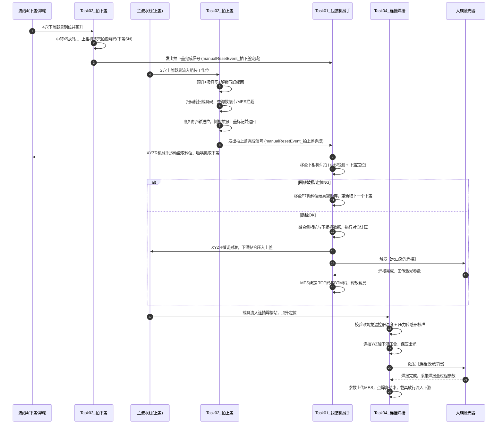

# M14 上下盖高精度视觉对位贴合与双激光焊接设备工艺流程与核心源码全景解析

---

<details open class="in-post-toc-card border border-neutral-200/80 dark:border-neutral-700/80 rounded-xl p-4 my-4 bg-neutral-50/50 dark:bg-neutral-800/30">
<summary class="font-bold text-base cursor-pointer select-none text-neutral-800 dark:text-neutral-200 flex items-center justify-between outline-none">
📑 本篇目录（点击收起 / 展开）
</summary>

<div class="max-h-72 overflow-y-auto mt-3 pt-2 border-t border-neutral-200/60 dark:border-neutral-700/60 hide-scrollbar">

## 目录

- [项目背景与设备定位](#1-项目背景与设备定位)
   - [1.1 产线上下游协同关系](#11-产线上下游协同关系)
   - [1.2 设备核心使命](#12-设备核心使命)
- [核心物料流向与“双轨双焊”全景拓扑](#2-核心物料流向与双轨双焊全景拓扑)
   - [2.1 双流线物料流向图](#21-双流线物料流向图)
   - [2.2 跨线协同生产时序图](#22-跨线协同生产时序图)
   - [2.3 异常分支与坏料智能剔除策略](#23-异常分支与坏料智能剔除策略)
- [系统硬件与运动轴系配置](#3-系统硬件与运动轴系配置)
   - [3.1 8轴伺服运动系统拓扑表](#31-8轴伺服运动系统拓扑表)
   - [3.2 3相机机器视觉检测系统（凌云相机）](#32-3相机机器视觉检测系统凌云相机)
   - [3.3 双大族激光器与传感器矩阵](#33-双大族激光器与传感器矩阵)
- [五大工位工艺流程与核心源码逐行解析](#4-五大工位工艺流程与核心源码逐行解析)
   - [4.1 工位 1：Task05_拍下盖流线缓存（前道 PLC 握手与进料接驳）](#41-工位-1task05_拍下盖流线缓存前道-plc-握手与进料接驳)
   - [4.2 工位 2：Task03_拍下盖（中转 X 轴步进、上相机扫码与取料防呆）](#42-工位-2task03_拍下盖中转-x-轴步进上相机扫码与取料防呆)
   - [4.3 工位 3：Task02_拍上盖（主流线 2 穴载具顶升解锁、MES拦截与侧相机测偏）](#43-工位-3task02_拍上盖主流线-2-穴载具顶升解锁mes拦截与侧相机测偏)
   - [4.4 工位 4：Task01_组装（XYZR 机械手取料、下相机网纱质检、对位算法、大族水口焊接）](#44-工位-4task01_组装xyzr-机械手取料下相机网纱质检对位算法大族水口焊接)
   - [4.5 工位 5：Task04_热压/连挡焊接（温控力控保压下潜、大族连档激光封焊、参数归档）](#45-工位-5task04_热压连挡焊接温控力控保压下潜大族连档激光封焊参数归档)
   - [4.6 辅助工位：Task00_空站（后台回流线带料巡检）](#46-辅助工位task00_空站后台回流线带料巡检)
- [跨系统通讯时序与工业数字化闭环](#5-跨系统通讯时序与工业数字化闭环)
   - [5.1 汇川 PLC 与 PC 的 EIP 以太网握手时序](#51-汇川-plc-与-pc-的-eip-以太网握手时序)
   - [5.2 凌云视觉系统（LusterCamera）交互与对位矩阵计算推导](#52-凌云视觉系统lustercamera交互与对位矩阵计算推导)
   - [5.3 大族激光器（Han's Laser）通讯与焊接参数采集](#53-大族激光器hans-laser通讯与焊接参数采集)
   - [5.4 工业互联全景：MES / Bali PDCA / HIVE / AAC_IOT](#54-工业互联全景mes--bali-pdca--hive--aac_iot)
- [安全互锁、防撞干涉区与异常防呆设计](#6-安全互锁防撞干涉区与异常防呆设计)
   - [6.1 组装 Y 轴与侧相机 Y 轴空间干涉区动态互锁](#61-组装-y-轴与侧相机-y-轴空间干涉区动态互锁)
   - [6.2 气缸与伺服硬件防撞保护](#62-气缸与伺服硬件防撞保护)
   - [6.3 关键质量防呆矩阵](#63-关键质量防呆矩阵)
- [架构总结与工程落地启示](#7-架构总结与工程落地启示)

</div>
</details>
---

## 1. 项目背景与设备定位

在 3C 消费电子旗舰产品（如超薄均热板 Vapor Chamber，简称 **VC**）的高精密自动化产线中，VC 上下盖组装必须达到微米级对齐，同时焊接气密性直接决定散热效能与良率。

本项目为博众精工（BoZhon）开发的 **M14 工站：M14-2-B02 合盖设备（上位机工程名：BZProject_TOP_BTM Assembly Machine）**。该机台是整条均热板智能组装产线中的“心脏工位”，实现高精贴合与两道激光焊接一体化。

### 1.1 产线上下游协同关系
在流水线拓扑中，M14 处于组装工艺的核心承重节点：
- **上游工位 M15（点胶/点焊膏工站）**：在上盖上预涂布精密焊膏，并将载具放行至 M14。
- **本站 M14（合盖与激光焊接工站）**：
  1. 承接来自主流线的**双穴上盖（TOP）载具**；
  2. 承接来自侧边供料线的**多穴下盖（BTM，带精密滤网/网纱）载具**；
  3. 执行 3 组工业相机的视觉对位与下盖网纱质量缺陷复检；
  4. 实现下盖到上盖的高精度压合贴装；
  5. 执行第一道【水口激光焊接】与第二道【连档激光焊接】；
  6. 实现 TOP 码与 BTM 码一对一锁定绑定，并将所有过程参数上传 MES。
- **下游工位 M16（测高/保压工站）与 M13（外观及尺寸复检工站）**：承接本站焊接合格的产品进行厚度测量、真空保压测试及 CCD 尺寸终检。

### 1.2 设备核心使命
设备需在高速节拍（CT）下，达成微米级视觉定位装配，并通过激光焊接实现初固定与深度密封，避免后续工序发生任何位置漂移。

---

## 2. 核心物料流向与“双轨双焊”全景拓扑

### 2.1 双流线物料流向图

设备内部规划了相互平行但异步协同的**双流水线系统**：

```text
┌────────────────────────────────────────────────────────────────────────┐
│                      M14 合盖机双轨物流与工位物理布局                  │
├────────────────────────────────────────────────────────────────────────┤
│ 【主流水线】(2穴/Carrier)                                              │
│  上游M15流入 ──► [组装缓存位] ──► [组装工作位] ──► [连挡焊接缓存] ──►    │
│                                        │                │              │
│                                        │ 贴合+水口激光焊 │ 连档激光焊   │
│                                        ▼                ▼              │
│                           [连挡焊接工作位] ──────► [流出位] ──► 流向下游│
│                                                                        │
│ 【跨线执行机构】                                                       │
│   ▲                      ▲ 组装XYZR机械手 (取料/仰拍/贴合)             │
│   │ 侧相机Y轴            │                                             │
│                                                                        │
│ 【侧边供料线 (流线4)】(4~6穴/Carrier)                                   │
│  前道PLC供料 ──► [中转缓存位] ──► [中转工作位] ──────► [流出位] ──► 回流线│
│                                        ▲                               │
│                                        │ 上相机俯拍(扫码+粗定位)        │
└────────────────────────────────────────────────────────────────────────┘
```

### 2.2 跨线协同生产时序图



### 2.3 异常分支与坏料智能剔除策略

1. **下盖网纱不良，单抛下盖（不报废上盖）**：
   若下相机检测到下盖网纱破损或烧网不良，机械手直接将坏件抛入【P7抛料位】，吸嘴复位抓取供料线下一个穴位，主流线上的上盖完好保留。
2. **前道上盖不良，整穴屏蔽跳过**：
   若数据库查询到上盖在前道（M15机台）判定为 NG，组装站自动将对应穴位置为屏蔽状态，机械手不取料、不贴合、激光不出光，避免浪费下盖物料。
3. **连续 5 次网纱异常整机停机**：
   当下相机连续检测到 5 次网纱缺陷时，判定为来料批次性异常，上位机自动报警停机并点亮红灯，要求人工排查。

---

## 3. 系统硬件与运动轴系配置

### 3.1 8轴伺服运动系统拓扑表

上位机驱动 8 组高精度伺服电机，通过 EtherCAT / 脉冲总线实现毫秒级响应（驱动配置文件详见 `驱动器参数2026-09-17`）：

```text
┌────────────────────────────────────────────────────────────────────────┐
│                        M14 自动化运控系统轴系拓扑                      │
├────────┬─────────────────┬───────────────────┬─────────────────────────┤
│ 轴编号 │ 轴名称          │ 物理执行机构      │ 主要目标点位与职责      │
├────────┼─────────────────┼───────────────────┼─────────────────────────┤
│ 轴 1   │ 组装X轴         │ 机械手水平横移轴  │ P0待机/P4取料/P5仰拍/P7抛料/组装贴合 │
│ 轴 2   │ 组装Y轴         │ 机械手前后移动轴  │ 控制贴合位置对齐（与侧相机Y轴存在干涉区）│
│ 轴 3   │ 组装Z轴 (带刹车)│ 吸嘴精密升降轴    │ 控制取料下潜、提升待机与精密贴合高度   │
│ 轴 4   │ 组装R轴         │ 直驱精密旋转轴    │ 补偿下盖相对于上盖的偏转角度 θ       │
│ 轴 5   │ 侧相机Y轴       │ 侧相机伸缩平移轴  │ 移入组装位侧视拍摄上盖穴位1/2        │
│ 轴 6   │ 连挡焊接Y轴     │ 连挡焊接模组Y轴   │ 对准上盖穴位1与穴位2连档焊接位置     │
│ 轴 7   │ 连挡焊接Z轴(带刹车) 连挡压头精密升降轴 │ 连挡焊接压头预压下潜与力控保压       │
│ 轴 8   │ 中转载具移动X轴 │ 供料线步进驱动轴  │ 驱动下盖4/6穴载具逐穴移动到拍照与取料位│
└────────┴─────────────────┴───────────────────┴─────────────────────────┘
```

### 3.2 3相机机器视觉检测系统（凌云相机）

```text
┌────────────────────────────────────────────────────────────────────────┐
│                         3 组工业视觉系统分工矩阵                       │
├───────────┬──────────────┬──────────────────┬──────────────────────────┤
│ 相机标识  │ 通讯端口     │ 视野与安装方式   │ 核心测量任务与算法       │
├───────────┼──────────────┼──────────────────┼──────────────────────────┤
│ 上相机    │ TCPIP_Port 3 │ 俯视 (中转供料位)│ 1. 识别下盖条码 (下盖SN) │
│           │              │                  │ 2. 粗定位与有无料判断    │
│           │              │                  │ 3. 取料位置偏差防呆      │
├───────────┼──────────────┼──────────────────┼──────────────────────────┤
│ 侧相机    │ TCPIP_Port 4 │ 侧倾斜视(组装位) │ 1. 拍摄主流线载具内上盖  │
│           │              │                  │ 2. 计算上盖实际物理位姿  │
├───────────┼──────────────┼──────────────────┼──────────────────────────┤
│ 下相机    │ TCPIP_Port 5 │ 仰视 (组装工台)  │ 1. 拍摄吸嘴上吸持的下盖  │
│           │              │                  │ 2. 网纱缺陷与烧网外观检测│
│           │              │                  │ 3. 下盖精细坐标测量      │
│           │              │                  │ 4. 融合计算输出组装补偿  │
└───────────┴──────────────┴──────────────────┴──────────────────────────┘
```

### 3.3 双大族激光器与传感器矩阵

- **激光焊接配置**：
  - **大族激光 1（水口焊接）**：组装站贴合即时点焊，输出 `焊接触发`，输入 `焊接完成`、`焊接结果`。
  - **大族激光 2（连档焊接）**：连挡站主体封焊，输出 `焊接触发_连档焊接`、`焊接组合1/2` 配方选择。
- **高精度过程监控传感器**：
  - **欧姆龙温控器（OMRON）**：Modbus-RTU 实时采集连挡焊接压头温度，确保处于工艺设定温区。
  - **压力传感器 / 汇川压力伺服**：实时采集连挡 Z 轴预压接触力，力控精度达到牛顿级，杜绝压伤压碎。
  - **真空检测矩阵**：组装吸嘴真空检测开关、主流线上盖真空吸盘到位感应、下盖载具定位感应。

---

## 4. 五大工位工艺流程与核心源码逐行解析

项目基于 `mWorkShare` 工位基类多线程架构，每个工位以独立状态机循环运行。

---

### 4.1 工位 1：Task05_拍下盖流线缓存（前道 PLC 握手与进料接驳）

#### 详细工艺步序：
1. **等待 PLC 有料**：检测到缓存位无料时，通过 EIP 向外部前道 PLC 轮询询问是否具备出料条件（`GetPLCHaveSingle()`）。
2. **要料握手**：向 PLC 发出要料请求信号 `SetPCAskSingleToPLC(true)`，启动流线4正转。
3. **载具接驳到位**：当光电检测到载具到达流线4缓存位（`InNo.流线4缓存位到位信号`），关闭要料信号。
4. **移交工作位**：载具被移送至 `中转载具工作站` 供后续工位进行拍照与取料。

#### 核心代码解析：

```csharp
// 5.运动模块/Task05_拍下盖流线缓存.cs: 向PLC要料控制
case (int)WorkStep.向PLC要料:
    if (!MotionDll.ConvVitMode && mGlobal.联机模式)
    {
        // 向外部PLC置位要料握手信号
        if (PLCControl.Instance.SetPCAskSingleToPLC(true))
        {
            AddLog("向PLC要料完成", LogsType._Auto, StaInfo.步序号, true, false, false);
            mSetStep = (int)WorkStep.等待载具到位;
        }
        else
        {
            FailTipShow.Instance.FailTip(this, "向PLC要料失败", "重试", "忽略", 
                (int)WorkStep.向PLC要料, (int)WorkStep.等待载具到位, false, ErrIndex.向PLC要料失败);
        }
    }
    break;
```

---

### 4.2 工位 2：Task03_拍下盖（中转 X 轴步进、上相机扫码与取料防呆）

#### 详细工艺步序：
1. **载具顶升**：下盖多穴载具进入中转工作位，触发 `流线4顶升气缸上升` 锁紧治具。
2. **多穴步进移动**：驱动 `中转载具移动X轴` 依序将载具送至 `P1` $\sim$ `P6` 穴位。
3. **上相机识别与防呆**：
   - 触发上相机拍摄，返回状态码 `str[3]`：
     - `"1"`：穴位有料且拍照成功。提取下盖条码 SN。
     - 校验条码长度：若小于 `UserPar.条码长度下限`，弹窗拦截。
     - 取料位置偏差防呆：计算相机给出的取料点与标准示教点 `P10取料防呆位置` 的三维偏差，超限则报警。
4. **入队并触发机械手**：将合格的下盖 SN 压入并发队列 `相机返回的下盖SN`，置位 `manualResetEvent_拍下盖完成`。
5. **取料等待与放行**：等待组装机械手将该穴物料吸走后，继续下一穴。全部取完后，顶升气缸下降，空载具流向回流线。

#### 核心代码解析：

```csharp
// 5.运动模块/Task03_拍下盖 .cs: 上相机拍照与防呆逻辑
case (int)WorkStep.上相机拍照:
    CameraReturnEnum cameraReturnEnum = LusterCameraManager.Instance[(int)TCPIP_Port.上相机]
        .对位拍照(new PosInfo[0], 1, $"TestSN{DateTime.Now:yyyyMMddHHmmss}");
        
    if (cameraReturnEnum == CameraReturnEnum.OK)
    {
        string[] cameraStr = LusterCameraManager.Instance[(int)TCPIP_Port.上相机].CameraReturnStr.Split(',');
        if (cameraStr[3] == "1") // 有料且拍照成功
        {
            // 条码长度防呆检测
            if (cameraStr[4].Trim().Length < mGlobal.ParDbl(ParName.名称枚举.UserPar.条码长度下限))
            {
                FailTipShow.Instance.FailTip(this, "四穴载具，相机反馈网纱盖SN长度错误", "重试", "忽略", 
                    (int)WorkStep.上相机拍照, (int)WorkStep.跳过步序, false, ErrIndex.载具条码长度错误);
                break;
            }
            // 将下盖SN推入生产队列
            相机返回的下盖SN.Enqueue(cameraStr[4]);
            mSetStep = (int)WorkStep.上相机拍照防呆;
        }
    }
    break;

case (int)WorkStep.上相机拍照防呆:
    double 允许偏差 = mGlobal.ParDbl(ParName.名称枚举.UserPar.取下盖位置允许偏差);
    // 三轴坐标与标准点比对，防止飞车或撞针
    if (Math.Abs(相机返回的取下盖位置.X - Task01_组装.Instance.P10取料防呆位置.X) > 允许偏差 ||
        Math.Abs(相机返回的取下盖位置.Y - Task01_组装.Instance.P10取料防呆位置.Y) > 允许偏差 ||
        Math.Abs(相机返回的取下盖位置.R - Task01_组装.Instance.P10取料防呆位置.R) > 允许偏差)
    {
        FailTipShow.Instance.FailTip(this, $"穴位{当前拍照穴位}设定取料位置与相机返回偏差过大", "重试", "跳过",
            (int)WorkStep.上相机拍照, (int)WorkStep.跳过步序, false, ErrIndex.设定取料位置与相机返回的取料位置偏差过大);
    }
    else
    {
        分支切换((int)分支选择.等待组装站取料完成, (int)WorkStep.等待组装站取料完成);
    }
    break;
```

---

### 4.3 工位 3：Task02_拍上盖（主流线 2 穴载具顶升解锁、MES拦截与侧相机测偏）

#### 详细工艺步序：
1. **主流线进料夹紧**：2 穴载具到位，`组装站顶升气缸` 上升，吸真空气缸伸出，上盖被牢固吸持。
2. **治具解锁**：`组装站解锁气缸_穴位1/2` 缩回，松开产品边缘，让产品具备精密自适应组装自由度。
3. **载具扫码与 MES 拦截**：扫描载具码，向数据库查询前道 M15 结果；调用 MES 进站拦截接口，若上盖前道不合格，则对应穴位标记屏蔽。
4. **侧相机拍摄**：
   - 安全互锁确认：确认组装机械手已退回安全区后，驱动 `侧相机Y轴` 移至 `P1拍上盖位置`；
   - 侧相机分别拍摄穴位 1 和穴位 2，输出上盖实际位姿；
   - 拍完后，侧相机退回 `P0待机位置`，置位 `manualResetEvent_拍上盖完成`。
5. **放行流转**：等待组装及第一道焊接全部完成后，解锁气缸伸出锁紧治具，顶升下降，载具流入下一工位。

#### 核心代码解析：

```csharp
// 5.运动模块/Task02_拍上盖.cs: 侧相机安全进位与拍摄
case (int)WorkStep.Y轴移动到拍照位置:
    // 强制安全互锁：组装机械手必须退到抛料位之后，侧相机方可伸出
    while (true)
    {
        if (GetEncMm(mAxis.组装Y轴) < Task01_组装.Instance.P7抛下盖位置.Y) break;
        Thread.Sleep(1);
    }
    // 侧相机Y轴进位拍照
    if (OneAxisMoveDone((int)mAxis.侧相机Y轴, GetPosInfo(mTeachN.拍上盖站, ePx.P1拍上盖位置).Y, -1, 100))
    {
        mSetStep = (int)WorkStep.侧相机开始拍照;
    }
    break;
```

---

### 4.4 工位 4：Task01_组装（XYZR 机械手取料、下相机网纱质检、对位算法、大族水口焊接）

#### 详细工艺步序：
1. **跨线吸取下盖**：
   - 机械手根据上相机给出的取料坐标，运动到供料线取料点；
   - 吸嘴开启真空并下潜，检测到真空到达信号后提速上升。
2. **下相机仰拍质检**：
   - 机械手移动到下相机正上方（`P5拍下盖位置`）；
   - 下相机仰拍：执行**网纱外观检测（烧网检测）**与**下盖精确位姿测量**；
   - 若网纱有烧孔、折痕或漏装，机械手转至 `P7抛下盖位置` 吹气抛弃，重新去取料。
3. **视觉对位矩阵融合**：
   - 将侧相机测出的上盖偏移与下相机测出的下盖偏差，通过标定矩阵合成最终组装位姿 $(X_{fit}, Y_{fit}, R_{fit})$。
4. **贴合组装**：
   - 驱动机械手 XYZR 四轴运动至组装位置，以设定速度压入下盖，吸嘴破真空。
5. **第一道【水口激光焊接】**：
   - 在保持机械微压贴合的状态下，上位机置位 `OutNo.焊接触发`；
   - 大族激光器出光对水口点焊，完成后回传参数；
   - 上位机调用 MES 接口将 `TOP_SN` 与 `BTM_SN` 现场绑定，并将激光参数打包上传。

#### 核心代码解析：

```csharp
// 5.运动模块/Task01_组装.cs: 组装贴合与水口激光焊接时序
case (int)WorkStep.XYZR运动到组装位置:
    // 计算综合对位位置
    posInfo = 相机给出的贴合位置;
    posInfo.Z = 示教的贴合位置[当前组装穴位号].Z;

    // 机械手微调下潜贴合
    if (StaVirualMoveDone(mTeachN.组装站, posInfo, P1安全位置.Z, false, 10,
        mParList[(int)ParName.名称枚举.UserPar.贴合高度].Data,
        mParList[(int)ParName.名称枚举.UserPar.贴合速度].Data))
    {
        // 释放下盖吸嘴真空
        多个输出(new OutNo[] { OutNo.组装站吸下盖吸真空, OutNo.组装站吸下盖破真空 }, new int[] { 0, 0 });
        mSetStep = (int)WorkStep.开始组装焊接;
    }
    break;

case (int)WorkStep.开始组装焊接:
    if (!mParList[(int)FuncChk.屏蔽水口焊接].CheckSts && mGlobal.Production生产模式)
    {
        if (ReadDi(InNo.焊接任务中) == 0)
        {
            // 触发大族激光出光点焊水口
            DoSet(OutNo.焊接触发);
            mSetStep = (int)WorkStep.等待组装焊接完成;
        }
    }
    break;

case (int)WorkStep.等待组装焊接完成:
    if (mGlobal.ReadDiPLF(InNo.焊接完成))
    {
        DoReset(OutNo.焊接触发);
        AutoConv.AutoConv.mConvData[(int)流线ID.组装站工作位].Sta_组装[当前组装穴位号].焊接结果 = true;
        
        // 提取激光参数并报工MES
        string par;
        获取大族激光参数(out par);
        向MES发送大族激光参数(par);
        
        // 绑定上下盖条码
        Top码绑Btm码(当前组装穴位号);
        分支切换((int)分支选择.流程结束, (int)WorkStep.运行完成);
    }
    break;
```

---

### 4.5 工位 5：Task04_热压/连挡焊接（温控力控保压下潜、大族连档激光封焊、参数归档）

#### 详细工艺步序：
1. **进站顶升定位**：主流线载具进入连挡站，顶升气缸托起，吸真空拉紧。
2. **温控器与压力传感器检查**：
   - 读取欧姆龙温控器实际温度，核验处于设定温区（`[连挡焊接温度下限, 连挡焊接温度上限]`）；
   - 读取压力传感器初始偏置。
3. **伺服下压与连挡保压**：
   - 驱动 `连挡焊接Y轴` 与 `Z轴` 协同下潜至压合位置，以恒定压力下压连档部位。
4. **第二道【连档激光焊接】**：
   - 选择工艺通道（`焊接组合1_连档焊接` 或 `焊接组合2`）；
   - 触发 `OutNo.焊接触发_连档焊接`，大族激光执行连档全熔透密封激光焊；
   - 接收 `InNo.焊接完成_连档焊接` 信号。
5. **成品放行下线**：
   - 焊接全过程数据上传 MES，发送 `MES_点焊膏结束`；
   - 连挡 Z 轴提升至待机点，顶升气缸下降，成品合格载具流向下游 M16/M13。

#### 核心代码解析：

```csharp
// 5.运动模块/Task04_热压.cs: 连档激光焊接与温控校验
case (int)WorkStep.开始连档焊接:
    // 切换大族激光焊接配方通道
    if (当前连挡焊接穴位号 == 1)
    {
        DoSet(OutNo.焊接组合1_连档焊接);
        DoReset(OutNo.焊接组合2_连档焊接);
    }
    else
    {
        DoSet(OutNo.焊接组合2_连档焊接);
        DoReset(OutNo.焊接组合1_连档焊接);
    }

    // 触发大族激光出光
    DoSet(OutNo.焊接触发_连档焊接);
    mSetStep = (int)WorkStep.等待连档焊接完成;
    break;

case (int)WorkStep.等待连档焊接完成:
    if (mGlobal.ReadDiPLF(InNo.焊接完成_连档焊接))
    {
        DoReset(OutNo.焊接触发_连档焊接);
        // 获取激光器过程参数并上报MES
        string par;
        获取大族激光参数(out par);
        向MES发送大族激光参数(par);

        AutoConv.AutoConv.mConvData[(int)流线ID.连挡焊接站工作位].Sta_连挡焊接[当前连挡焊接穴位号].Result = true;
        分支切换((int)分支选择.产品释放, (int)WorkStep.关闭真空吸);
    }
    break;
```

---

### 4.6 辅助工位：Task00_空站（后台回流线带料巡检）

#### 详细工艺步序：
独立线程后台常驻，实时监控空载具回流线状态：
- 调用 `PLCControl.Instance.GetPLCBackLine()` 检测回流线上是否有残留物料；
- 一旦检测到有料，立即弹窗报警拦截：*“四穴载具回流线有料报警，请人工清料！”*，防止空治具带料引发后续工段机械撞击。

---

## 5. 跨系统通讯时序与工业数字化闭环

### 5.1 汇川 PLC 与 PC 的 EIP 以太网握手时序
上位机通过工业以太网协议（EtherNet/IP）与汇川 PLC 进行寄存器级交互：
- **流线4供料握手**：
  `PC查询料仓状态(GetPLCHaveSingle)` $\rightarrow$ `PC置位要料(SetPCAskSingleToPLC=true)` $\rightarrow$ `PLC送料入线` $\rightarrow$ `PC感应到位复位要料`。
- **回流线安全巡检**：
  周期轮询 PLC 内部寄存器，监听回流光电信号。

### 5.2 凌云视觉系统（LusterCamera）交互与对位矩阵计算推导
上位机与 3 台凌云相机均建立专用 TCP 通讯客户端：
1. **触发格式**：发送指令 `MatchPos,Cavity,SN`。
2. **返回协议解析**：
   字符串以逗号分隔，如：`Result,X,Y,Theta,Status,SN`。
3. **坐标对位变换模型**：
   组装实际目标由下式计算：
   $$\begin{bmatrix} X_{target} \\ Y_{target} \\ R_{target} \end{bmatrix} = \begin{bmatrix} X_{top\_teach} \\ Y_{top\_teach} \\ R_{top\_teach} \end{bmatrix} + \begin{bmatrix} \Delta X_{side} \\ \Delta Y_{side} \\ \Delta R_{side} \end{bmatrix} - \begin{bmatrix} \Delta X_{bottom} \\ \Delta Y_{bottom} \\ \Delta R_{bottom} \end{bmatrix} + \begin{bmatrix} Offset_X \\ Offset_Y \\ Offset_R \end{bmatrix}$$
   该算法有效消除吸嘴机械抓取随机公差与治具加工形位公差。

### 5.3 大族激光器（Han's Laser）通讯与焊接参数采集
- 采用硬件 IO 高速触发确保出光时延 $< 5\text{ms}$；
- 焊接完成后，上位机通过 TCP 端口向大族激光器请求焊接实际监控数据（包括平均功率、峰值功率、出光能量积分与离焦量），确保每一处焊点质量可量化追溯。

### 5.4 工业互联全景：MES / Bali PDCA / HIVE / AAC_IOT
系统形成四位一体的工业 4.0 追溯闭环：
- **MES（制造执行系统）**：完成 `进站拦截`、`上料防呆`、`TOP码绑定BTM码`、`点焊膏结束上报`。
- **Bali PDCA**：严格遵循消费电子巨头标准测试规范，对贴合公差、压力曲线、激光能量进行统计制程分析（CPK/SPC）。
- **HIVE**：实时上报机台运行模式（Production、Engineering、Down）及停机真实代码。
- **AAC_IOT**：微秒级采集 8 轴伺服负载电流与温控器数据，用于预测性维护。

---

## 6. 安全互锁、防撞干涉区与异常防呆设计

### 6.1 组装 Y 轴与侧相机 Y 轴空间干涉区动态互锁
- 组装机械手 Y 轴与侧相机 Y 轴在 X 方向上存在物理交叠空间。
- **软件互锁设计**：
  - 侧相机伸出前，必须确保组装机械手处于 `P7抛料位` 之后（`GetEncMm(组装Y轴) < P7抛下盖位置.Y`）；
  - 组装机械手进入组装贴合区前，强制调用 `判断侧相机Y轴是否在安全位置()`，确认侧相机处于 `P0待机位置`（物理光电与编码器双重核实）。

### 6.2 气缸与伺服硬件防撞保护
- **伺服抱闸保护**：组装 Z 轴与连挡 Z 轴均配置硬件抱闸，伺服下电或急停瞬间抱闸立即抱紧，防止重力下坠损坏模具与产品。
- **顶升到位互锁**：任何机械手下潜操作前，必须核查顶升到位信号 `InNo.组装站顶升气缸上升`，杜绝悬空压合导致治具结构受损。

### 6.3 关键质量防呆矩阵
- **网纱连续 5 次 NG 停机**：防止治具粘胶或来料批次严重损坏。
- **条码长度与格式防呆**：防止混入跨机种原料。
- **吸嘴真空掉料复核**：取料提升及高速移动后实时检测真空，真空降低立即执行安全降速并抛料，杜绝飞行甩料。

---

## 7. 架构总结与工程落地启示

M14 合盖机展示了高端 3C 自动化产线在超高节拍与超微精度下极具代表性的软件工程范式：

1. **多流线异步解耦**：
   供料线（多穴）与主流线（双穴）在节拍上完全解耦，利用并发队列作为缓冲桥梁，避免任何一方出现饥饿等待。
2. **多传感器融合决策**：
   结合 3 组工业视觉、温控器与高频测力计，贴合前算偏差、贴合中控压力、贴合后测焊接，实现了全闭环制造控制。
3. **软硬件全方位防呆**：
   从空间干涉区动态阻断、气缸状态回读，到坏料单抛策略，兼顾了设备安全运行与物料良品率的最大化。
